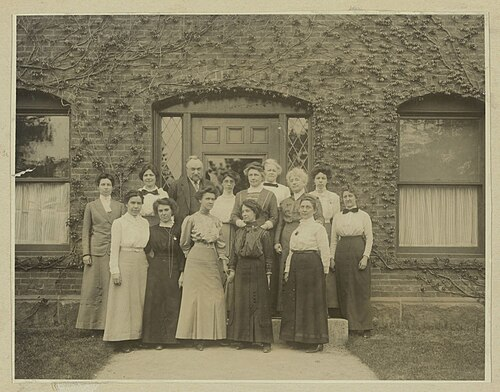
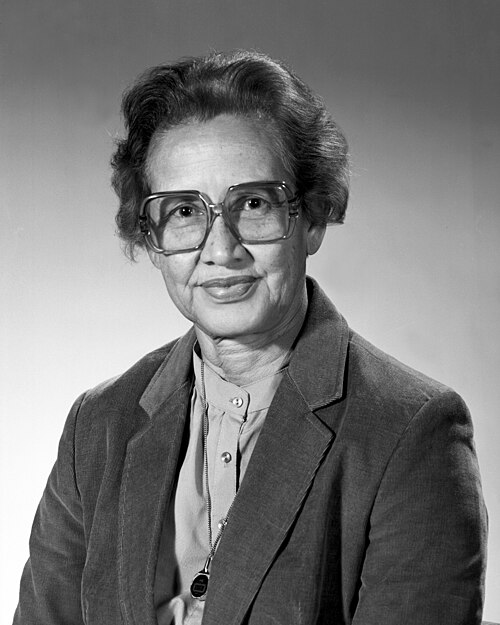
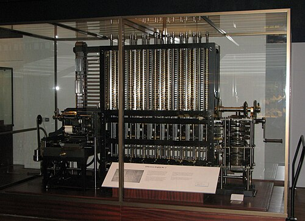
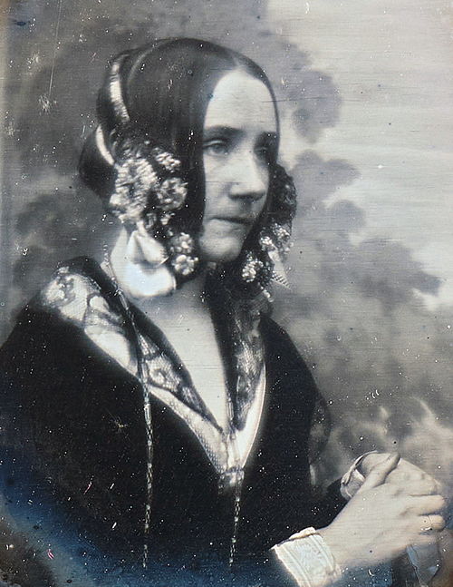
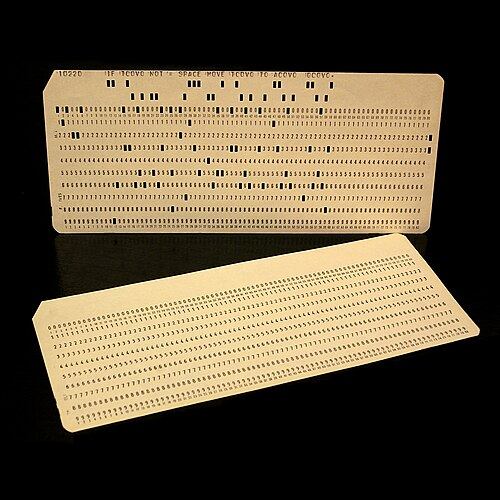
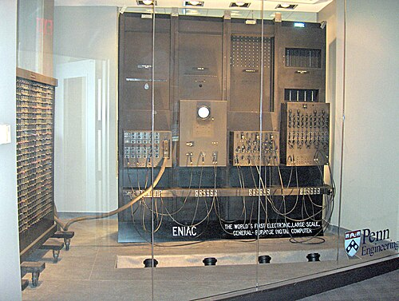

# When computers were people

*Session 1 · Introduction · a historical background ·
[slides](../../Slides/01-Introduction/ICSS-2026-01-Introduction.qmd)*

> The word "computer" named a job before it named a machine, and for most of
> its history the job was done by women. The tour of the lecture from Babbage
> to the PC era is a history of hardware; this is the history of the work.

## Computing as a job

<!-- FIG -->
<figure class="side wide"><figcaption><b>The Harvard Observatory computers at work, around 1890.</b> Photo: unknown author, Public domain, via <a href="https://commons.wikimedia.org/wiki/File:Edward_Charles_Pickering%27s_Harem_13_May_1913.jpg">Wikimedia Commons</a>.</figcaption></figure>
<!-- /FIG -->
From the seventeenth century until the 1950s a *computer* was a person who
computed: someone who worked through tables of logarithms, tides, artillery
ranges or star positions by hand, following a fixed procedure written by
somebody else. The procedure, do this to these numbers, then that, then
check, is what the lecture calls an algorithm, and the person was its
processor. Observatories, navies, insurance offices and census bureaus
employed rooms of them, organized like factories: one person designed the
calculation, many executed it, others checked.

By the 1880s the work had a gender. Astronomical observatories in Europe and
America discovered that educated women would do exacting numerical work for
half a man's wage, and hired them in numbers; the "computers" of the Harvard
Observatory classified hundreds of thousands of stars over forty years. The
pattern held through both world wars, since the ballistics tables of 1918 and
1943 were computed by women, and into the space age. The women of the
segregated "West Area Computing" unit at NASA's Langley laboratory calculated
the trajectories of the first American spaceflights, and when the electronic
<!-- FIG -->
<figure class="side"><figcaption><b>Katherine Johnson (1918–2020) at NASA Langley in 1966.</b> Photo: NASA, Public domain, via <a href="https://commons.wikimedia.org/wiki/File:Katherine_Johnson_1983.jpg">Wikimedia Commons</a>.</figcaption></figure>
<!-- /FIG -->
machines arrived it was they who learned to program them. Katherine Johnson,
the best known of them, was asked by John Glenn in 1962 to re-check by hand
the orbit the new IBM computer had produced before he would fly in it.

## Mechanizing the work

<!-- FIG -->
<figure class="side wide"><figcaption><b>Babbage's Difference Engine No. 2, built to his drawings in 1991.</b> Photo: User:geni, CC BY-SA 4.0, via <a href="https://commons.wikimedia.org/wiki/File:Babbage_Difference_Engine.jpg">Wikimedia Commons</a>.</figcaption></figure>
<!-- /FIG -->
The machines were designed to do the computers' job. Charles Babbage's
Difference Engine of the 1820s was meant to print mathematical tables without
human error, and his Analytical Engine of the 1830s went further and was, on
paper, a general-purpose machine, with a mill for arithmetic, a store for
numbers, and instructions on punched cards borrowed from the weaving
<!-- FIG -->
<figure class="side"><figcaption><b>Ada Lovelace (1815–1852), in a portrait of 1840.</b> Photo: Antoine Claudet, Public domain, via <a href="https://commons.wikimedia.org/wiki/File:Ada_Lovelace_daguerreotype_by_Antoine_Claudet_1843_-_cropped.png">Wikimedia Commons</a>.</figcaption></figure>
<!-- /FIG -->
industry. Neither was built in his lifetime. What survives of the Analytical
Engine's intellectual life is largely due to Ada Lovelace, whose 1843 notes on
it, the subject of the person slide of session 4, contain a worked procedure
for the machine to follow and the first clear statement that such a machine
could manipulate symbols of any kind, not only numbers. Her notes are where
the idea of programming a machine, as distinct from building one, first
appears in print.

<!-- FIG -->
<figure class="side wide"><figcaption><b>An 80-column punched card: one record, one attribute per column.</b> Photo: José Antonio González Nieto - cropped by Eyesint, CC BY 4.0, via <a href="https://commons.wikimedia.org/wiki/File:2punchCards-square.jpg">Wikimedia Commons</a>.</figcaption></figure>
<!-- /FIG -->
The mechanization that actually happened came from the census. The 1880
United States count had taken most of a decade to tabulate by hand; for 1890
the Census Bureau adopted punched cards and electric counting machines, the
population total was announced within weeks, and the full tabulation finished
in a fraction of the time. The company formed to sell those machines became,
through mergers, IBM, and the punched card remained the unit of data
processing for the next seventy years; the 80-column line that many editors
still default to is the width of a 1928 IBM card.

## Machines that hold their own instructions

<!-- FIG -->
<figure class="side wide"><figcaption><b>ENIAC being programmed, by rewiring, in 1946.</b> Photo: The original uploader was TexasDex at English Wi, CC BY-SA 3.0, via <a href="https://commons.wikimedia.org/wiki/File:ENIAC_Penn1.jpg">Wikimedia Commons</a>.</figcaption></figure>
<!-- /FIG -->
The electronic computers of the 1940s, Colossus at Bletchley Park and ENIAC in
Philadelphia, were built for war work and were programmed by rewiring. The
decisive idea, written down in 1945, was to store the program in the same
memory as the data, so that a machine could be told what to do by loading
numbers rather than by moving cables. Every computer since has been built
that way, and session 4 draws the architecture. The programmers of ENIAC were
six women recruited from the pool of human computers, who worked out how to
set up a trajectory calculation from wiring diagrams before they were allowed
into the room with the machine. When it was presented to the press in 1946
they were not introduced. The story of the next thirty years is partly the
story of that erasure: programming began as women's work, an extension of the
computing job, and was reclassified as engineering, and as men's work, as it
became prestigious. Women earned 37% of American computer-science degrees in
1984, a share that then fell for twenty years as the personal computer was
marketed to boys, and that has not recovered.

## The thread to the lecture

Session 1 asks what a computer is and what computer science is. The history
adds what the definitions leave out: computation has always been a way of
organizing people's work, a procedure written by one person, executed by
others and checked by a third, and the machine is a late arrival in that
arrangement. A data analysis is still exactly this, which is why the course
spends so long on writing procedures down so that someone else can run them.

## Further reading

- Grier, D. A. (2005), *When Computers Were Human*, Princeton University
  Press.
- Shetterly, M. L. (2016), *Hidden Figures*, on the NASA computers.
- Light, J. S. (1999), "When Computers Were Women", *Technology and Culture*
  40(3).
- Abbate, J. (2012), *Recoding Gender*, MIT Press, on how the field changed
  who it welcomed.
