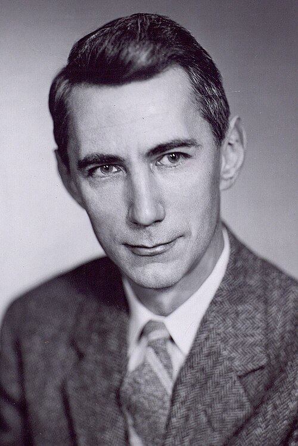
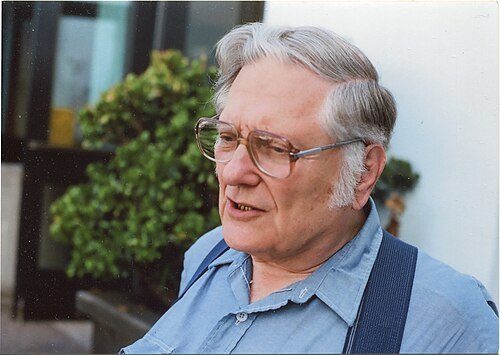
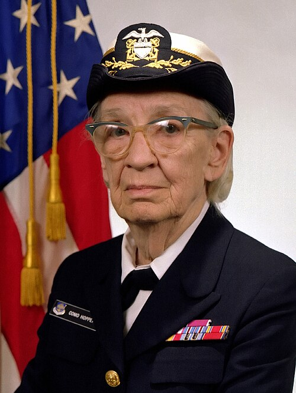

# A mathematical theory of communication

*Session 2 · Information Coding · a historical background ·
[slides](../../Slides/02-InformationCoding/ICSS-2026-02-InformationCoding.qmd)*

> The bit is younger than the jet engine. Between 1948 and 1992 a handful of
> arguments settled how information is measured, how it survives noise and
> what a byte means, and each of them is still inside your laptop.

## Measuring information

<!-- FIG -->
<figure class="side"><figcaption><b>Claude Shannon (1916–2001).</b> Photo: unknown author, CC BY 2.0, via <a href="https://commons.wikimedia.org/wiki/File:C.E._Shannon._Tekniska_museet_43069_(2x3_crop).jpg">Wikimedia Commons</a>.</figcaption></figure>
<!-- /FIG -->
Two ideas had been waiting for a use. Leibniz had shown in 1703 that 0 and 1
could write every number, and Boole had shown in 1854 that logic could be
done as algebra with two values. Nobody connected them to anything physical
until a twenty-one-year-old master's student at MIT, Claude Shannon, showed
in 1937 that Boole's algebra described exactly what arrangements of
electrical relays could do. That thesis is why the lecture can say that
everything on a computer is bits without apology: switches are logic, and
logic is arithmetic in base 2. Shannon's second paper is the one the lecture
opens with. *A Mathematical Theory of Communication* (1948), written at Bell
Labs, asked how much information a message carries and answered with a
number, the count of yes/no questions needed to pin it down. The biased dice,
the question trees and the coding-efficiency argument of the lecture are that
paper's, almost unchanged. The unit was named there, *bit* for binary digit,
and within a decade information had become a quantity engineers could budget
for, like power or bandwidth.

## Surviving noise, and agreeing on symbols

A theory of how much a channel could carry raised two practical problems, and
the 1950s solved both. The first was reliability: codes that add just enough
redundancy that a corrupted bit can be detected and corrected, invented at
Bell Labs in 1950 by an engineer irritated that the relay computers halted on
every error over the weekend. Every disk, every QR code and every mobile-phone
call uses their descendants. The second was efficiency: variable-length codes
that give short codewords to common symbols, solved optimally in 1952 as a
term paper by a graduate student at MIT, and still the core of every ZIP
file. Agreeing which number means which letter turned out to be harder than
either, because it was a political problem rather than a mathematical one.
ASCII (1963) fitted American English into seven bits and nothing else, and
the code pages of the 1980s patched it separately in every country, so that
one byte meant ö in Germany and ц in Russia. The fix was a single table for
every script, Unicode, proposed in 1988 and maintained by a consortium since
1991, together with an encoding for it, UTF-8, sketched in 1992 on a diner
placemat, that keeps ASCII as one byte and everything else as more. The
lecture recommends UTF-8 without qualification because it ended thirty years
of the problem that the boarding-pass example of this course illustrates.

## The number that behaves the same everywhere

<!-- FIG -->
<figure class="side"><figcaption><b>William Kahan, the author of IEEE 754.</b> Photo: George Bergman, CC BY-SA 4.0, via <a href="https://commons.wikimedia.org/wiki/File:William_Kahan_2008.jpg">Wikimedia Commons</a>.</figcaption></figure>
<!-- /FIG -->
Floating point had the same problem, since every manufacturer rounded
differently and a calculation gave different answers on different machines,
and its solution has one author to an unusual degree. William Kahan, a
Canadian numerical analyst at Berkeley, spent the late 1970s persuading Intel
and then the entire industry to adopt one layout, one rounding rule and one
set of special values. IEEE 754 was ratified in 1985, and he received the
Turing Award for it in 1989. The example in the notebooks of this course,
`0.1 + 0.2`, comes out identically on every device you own because of that
standard.

## Grace Hopper and the decimal point

<!-- FIG -->
<figure class="side"><figcaption><b>Grace Hopper (1906–1992), photographed in 1984.</b> Photo: James S. Davis, Public domain, via <a href="https://commons.wikimedia.org/wiki/File:Commodore_Grace_M._Hopper,_USN_(covered)_head_and_shoulders_crop.jpg">Wikimedia Commons</a>.</figcaption></figure>
<!-- /FIG -->
The person slide of the lecture is Grace Hopper, and she appears in a session
on number representation because of a design decision. COBOL, the business
language she drove into existence in 1959, does arithmetic in decimal by
default, so that the rounding errors that the IEEE 754 section of the lecture
explains cannot appear in a bank balance. That choice is why COBOL still runs
a large share of the world's financial transactions, and why the lecture's
advice to keep money out of floating point has a precedent more than sixty
years old. Hopper had programmed the first American computers in the 1940s,
built the first compiler in 1952, and retired from the Navy as a rear admiral
at 79. Her insistence that programs be written for people rather than
machines is the story of session 4.

## The thread to the lecture

Every topic of session 2 was settled in a known year by a known argument:
bits and entropy in 1948, error correction in 1950, optimal codes in 1952,
character sets in 1963, 1988 and 1992, floating point in 1985. It is a young
field, and its conventions are decisions that someone won, which is worth
knowing when a convention bites you.

## Further reading

- Gleick, J. (2011), *The Information: A History, a Theory, a Flood*.
- Shannon, C. E. (1948), "A Mathematical Theory of Communication", *Bell
  System Technical Journal* 27; the first ten pages are readable by anyone.
- Beyer, K. (2009), *Grace Hopper and the Invention of the Information Age*,
  MIT Press.
