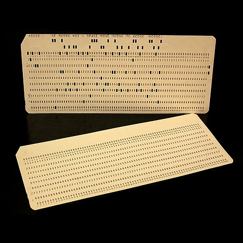
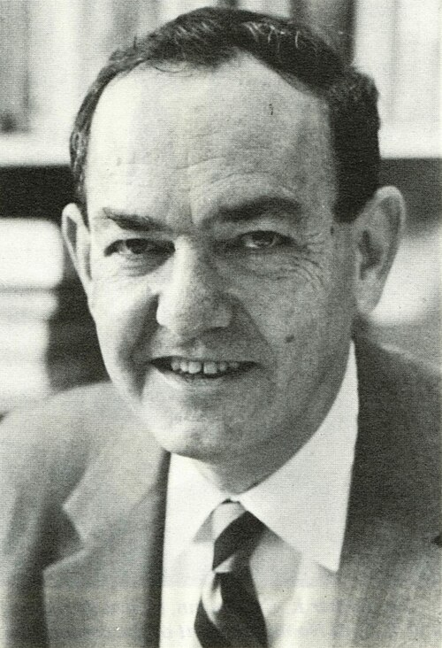
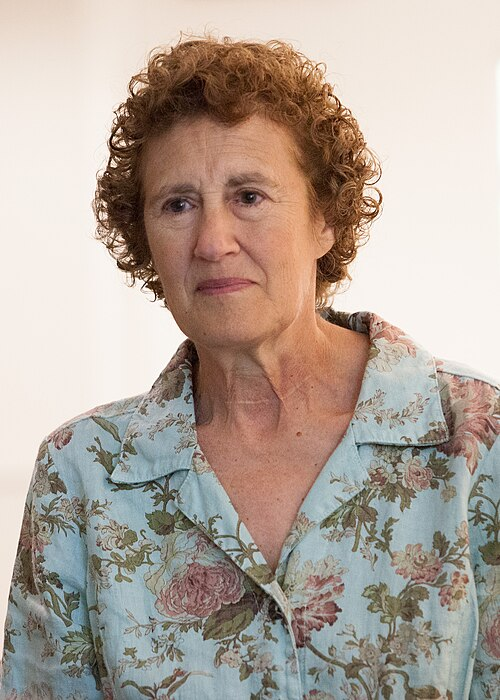
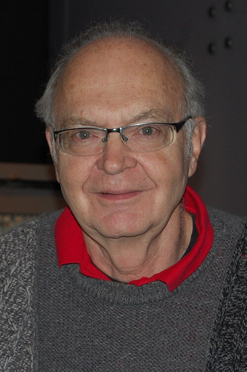

# Shapes for data

*Session 3 · Data Structures · a historical background ·
[slides](../../Slides/03-DataStructures/ICSS-2026-03-DataStructures.qmd)*

> Arrays came with the machines, lists came from a program that tried to
> think, and the idea that a data structure is a contract rather than a layout
> came from a woman whom Princeton refused to admit.

## Structures the hardware gave us

<!-- FIG -->
<figure class="side wide"><figcaption><b>An 80-column punched card, the fixed-width record that preceded the array.</b> Photo: José Antonio González Nieto - cropped by Eyesint, CC BY 4.0, via <a href="https://commons.wikimedia.org/wiki/File:2punchCards-square.jpg">Wikimedia Commons</a>.</figcaption></figure>
<!-- /FIG -->
The oldest data structure in the course is the punched card: one record per
card, one attribute per column, a fixed-width row that session 11 will call a
table. For seventy years, from the 1890 census to the 1960s, that was what
data was, and the machines that sorted and counted cards were the whole of
data processing. The *array* arrived with the stored-program computer of
1945. Memory was a row of numbered cells, and if the elements of a collection
are the same size and stored next to each other, the address of the $k$-th
is a multiplication and an addition away. The first compilers, above all
FORTRAN from IBM in 1957, gave the array a notation, and for a decade it was
the only structure most programmers had. It is still the fastest thing in the
trade-off table of the lecture for the one operation it is good at.

## Structures a problem demanded

<!-- FIG -->
<figure class="side"><figcaption><b>Herbert Simon (1916–2001), for whom the linked list was a means to prove theorems.</b> Photo: Rochester Institute of Technology, Public domain, via <a href="https://commons.wikimedia.org/wiki/File:Herbert_Simon,_RIT_NandE_Vol13Num11_1981_Mar19_Complete.jpg">Wikimedia Commons</a>.</figcaption></figure>
<!-- /FIG -->
The *linked list* was invented not to store data but to make a machine
reason. In 1956 Herbert Simon, the political scientist whose *Sciences of the
Artificial* opens this course and who returns in session 13, was building
with two colleagues a program to prove theorems from *Principia
Mathematica*. Logical expressions of unknown and changing length would not
fit in arrays, so they designed a language whose basic object was a chain of
cells, each pointing to the next. The list, the stack and the idea of a
symbol as an addressable thing all date from that project, which is also
usually counted as the first artificial-intelligence program. LISP took up
the same idea in 1958 and made the list its only structure, and the recursion
of session 6 is what it looks like in practice.

Hashing came out of an IBM memo of 1953 on how to put records into buckets by
a number computed from their key, and how to chain the ones that collided.
The memo was never published and was reconstructed by historians decades
later, and the idea was reinvented at least twice before 1960, by which time
it was in every serious compiler. The binary search tree, the answer of the
lecture when you need both fast search and cheap insertion, appears in three
independent papers around 1960. None of these structures has a single
inventor. Each was found by several people within a few years of each other,
because the problems that needed them had arrived.

## Structures as promises

<!-- FIG -->
<figure class="side"><figcaption><b>Barbara Liskov, who defined the abstract data type; Turing Award 2008.</b> Photo: Kenneth C. Zirkel, CC BY-SA 3.0, via <a href="https://commons.wikimedia.org/wiki/File:Barbara_Liskov_MIT_computer_scientist_2010.jpg">Wikimedia Commons</a>.</figcaption></figure>
<!-- /FIG -->
The lecture defines a data structure as data types together with the
operations defined on them, and that definition has an author. Barbara Liskov
was refused entry to the mathematics graduate program of Princeton in 1961
because it did not take women, went to Stanford instead, and in 1968 became
one of the first women in the United States to earn a doctorate in computer
science. At MIT in 1974 she designed a language, CLU, around a new idea: an
*abstract data type* is a set of operations and the guarantees they make, and
a program should be able to use a stack or a queue without knowing, or being
able to depend on, how it is laid out in memory. That separation is why
session 3 can treat the operations of a stack, push and pop in $O(1)$, as
the thing that matters and the linked list underneath as an implementation
choice. Every modern language's notion of a class, an interface or a module
descends from CLU, and the examples in this course that turn on choosing the
right structure, the Back button of the browser, the word count and the
waiting room, are applications of the same distinction between what a
structure promises and how it is built. Liskov received the Turing Award in
2008.

## The encyclopedia

<!-- FIG -->
<figure class="side"><figcaption><b>Donald Knuth, author of The Art of Computer Programming since 1962.</b> Photo: Alex Handy, CC BY-SA 2.0, via <a href="https://commons.wikimedia.org/wiki/File:Donald_Ervin_Knuth_(cropped).jpg">Wikimedia Commons</a>.</figcaption></figure>
<!-- /FIG -->
Most of what any course teaches about data structures was first written down
properly in one place. Donald Knuth began *The Art of Computer Programming*
in 1962 as a book about compilers. Its first volume (1968) collected
everything then known about lists, trees, stacks and queues, with proofs,
exercises and histories, and its third (1973) did the same for searching and
sorting. The analysis of hashing, the history of the binary search tree and
the O-notation of session 8 all come, in the form now taught, from those
volumes, and Knuth is still writing them.

## The thread to the lecture

The trade-off table of the lecture, arrays for indexing, lists for editing,
hashing for lookup and trees for order, summarizes about fifteen years of
invention, from 1945 to 1960, by people who mostly wanted something else: a
census counted, a theorem proved, a compiler built. The abstraction that lets
you choose among them without caring how they are built is Liskov's, and it
is why the course can teach the structures as decisions rather than as memory
diagrams.

## Further reading

- Knuth, D. E., *The Art of Computer Programming*, vol. 1, section 2.6,
  "History and bibliography".
- Liskov, B. (2009), Turing Award lecture, "The Power of Abstraction",
  online at the ACM.
- Nilsson, N. (2009), *The Quest for Artificial Intelligence*, Cambridge
  University Press, the chapters on the Logic Theorist.
