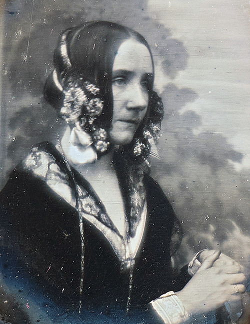
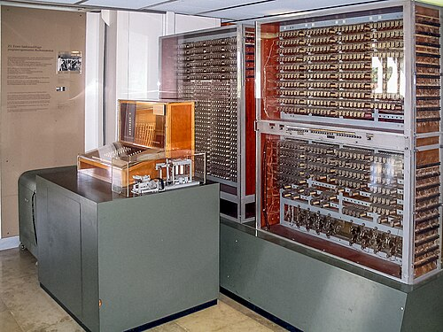
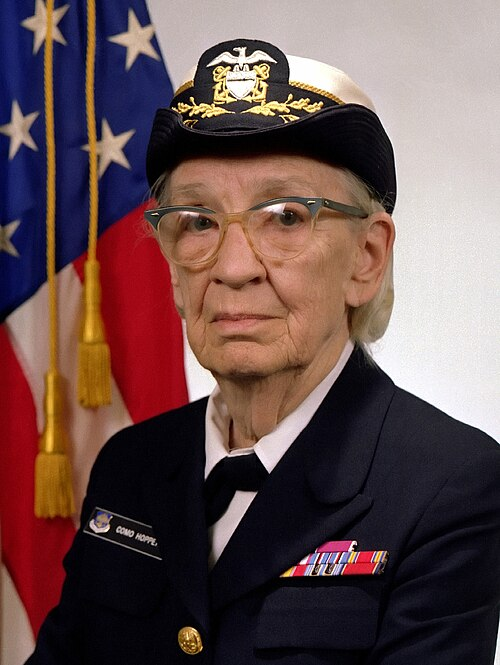

# Telling the machine what to do

*Session 4 · Software · a historical background ·
[slides](../../Slides/04-Software/ICSS-2026-04-Software.qmd)*

> A countess wrote the first program for a machine that did not exist. A
> rear admiral insisted that computers should be told what to do in something
> like English. A teenager who was forbidden to touch the computer he guarded
> read the manuals instead. Programming languages have a short history and a
> repeated argument.

## Before there was anything to run it on

<!-- FIG -->
<figure class="side"><figcaption><b>Ada Lovelace (1815–1852), in a portrait of 1840.</b> Photo: Antoine Claudet, Public domain, via <a href="https://commons.wikimedia.org/wiki/File:Ada_Lovelace_daguerreotype_by_Antoine_Claudet_1843_-_cropped.png">Wikimedia Commons</a>.</figcaption></figure>
<!-- /FIG -->
The person slide of the lecture is Ada Lovelace, and her claim to the title of
first programmer rests on a single publication. In 1843 she translated an
Italian account of Babbage's Analytical Engine and appended notes three times
longer than the original. Note G contains a step-by-step procedure for the
engine to compute Bernoulli numbers, a loop with variables whose values change
as it runs, and something more: the observation that a machine which
manipulates symbols by rule "might act upon other things besides number",
might compose music, and, in a passage that reads as a reply to session 10,
"has no pretensions whatever to originate anything". The engine was never
built and the program was never run. It is still recognizably a program.

## Machines that could be told things

<!-- FIG -->
<figure class="side wide"><figcaption><b>A reconstruction of Zuse's Z3 of 1941 in the Deutsches Museum.</b> Photo: File:Z3 Deutsches Museum.JPG: Venusianer at Germ, CC BY-SA 3.0, via <a href="https://commons.wikimedia.org/wiki/File:Z3_Deutsches_Museum_b.jpg">Wikimedia Commons</a>.</figcaption></figure>
<!-- /FIG -->
The first programmable computers that actually worked appeared in the 1940s,
in Berlin, in Britain and in the United States, and all of them were
programmed in the machine's own terms: numbers standing for instructions,
punched into tape or set on switches. The first design for a *high-level*
language, one written for the problem rather than for the hardware, was drawn
up in Germany by 1945 and not published until 1972, by which time the world
had reinvented it.

<!-- FIG -->
<figure class="side"><figcaption><b>Grace Hopper, who named the compiler.</b> Photo: James S. Davis, Public domain, via <a href="https://commons.wikimedia.org/wiki/File:Commodore_Grace_M._Hopper,_USN_(covered)_head_and_shoulders_crop.jpg">Wikimedia Commons</a>.</figcaption></figure>
<!-- /FIG -->
The reinvention was largely one woman's campaign. Grace Hopper joined the US
Navy Reserve in 1943, in her late thirties, was assigned to the Harvard Mark
I, and wrote the first manual for a computer. In 1952 she built a program
that assembled other programs from a library of pieces and called it a
*compiler*; the word is hers. Told that computers could not understand
English, she built a language whose statements read like English sentences,
and then advised the committee that produced COBOL in 1959, which took most
of its shape from her design. Her argument was not that English is a good
notation but that a program should be written independently of any one
machine, so that the same program could run on the next computer. That is the
*high-level language* of the lecture, and every language since has accepted
the argument. The paradigms the lecture surveys are later chapters of it.
FORTRAN (1957) made the array and the loop standard. A 1968 letter to the ACM
argued that programs should be readable as blocks rather than as jumps,
which is the structured style of the flowcharts of session 5. Simula (1967),
built in Oslo to write simulations, found that an object carrying its own data
and procedures was the natural unit for modeling anything, and
object-oriented programming was born. Python, the language of this course,
was begun over a Christmas holiday in 1989 as something readable enough to
teach.

## Who was allowed in

Clarence "Skip" Ellis grew up in Chicago and, at fifteen, took a night job
guarding a company's new computer. He was forbidden to touch it, so he read
the manuals instead, and when the company ran short of punched cards he
showed them how to reuse the old ones. In 1969 he received a doctorate in
computer science from the University of Illinois, the first African American
to do so. He worked on one of the first parallel computers, which session 12
mentions, and at Xerox PARC in the 1970s on the systems from which the
graphical desktop came. His later work on how several people can edit the
same document at once without overwriting each other is the mechanism inside
Google Docs. His route in, reading the manuals when barred from the machine,
is not an anecdote but the pattern. Programming was, for its first decades,
learned on the job by whoever was in the room, which made it briefly more
open than engineering and then, as it professionalized, less so. The history
post of session 1 tells the same story for women.

## The thread to the lecture

Session 4 presents languages, interpreters, compilers and paradigms briefly,
and then turns to how software is specified and tested. The history shows one
argument, repeated: programs should be
written for people, and the machine should be made to accommodate that, by a
compiler in 1952, by readable control structures in 1968, by objects that
match the things being modeled in 1967, and by a language honest about what
it is doing in 1989. The opening examples of this session, code generated by
AI agents that nobody specified or read, are the newest form of the problem
Hopper set out to solve: a procedure whose meaning nobody has written down.

## Further reading

- Beyer, K. (2009), *Grace Hopper and the Invention of the Information Age*,
  MIT Press.
- Padua, S. (2015), *The Thrilling Adventures of Lovelace and Babbage*, a
  graphic novel with footnotes more accurate than most biographies.
- Sammet, J. (1969), *Programming Languages: History and Fundamentals*, the
  field's own first history.
