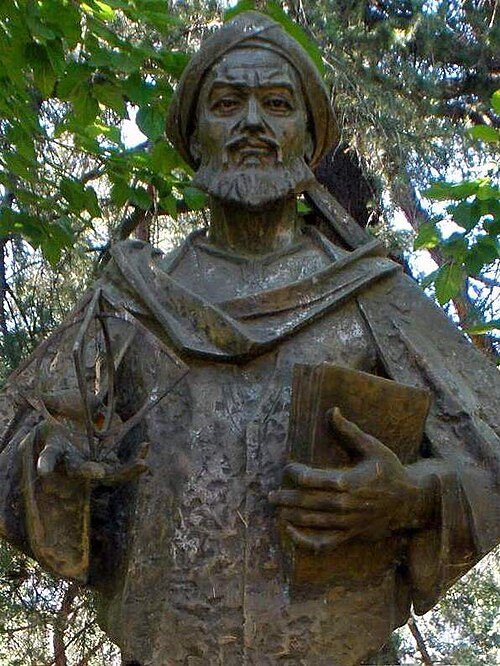
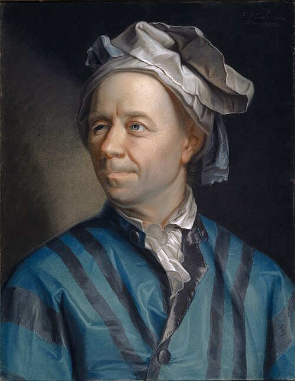
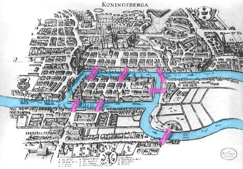

# The namesake, and the first programs

*Session 5 · Algorithms · a historical background ·
[slides](../../Slides/05-Algorithms/ICSS-2026-05-Algorithms.qmd)*

> The word comes from a ninth-century scholar in Baghdad whose name was
> mangled into Latin. The idea that a procedure must provably end in a known
> number of steps is a woman's doctoral thesis from 1926. And the search that
> this session builds was invented three times by people routing wires.

## Al-Khwarizmi and the general method

<!-- FIG -->
<figure class="side"><figcaption><b>A statue of al-Khwarizmi in Khiva, Uzbekistan.</b> Photo: Zarateman, CC0, via <a href="https://commons.wikimedia.org/wiki/File:Madrid_-_Ciudad_Universitaria,_Monumento_a_Muhammad_al-Juarismi_(cropped).jpg">Wikimedia Commons</a>.</figcaption></figure>
<!-- /FIG -->
The person slide of the lecture is Muhammad ibn Musa al-Khwarizmi, born
around 780, probably in Khwarazm in present-day Uzbekistan, and working in
Baghdad at the House of Wisdom, the library and translation center of the
caliphate. Two of his books shaped the vocabulary of every mathematics
classroom since. *The Compendious Book on Calculation by Completion and
Balancing* is the origin of the word *algebra*, from *al-jabr*, "completion",
and its method is procedural: reduce any problem to one of six standard
forms, then apply the fixed steps for that form. His other book explained the
Indian decimal system with its zero to Arabic readers, and when it reached
Latin Europe in the twelfth century its opening words, *Dixit Algorizmi*, "so
said al-Khwarizmi", turned his name into the word for the method.

Procedures are older than he is. Euclid's *Elements*, from around 300 BC,
contains the greatest-common-divisor recipe that session 6 uses, and
Babylonian clay tablets a thousand years before that show worked recipes for
square roots. What al-Khwarizmi's books put into the Western tradition was
the idea of a *general* method, a recipe that works for every problem of a
kind and not only for this one, and that is the idea that the definition of
an algorithm in the lecture formalizes. The transmission itself is part of
the story: Greek, Indian and Persian mathematics reached medieval Europe
through Arabic translations, and the word carries that route.

## A proof that the steps end

The lecture insists that an algorithm must terminate, and proving that a
general method does is real work. In 1926 Grete Hermann, a doctoral student
of Emmy Noether at Göttingen, published a thesis whose title states the
problem, *The Question of Finitely Many Steps in the Theory of Polynomial
Ideals*. She showed that a central question in algebra could be settled by a
procedure whose number of steps was bounded in advance by a formula, and she
gave the bound. It is regarded as the founding paper of computer algebra,
sixty years before there was software to run it. Hermann then left
mathematics for physics and philosophy. In 1935 she found the flaw in a
celebrated proof that quantum mechanics could have no hidden variables, a
result the physics community ignored for thirty years, and under the Nazi
regime she worked in the political resistance before emigrating. Her thesis
marks a shift that the list of properties in the lecture, input, output,
definiteness and finiteness, takes for granted: it is not enough for a
procedure to work when tried, it must be shown to finish. Session 9 follows
that demand to its conclusion, where some questions turn out to have no
finishing procedure at all.

## Graphs, and the search that finds the shortest path

<!-- FIG -->
<figure class="side"><figcaption><b>Leonhard Euler (1707–1783).</b> Photo: Jakob Emanuel Handmann, Public domain, via <a href="https://commons.wikimedia.org/wiki/File:Leonhard_Euler_-_Jakob_Emanuel_Handmann_(Kunstmuseum_Basel).jpg">Wikimedia Commons</a>.</figcaption></figure>
<!-- /FIG -->
The graph problems of session 5 begin with Leonhard Euler and the bridges of
Königsberg, presented to the St Petersburg Academy in 1735, the first problem
solved by throwing away the geometry and keeping only which things were
connected to which. Graph theory as a subject took another two centuries to
form, and the word "graph" in this sense dates from 1878.

<!-- FIG -->
<figure class="side wide"><figcaption><b>Königsberg in 1652, with its seven bridges.</b> Photo: Twotwos, CC BY-SA 4.0, via <a href="https://commons.wikimedia.org/wiki/File:Bridges_of_Konigsberg.png">Wikimedia Commons</a>.</figcaption></figure>
<!-- /FIG -->
Breadth-first search, the algorithm the session builds up, has three
independent inventors, which is the sign of an idea whose time had come. A
German engineer described it in a 1945 thesis that stayed unpublished until
1972. An American presented it in 1959 as a way to find "the shortest path
through a maze", exactly the example of this course, for routing wires on
circuit boards. And it was published again in 1961 for the same purpose. The
contact tracing, the mazes and the Erdős numbers of this session are all that
wire-routing procedure. It kept being rediscovered until someone wrote it down
clearly enough to stick, which is what pseudocode is for.

## The thread to the lecture

Session 5 defines an algorithm and gives ways to write one down. The history
says where the pieces came from, the general method from Baghdad, the demand
for a termination proof from Göttingen and the search itself from engineers
who needed to route wires, and what it took for each to become common
property: a translation, a thesis, a clear enough description. That last step
is the one the session practices.

## Further reading

- Berggren, J. L. (2016), *Episodes in the Mathematics of Medieval Islam*,
  2nd ed., Springer.
- Knuth, D. E. (1972), "Ancient Babylonian algorithms", *Communications of
  the ACM* 15(7).
- Herzenberg, C. L. (2008), "Grete Hermann: an early contributor to quantum
  theory", arXiv:0812.3986, the only accessible short biography.
