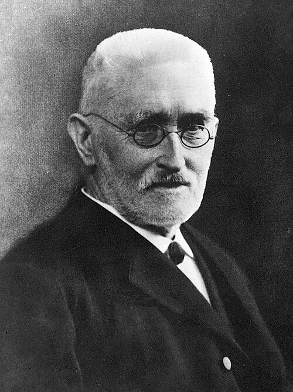
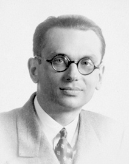
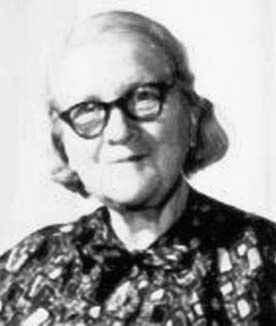
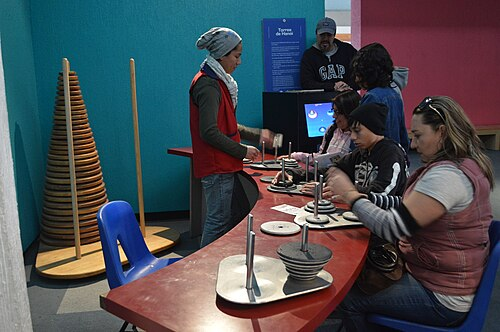

# Defined in terms of itself

*Session 6 · Recursion · a historical background ·
[slides](../../Slides/06-Recursion/ICSS-2026-06-Recursion.qmd)*

> Recursion was a foundation of mathematics before it was a programming
> technique. The person who made it a subject of its own could not get a
> university post for most of her life, and the language feature that made it
> practical was slipped into a standard at the last minute.

## Foundations

<!-- FIG -->
<figure class="side"><figcaption><b>Richard Dedekind (1831–1916), who defined arithmetic by recursion.</b> Photo: Unknown (Mondadori Publishers), Public domain, via <a href="https://commons.wikimedia.org/wiki/File:Richard_Dedekind_1900s.jpg">Wikimedia Commons</a>.</figcaption></figure>
<!-- /FIG -->
Two of the recursive examples of the course are old: the rabbit puzzle of
1202 that gives the Fibonacci numbers, and the Tower of Hanoi, invented and
sold as a puzzle in 1883 complete with its legend of the monks. But recursion
as an idea dates from the 1880s, when mathematicians tried to say what the
natural numbers are. Dedekind's essay of 1888 defined addition and
multiplication by recursion on "the next number", so that $a + (b+1) =
(a+b)+1$, and proved that such definitions actually define something, and the
axioms of arithmetic published the following year made induction the engine.
Base case and recursive case, the two obligations of the lecture, are from
that decade.

<!-- FIG -->
<figure class="side"><figcaption><b>Kurt Gödel (1906–1978).</b> Photo: unknown author, Public domain, via <a href="https://commons.wikimedia.org/wiki/File:Kurt_g%C3%B6del.jpg">Wikimedia Commons</a>.</figcaption></figure>
<!-- /FIG -->
For the next forty years recursion was a tool of logicians trying to settle
what could be proved at all. Kurt Gödel's incompleteness paper of 1931 used a
precisely defined class of "primitive recursive" functions, those buildable
from zero, successor and recursion, as the machinery of its proof, and it was
already known that some perfectly computable functions grew too fast to be in
that class. What "computable" should mean was an open question, and session 9
tells how it was answered in 1936.

## Rózsa Péter

<!-- FIG -->
<figure class="side"><figcaption><b>Rózsa Péter (1905–1977), founder of recursive function theory.</b> Photo: JOC/EFR March 2006, Public domain, via <a href="https://commons.wikimedia.org/wiki/File:RozsaPeter.jpg">Wikimedia Commons</a>.</figcaption></figure>
<!-- /FIG -->
Rózsa Péter was born in Budapest in 1905, studied mathematics alongside John
von Neumann, and from 1932 wrote the papers that made recursive functions a
field rather than a tool inside logic. She classified them by how many nested
recursions they needed, showed which forms of recursion reduce to simpler
ones, and proposed the name *recursive function theory* for the subject. Her
1951 book *Rekursive Funktionen* was the first monograph on it and the
standard reference for a generation. None of this earned her a university
position. Under Hungary's anti-Jewish laws she lost even her school-teaching
post in 1939, survived the war in the Budapest ghetto, and taught in a
teacher-training college until 1955, when she was fifty and finally appointed
to a professorship. In between she wrote *Playing with Infinity* (1945), an
account of mathematics for lay readers built around iteration and recursion
that has been translated into fourteen languages, and late in her career she
argued, in *Recursive Functions in Computer Theory* (1976), that her subject
was the theory behind programming. It was.

## Into the languages

Recursion entered programming through LISP (1958 to 1960), whose designer,
John McCarthy, had read the logicians and set out to make their notation
executable. In LISP a function defined in terms of itself was the normal case
rather than a special one, and the tree-shaped procedures of this session
are LISP's native style. It entered the mainstream through a committee. ALGOL
60, the language whose grammar notation session 9 uses, was designed by an
international group that had not agreed on recursion, and the sentence making
recursive procedures legal is usually said to have been added to the report
at the last moment by two of its Dutch and Danish members. The run-time
stack that makes recursion work, the program stack of this session, was their
implementation of 1960, and every language since has copied it. The "maximum
recursion depth exceeded" error that the notebooks of the course mention is
that stack running out.

<!-- FIG -->
<figure class="side"><figcaption><b>A Tower of Hanoi puzzle, sold with its legend since 1883.</b> Photo: AlejandroLinaresGarcia, CC BY-SA 3.0, via <a href="https://commons.wikimedia.org/wiki/File:UniversumUNAM34.JPG">Wikimedia Commons</a>.</figcaption></figure>
<!-- /FIG -->
Two further ideas in the session have their own dates. Depth-first search is
older than the stack: a French engineer described it in the 1880s as a way of
exploring a maze without getting lost, using chalk marks where the algorithm
uses a visited set. Dynamic programming, the cure of the lecture for
recursion that recomputes the same thing, was named in the early 1950s at the
RAND Corporation by a mathematician who chose the word "dynamic" because, he
said later, the official in Washington who oversaw the funding could not
object to it.

## The thread to the lecture

Session 6 asks you to recognize self-similar structure and write a definition
with a base case and a recursive case. The history is a warning against
treating that as a coding trick. Recursion was the mechanism by which
mathematicians first made "computable" precise, decades before a machine could
run it, and the person who understood it best spent most of her working life
outside the institutions that would later teach her results.

## Further reading

- Péter, R. (1961), *Playing with Infinity*, still in print and still the best
  non-technical introduction.
- Morris, E. and Harkleroad, L. (1990), "Rózsa Péter: recursive function
  theory's founding mother", *The Mathematical Intelligencer* 12(1).
- Davis, M. (2000), *The Universal Computer: The Road from Leibniz to Turing*.
