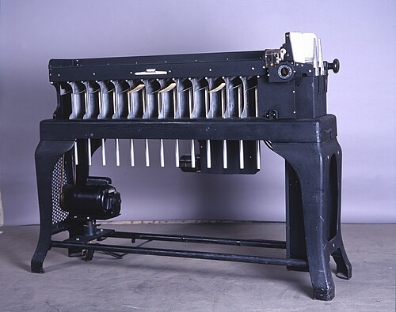
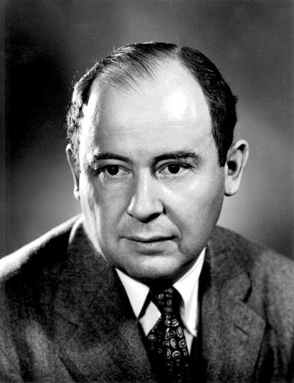
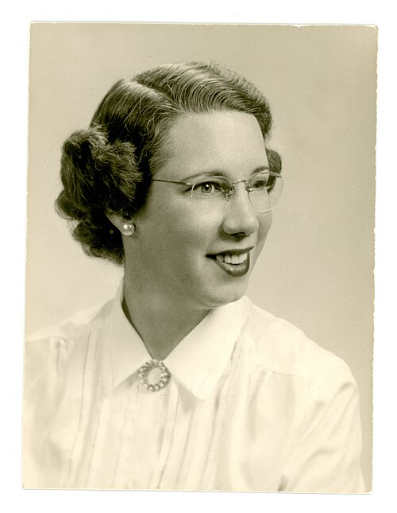
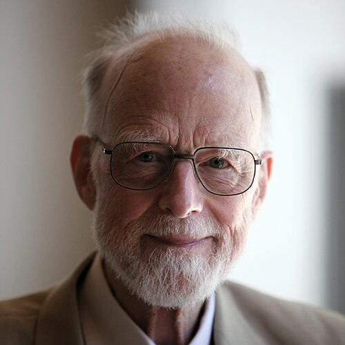

# Putting things in order

*Session 7 · Sorting Algorithms · a historical background ·
[slides](../../Slides/07-SortingAlgorithms/ICSS-2026-07-SortingAlgorithms.qmd)*

> Sorting was mechanized fifty years before it was programmed. The first
> program for a stored-program computer was a sort; so was the first program
> that wrote programs; and the fastest general-purpose sort was thought up by
> a student in Moscow who was supposed to be doing something else.

## Machines before programs

<!-- FIG -->
<figure class="side wide"><figcaption><b>A punched-card sorter: one column per pass, least significant first.</b> Photo: Tekniska museet, CC BY 4.0, via <a href="https://commons.wikimedia.org/wiki/File:IBM_080_(2).jpg">Wikimedia Commons</a>.</figcaption></figure>
<!-- /FIG -->
Sorting was the first data-processing task to be automated, and it happened
without a computer. The equipment built for the 1890 US census included a
sorting box whose lid sprang open at the pocket where a card belonged, so
that the operator could drop it in, and by 1901 a machine did the dropping.
Run the cards through once per column, least significant first, and the deck
came out in order. That is radix sort, the example in this course of a sort
that beats the comparison lower bound, and for the next sixty years "to
sort" in an office meant to feed cards through such a machine. The clerks who
did it relied on a property they had no name for: the deck stayed ordered by
the last column while it was being ordered by the next. Session 7 calls it
stability.

## The first programs

<!-- FIG -->
<figure class="side"><figcaption><b>John von Neumann (1903–1957).</b> Photo: LANL, Attribution, via <a href="https://commons.wikimedia.org/wiki/File:JohnvonNeumann-LosAlamos.gif">Wikimedia Commons</a>.</figcaption></figure>
<!-- /FIG -->
John von Neumann, the person slide of the lecture, wrote what Knuth has
called the first program for a stored-program computer in 1945, before any
such machine existed: a sorting routine for the planned EDVAC, to test
whether the new architecture could handle the kind of work that punched-card
equipment did. The algorithm was mergesort. That the first program was a
sort tells you what computers were expected to be for, and merge-based
sorting dominated commercial computing for two decades because it was what
tape drives could do well. Von Neumann's range, game theory, quantum
mechanics, the hydrogen bomb, cellular automata and the weather, is what the
slide is about, and the choice of a sort as his test case was not a whim.

<!-- FIG -->
<figure class="side"><figcaption><b>Betty Holberton (1917–2001), ENIAC programmer and author of the first sort generator.</b> Photo: Unknown photographer, Public domain, via <a href="https://commons.wikimedia.org/wiki/File:Betty-Holbeton-circa-1950s-600dpi.jpg">Wikimedia Commons</a>.</figcaption></figure>
<!-- /FIG -->
Six years later the first program that wrote programs was also a sort. Betty
Holberton had been one of the six women who programmed ENIAC, whose story
the history post of session 1 tells. At Remington Rand in 1951 she wrote a
sort-merge generator for the UNIVAC I, a program that, given a description
of the records and keys, produced the sorting program automatically. It is
usually counted as the first generative program and a direct ancestor of the
compiler, and Grace Hopper cited it as the model for her own. Holberton also
designed the instruction code of the UNIVAC so that it was easier for humans
to read, and later sat on the standards committees for COBOL and FORTRAN.
She is the reason the lecture can present a sort as a procedure a program can
be told to produce.

## Quicksort, and the limit

<!-- FIG -->
<figure class="side"><figcaption><b>Tony Hoare, in 2011.</b> Photo: Rama, CC BY-SA 2.0 fr, via <a href="https://commons.wikimedia.org/wiki/File:Sir_Tony_Hoare_IMG_5125.jpg">Wikimedia Commons</a>.</figcaption></figure>
<!-- /FIG -->
Tony Hoare was a twenty-five-year-old visiting student at Moscow State
University in 1959, there to study machine translation, when he needed to
sort the words of a sentence before looking them up in a dictionary held on
tape. The method he thought of, pick an element, partition the rest around
it and recurse, he could not express in any language he knew, because none of
them allowed recursion. He published it in 1961, after learning ALGOL 60 and
finding that its newly legal recursive procedures, whose story the history
post of session 6 tells, made it five lines. Quicksort is still, sixty years
on, the default sort in most system libraries, and its partition routine is
the one the exam prints.

The 1960s then closed the question. Heapsort (1964) gave a sort that was
$O(n \log n)$ in the worst case and in place. That two such different
algorithms landed on the same growth rate raised the question of whether
anything could beat it, and the decision-tree argument in the example of this
course, that no comparison sort can do better than $\log_2 n!$, was written
down properly in 1973 in the third volume of Knuth's *Art of Computer
Programming*, whose chapter on sorting ends with a history of the subject
from Hollerith on. The modern coda is the algorithm inside Python's
`sorted()`, designed in 2002 on a public mailing list: mergesort with an eye
for runs that are already in order, and stable, as the lecture insists a
library sort should be.

## The thread to the lecture

The session teaches four algorithms and a lower bound, and they arrived in
roughly that order: mechanical radix sorting in 1890, mergesort in 1945,
sorting as a generated program in 1951, quicksort in 1959 to 1961, heapsort
in 1964, and the proof that the bound is tight in 1973. Sorting is, in the
useful sense, a solved problem, which is why the lecture spends its time on
which sort to use and why, not on finding a better one.

## Further reading

- Knuth, D. E. (1998), *The Art of Computer Programming*, vol. 3, 2nd ed.,
  section 5.5, "Summary, history, and bibliography".
- Hoare, C. A. R. (1981), "The Emperor's Old Clothes", the 1980 Turing Award
  lecture, *Communications of the ACM* 24(2), with the Moscow story in his
  own words.
- Fritz, W. B. (1996), "The Women of ENIAC", *IEEE Annals of the History of
  Computing* 18(3).
