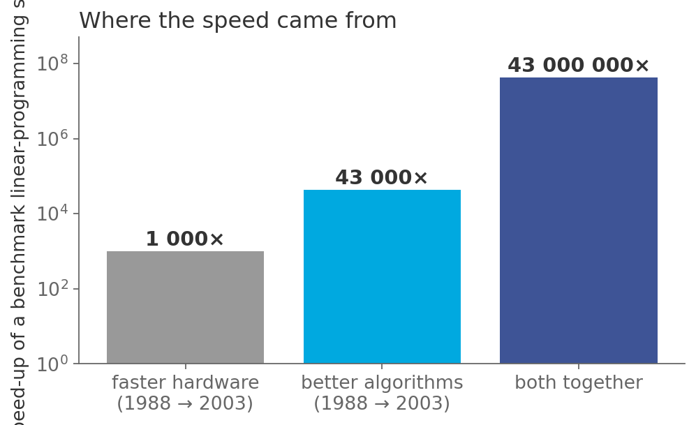
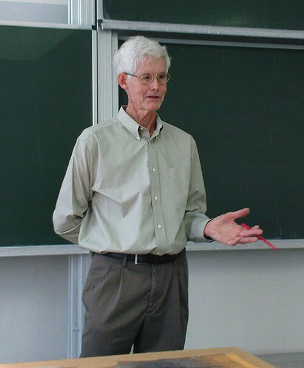
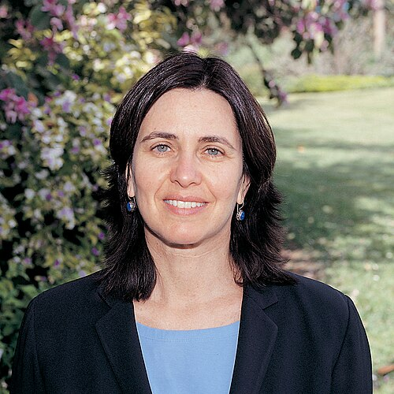
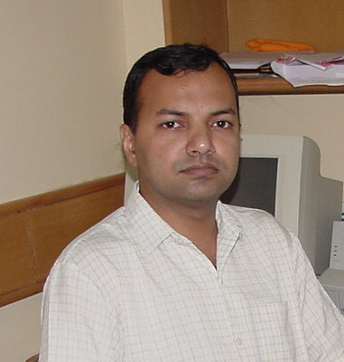

# How long will it take?

*Session 8 · Time Complexity · a historical background ·
[slides](../../Slides/08-TimeComplexity/ICSS-2026-08-TimeComplexity.qmd)*

> O-notation is older than the computer, the idea that "fast" means
> "polynomial" is from 1965, and the most celebrated complexity result of this
> century was proved in Kanpur by a professor and two undergraduates.

## A notation from number theory

<!-- FIG -->
<figure class="full"><figcaption>Algorithms against hardware, 1988–2003: the growth rate, not the clock speed, is what the notation measures.</figcaption></figure>
<!-- /FIG -->
The big O of session 8 was invented to talk about primes. It appears in an
1894 textbook on analytic number theory and was made standard by a 1909
handbook on the distribution of prime numbers, and for fifty years it was a
tool of pure mathematicians that had nothing to do with computers. Its use
for running times came with the first analyses of algorithms in the late
1950s, and the conventions the lecture uses, including $\Omega$ and $\Theta$,
were fixed in a two-page letter of 1976 titled "Big Omicron and Big Omega and
Big Theta", written by the author of the encyclopedia of session 3 because
everyone had been using the symbols differently. The same volumes that gave
session 3 its data structures gave session 8 its way of counting steps.

## A subject is born

The question of how many steps a computation takes, as a function of the
input size, was asked precisely for the first time in a 1965 paper whose
title, *On the Computational Complexity of Algorithms*, named the field. Using
the Turing machine of session 9 as the definition of a step, it showed that
more time genuinely buys more: there are problems solvable in $n^2$ steps and
not in $n$. The same year, two other papers independently proposed the
dividing line the lecture draws between feasible and infeasible, that
polynomial time is the right formalization of "practically computable", one
of them arguing that the distinction was one that working mathematicians
already recognized in practice. The class P dates from that year.

<!-- FIG -->
<figure class="side"><figcaption><b>Stephen Cook, Turing Award 1982.</b> Photo: Jiří Janíček Pokud hodláte některou z mých fotog, CC BY-SA 3.0, via <a href="https://commons.wikimedia.org/wiki/File:Prof.Cook.jpg">Wikimedia Commons</a>.</figcaption></figure>
<!-- /FIG -->
Between 1971 and 1973 the class NP acquired its shape. Stephen Cook proved
that satisfiability, the problem of the exercises of this course, was as hard
as anything verifiable in polynomial time, which made it the first
NP-complete problem, and the same result was found independently in the
Soviet Union. A single paper of 1972 then showed that twenty-one famous
problems, among them the traveling salesman, graph coloring, the knapsack and
the clique problem, were all equivalent to satisfiability, and a curiosity
became a theory. The question they left open, whether P equals NP, is the one
the Sudoku example of this course turns on, and it carries a million-dollar
prize. Cook received the Turing Award in 1982.

## Widening the question

<!-- FIG -->
<figure class="side"><figcaption><b>Shafi Goldwasser, Turing Award 2012.</b> Photo: Weizmann Institute of Science, Public domain, via <a href="https://commons.wikimedia.org/wiki/File:Shafi_Goldwasser.JPG">Wikimedia Commons</a>.</figcaption></figure>
<!-- /FIG -->
The second generation of complexity theory asked what happens when
computation is not a solitary calculation but a conversation. Shafi
Goldwasser, born in New York and raised in Israel, showed in the 1980s with
Silvio Micali that a prover could convince a skeptical verifier that a
statement is true without revealing anything else, a zero-knowledge proof,
and that letting the two sides talk creates new complexity classes
altogether. The work underlies a large part of modern cryptography, and it
shared the 2012 Turing Award. Her doctoral adviser, a Venezuelan-born
theorist who had written down in 1967 the axioms any measure of complexity
must satisfy, received the same prize in 1995, and between them the two
represent how far the subject moved from counting steps in a single
generation.

## Two undergraduates

<!-- FIG -->
<figure class="side"><figcaption><b>Manindra Agrawal of IIT Kanpur, first author of 'PRIMES is in P'.</b> Photo: Dany.GOT, CC BY-SA 4.0, via <a href="https://commons.wikimedia.org/wiki/File:Manindra_Agarwal.jpg">Wikimedia Commons</a>.</figcaption></figure>
<!-- /FIG -->
The growth-rate table of the lecture has a row for primality testing, and the
history has an ending. Deciding whether a number is prime is easy to state,
and by the 1970s there were fast randomized methods, but no one knew whether
it could be done in deterministic polynomial time. In 2002 Manindra Agrawal, a
professor at the Indian Institute of Technology Kanpur, and two of his
undergraduate students posted a nine-page paper titled "PRIMES is in P". It
gave an algorithm, elementary enough to be taught in a term, that settled a
question open since Gauss. The proof was checked within days by email and won
the Gödel Prize in 2006. It is a reminder of the lecture's own point about
algorithms outrunning hardware: the frontier of what is feasible moves when
someone thinks, not when someone buys a faster machine.

## The thread to the lecture

Session 8 gives you a notation, a definition of "fast" and a table of growth
rates. Each has a date: the notation from number theory, from 1894 to 1909
and fixed for computing in 1976; the definition of fast in 1965; the class of
hard problems in 1971 and 1972; and a demonstration in 2002 that a classical
problem can fall out of the exponential class by argument alone. The PCAST
figure among the examples of this session, algorithms beating hardware by a
factor of 43 000, is the same story told with numbers.

## Further reading

- Fortnow, L. (2013), *The Golden Ticket: P, NP, and the Search for the
  Impossible*, Princeton University Press.
- Knuth, D. E. (1976), "Big Omicron and Big Omega and Big Theta", *SIGACT
  News* 8(2), two pages.
- Agrawal, M., Kayal, N. and Saxena, N. (2004), "PRIMES is in P", *Annals of
  Mathematics* 160(2).
