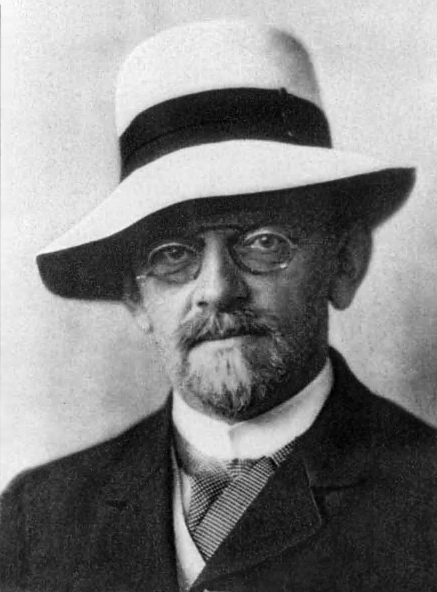
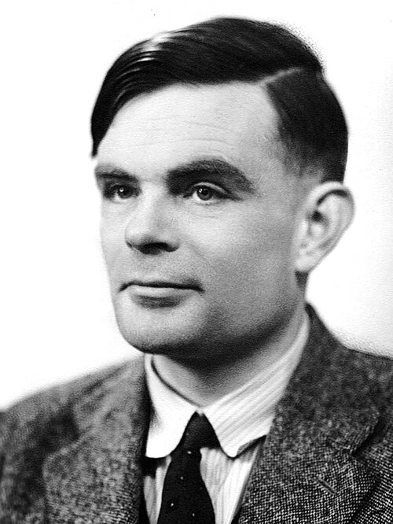
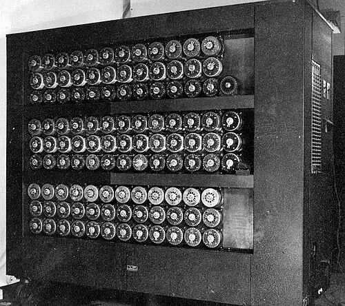
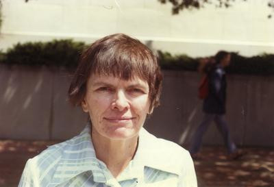

# What can be computed?

*Session 9 · Theoretical Computer Science · a historical background ·
[slides](../../Slides/09-TheoreticalCS/ICSS-2026-09-TheoreticalCS.qmd)*

> In 1928 a mathematician asked for a procedure to decide any mathematical
> statement. Within eight years the answer was no, and the proof defined the
> machine you are reading this on. The last of his decision problems fell in
> 1970, to a theorem carried most of the way by a woman who was not allowed
> to be paid for it.

## Hilbert's question

<!-- FIG -->
<figure class="side"><figcaption><b>David Hilbert (1862–1943).</b> Photo: unknown author, Public domain, via <a href="https://commons.wikimedia.org/wiki/File:Hilbert.jpg">Wikimedia Commons</a>.</figcaption></figure>
<!-- /FIG -->
David Hilbert dominated mathematics from Göttingen for forty years and
believed that every well-posed mathematical question had an answer. In 1928
he posed the *Entscheidungsproblem*, the decision problem: find a procedure
that, given any statement in formal logic, determines whether it is provable.
He expected a yes. Three years later Gödel's incompleteness theorem showed
that any system rich enough for arithmetic contains truths it cannot prove.
That did not settle Hilbert's question, but it left a gap: to say that no
procedure could do something, you first needed a definition of "procedure".

## 1936

<!-- FIG -->
<figure class="side"><figcaption><b>Alan Turing (1912–1954).</b> Photo: Elliott &amp; Fry, Public domain, via <a href="https://commons.wikimedia.org/wiki/File:Alan_turing_header.jpg">Wikimedia Commons</a>.</figcaption></figure>
<!-- /FIG -->
Three definitions arrived in one year, from Princeton and Cambridge, one
based on a notation for functions, one on a machine with a tape and a finite
set of rules, and one on the recursive functions whose story the history post
of session 6 tells, and all three were proved to describe exactly the same
set of computable things. That agreement is the *Church-Turing thesis*: this
is what "computable" means, and there is nothing beyond it. Two of the three
papers also showed that Hilbert's decision procedure could not exist. Alan
Turing's version is the one that stuck, because it was a machine. A tape, a
head that reads and writes one cell at a time, a table of rules: the Turing
machine of the lecture is his 1936 model unchanged, and his proof that no
machine can decide whether another machine will halt is the halting problem
of session 9. Within ten years there were real machines built on the idea.
Turing went on to break the German naval cipher at Bletchley Park, to design
one of the first stored-program computers, and to propose the test for
machine intelligence that session 10 mentions. He was prosecuted for
homosexuality in 1952, sentenced to chemical castration, and died of cyanide
poisoning in 1954. The British government apologized in 2009.

<!-- FIG -->
<figure class="side wide"><figcaption><b>Bletchley Park, where Turing worked from 1939.</b> Photo: unknown author, Public domain, via <a href="https://commons.wikimedia.org/wiki/File:Wartime_picture_of_a_Bletchley_Park_Bombe.jpg">Wikimedia Commons</a>.</figcaption></figure>
<!-- /FIG -->
The smaller machines of the lecture came afterwards and from the opposite
direction. Finite automata were abstracted from real switching circuits and
from a 1943 model of the neuron; the regular expression was invented in 1951
to describe what such circuits could recognize; and the 5-tuple,
nondeterminism and the proof that it adds no power are from a 1959 paper. The
hierarchy that arranges all these machines came from linguistics. A 1956
paper by a linguist showed that no finite-state grammar could generate the
sentences of English, using nested dependencies of exactly the kind the
bracket example of this course illustrates, and his 1959 follow-up arranged
grammars into the four classes, regular, context-free, context-sensitive and
unrestricted, and matched each to a machine.

## The tenth problem

<!-- FIG -->
<figure class="side"><figcaption><b>Julia Robinson (1919–1985).</b> Photo: George Bergman, GFDL 1.2, via <a href="https://commons.wikimedia.org/wiki/File:Julia_Robinson_1975.jpg">Wikimedia Commons</a>.</figcaption></figure>
<!-- /FIG -->
Hilbert had a longer list. In 1900 he had posed twenty-three problems for the
century, and the tenth asked for an algorithm to decide whether any polynomial
equation with integer coefficients has integer solutions. After 1936 it was
reasonable to suspect that there was none, and proving it took thirty-four
years. Most of the distance was covered by Julia Robinson. Robinson grew up in
Arizona and California, lost a year of school to rheumatic fever that damaged
her heart, and earned her doctorate at Berkeley in 1948. Because her husband
was on the mathematics faculty, the anti-nepotism rules of the university
barred her from a position there, and she worked for two decades without a
salary or a title. In 1950 she made the first serious attack on the tenth
problem, and in 1961, with two collaborators, reduced it to a single
remaining conjecture. In 1970 a twenty-two-year-old in Leningrad proved that
conjecture, using the Fibonacci numbers of session 6, and the problem was
closed: no such algorithm exists. Robinson insisted that the result be named
for him; the literature names all four. Berkeley made her a professor in
1976, the year she became the first woman mathematician elected to the US
National Academy of Sciences, and in 1983 she was the first woman president
of the American Mathematical Society.

## The thread to the lecture

Session 9 presents automata, grammars, Turing machines and the halting
problem as a ladder of what machines can do. The history shows that the top
rung was built first, in 1936, to answer a question about mathematics rather
than about machines, and that the lower rungs were reverse-engineered from
circuits and from language in the 1950s. It also shows what an impossibility
result costs. Robinson's twenty years on a single problem, without pay, are
the human scale of "no algorithm exists".

## Further reading

- Hodges, A. (1983), *Alan Turing: The Enigma*.
- Reid, C. (1996), *Julia: A Life in Mathematics*, by her sister, with
  Robinson's own autobiographical essay.
- Petzold, C. (2008), *The Annotated Turing*, the 1936 paper line by line.
