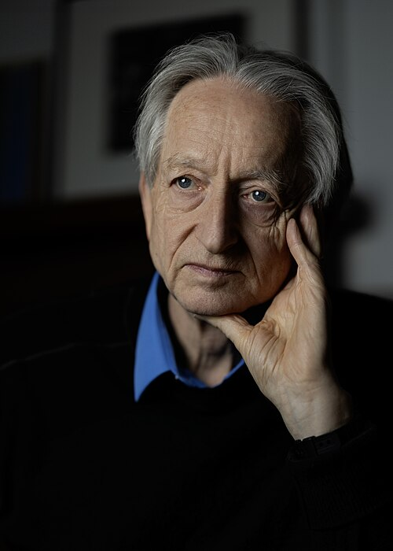
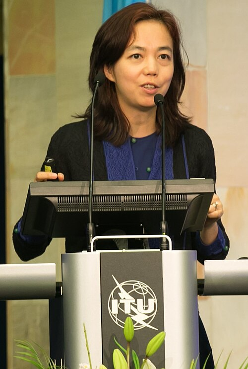
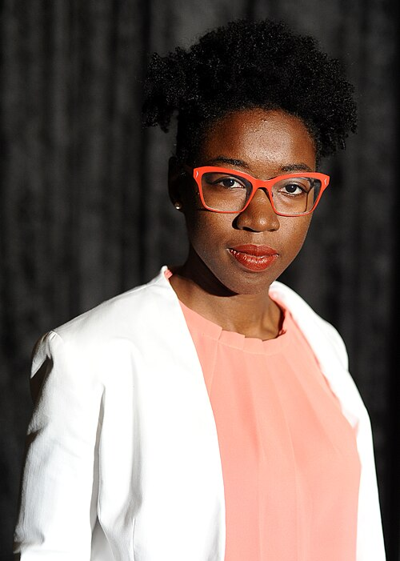

# Learning from examples

*Session 10 · Machine Learning · a historical background ·
[slides](../../Slides/10-MachineLearning/ICSS-2026-10-MachineLearning.qmd)*

> The person slide of the lecture calls Geoffrey Hinton the godfather of AI.
> The ideas he championed were forty years old when they finally worked, the
> dataset that made them work was built by a woman most of the field had
> advised to do something more sensible, and the audit that showed whom the
> resulting models fail was done by a graduate student with a white mask.

## Fitting rules to data, before computers

Learning a rule from examples is older than the field. Least squares was
developed around 1805 to predict the orbits of comets from noisy sightings, a
regression in the sense of the lecture, with the orbit as the model. Bayes's
rule for updating beliefs from evidence was published in 1763 and sat mostly
unused for a century and a half, and the Naive Bayes classifier of session 10
is its simplest application. The linear discriminant of 1936, fitted to three
species of iris, was the first standard classification dataset and still
ships with every library. It belongs to the history to note that its author
was also a leading eugenicist, and that the statistics of sorting things and
the politics of sorting people were, in the 1930s, one project for some of
its founders.

## The long argument for the neuron

The neural network began as a model of the brain. A 1943 paper treated the
neuron as a threshold switch and showed that networks of them could compute
any logical function. The first learning machine built on it, the perceptron
of 1958, adjusted its own weights from labeled examples and was implemented
as a room-sized device with motors turning potentiometers, and the *New York
Times* reported that the Navy expected it to walk, talk and be conscious of
its existence. A 1969 book proved what a single layer of such units could not
do, not even the exclusive or, and funding collapsed for fifteen years, the
first "AI winter" of the timeline in the lecture.

<!-- FIG -->
<figure class="side"><figcaption><b>Geoffrey Hinton, Turing Award 2018, Nobel Prize 2024.</b> Photo: Cmichel67, CC BY-SA 4.0, via <a href="https://commons.wikimedia.org/wiki/File:Geoffrey_Hinton_in_2026.jpg">Wikimedia Commons</a>.</figcaption></figure>
<!-- /FIG -->
What one layer could not do, several could, given a way to train them.
Geoffrey Hinton was one of the authors of the 1986 paper that gave that way,
pushing the error at the output back through every layer to adjust every
weight, and he kept working on networks through two decades in which the
approach was unfashionable and the center of gravity of the field had moved
to methods that came with theory and did not need days of training. He moved
to Toronto in 1987 partly because Canadian funding did not depend on military
relevance. The architecture that eventually won was old too: convolutional
networks, which scan an image for local features, date from Japan in 1980 and
were reading handwritten postcodes for the US Postal Service by 1989.

## The dataset

<!-- FIG -->
<figure class="side"><figcaption><b>Fei-Fei Li, who built ImageNet.</b> Photo: ITU Pictures, CC BY 2.0, via <a href="https://commons.wikimedia.org/wiki/File:Fei-Fei_Li_at_AI_for_Good_2017.jpg">Wikimedia Commons</a>.</figcaption></figure>
<!-- /FIG -->
What changed in 2012 was not the algorithm. Fei-Fei Li, born in Beijing, had
moved to the United States at fifteen and worked in her parents' dry-cleaning
shop through Princeton. As a young professor she concluded that the
bottleneck of the field was not models but examples, and set out to label
millions of images by hand. Colleagues advised her against it as a career
risk. Using crowd-sourced labor, her team built ImageNet, fourteen million
images in twenty-two thousand categories, released it in 2009, and attached
an annual competition. In 2012 two of Hinton's students entered a deep
convolutional network, trained on two consumer graphics cards, the GPUs of
session 12, and cut the error rate by more than a third. Every group in the
field switched to deep networks within two years. Li's dataset, not any
single idea, was the substrate the lecture says the field had been waiting
for, and Hinton shared the 2018 Turing Award and the 2024 Nobel Prize in
Physics for what happened next.

## Who the models fail

<!-- FIG -->
<figure class="side"><figcaption><b>Joy Buolamwini, first author of Gender Shades.</b> Photo: Niccolò Caranti, CC BY-SA 4.0, via <a href="https://commons.wikimedia.org/wiki/File:Joy_Buolamwini_-_Wikimania_2018_01.jpg">Wikimedia Commons</a>.</figcaption></figure>
<!-- /FIG -->
The section of the lecture on responsible AI has a founding experiment. Joy
Buolamwini, a graduate student at the MIT Media Lab, found that commercial
face-detection software did not register her face until she put on a white
mask. With a co-author at Microsoft Research she assembled a set of
parliamentarians' portraits balanced by gender and skin tone and tested three
commercial gender classifiers. *Gender Shades* (2018) reported error rates
below 1% for light-skinned men and up to 35% for dark-skinned women. The
companies revised their systems within months. The paper is the reason "who
are we generalizing for?" is on the list of questions in the lecture, and it
established a pattern, the external audit with a balanced test set, that has
since been applied to speech recognition, medical imaging and the language
models of the final section of the lecture.

## The thread to the lecture

Session 10 presents supervised learning, generalization and the bias-variance
trade-off, then ends with a list of ethical questions. The history puts
people to the turning points: a stubborn researcher who kept an unfashionable
idea alive, a dataset built against advice that made it work, and an audit
that made the field measure whom its models serve. It also makes the point
of the lecture about substrates. The ideas waited for data and hardware, not
the other way round.

## Further reading

- Metz, C. (2021), *Genius Makers*, the deep-learning decade as journalism.
- Li, F.-F. (2023), *The Worlds I See*, her own account of ImageNet.
- Buolamwini, J. and Gebru, T. (2018), "Gender Shades: Intersectional
  Accuracy Disparities in Commercial Gender Classification", *Proceedings of
  Machine Learning Research* 81, fifteen pages.
