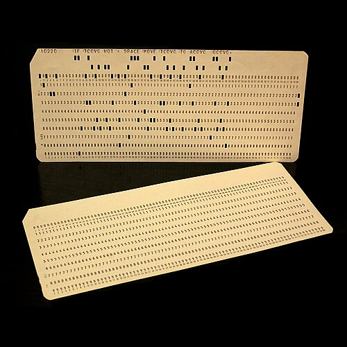
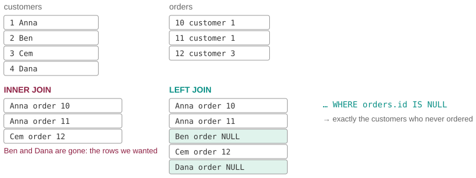
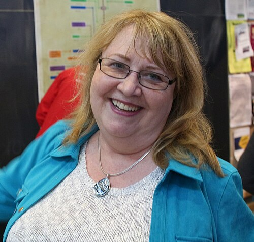

# One copy of every fact

*Session 11 · Databases · a historical background ·
[slides](../../Slides/11-Databases/ICSS-2026-11-Databases.qmd)*

> The relational model was a mathematician's protest against his employer's
> product line, SQL was a summer project, and the reason your query runs in a
> second rather than an hour is a 1979 paper by a woman whose employer was in
> no hurry to use it.

## Files, then models

<!-- FIG -->
<figure class="side wide"><figcaption><b>Before databases: one record per card, filed in drawers.</b> Photo: José Antonio González Nieto - cropped by Eyesint, CC BY 4.0, via <a href="https://commons.wikimedia.org/wiki/File:2punchCards-square.jpg">Wikimedia Commons</a>.</figcaption></figure>
<!-- /FIG -->
Before databases there were files, and before files there were cards. The
punched-card record of the history of session 3 became, in the 1950s, the
tape record: batch jobs that read one tape and wrote another. The 1960s
brought disks, which could reach any record without rewinding, and with them
the first systems that deserved the name. The two dominant designs, records
pointing to related records in a network that the programmer navigated by
hand, and records arranged in a hierarchy, as in the system IBM wrote for the
Apollo program to track the parts of the Saturn V, both worked, and both
required the programmer to know exactly how the data was stored in order to
ask it anything. That is the opposite of the *data independence* the lecture
lists as the first reason to use a database.

## Codd's tables

<!-- FIG -->
<figure class="side wide"><figcaption>Codd's proposal in one picture: tables related by matching values, not by pointers.</figcaption></figure>
<!-- /FIG -->
Edgar F. Codd, an English mathematician who had flown in the RAF and then
joined IBM, published *A Relational Model of Data for Large Shared Data
Banks* in 1970. Its proposal was that data should be presented as tables,
relations in the mathematical sense, with no pointers, no navigation and no
visible storage structure, and queried in a language derived from logic.
Everything in the middle of session 11 is in that paper: keys, the separation
of the logical from the physical, and the insistence that the same fact be
stored once. IBM, which was selling the hierarchical system, did not welcome
it. Codd spent the 1970s arguing, sometimes in public against his own
employer, and his twelve rules for what may call itself "relational" were
published in 1985 partly as a rebuke to products that used the word loosely.
He received the Turing Award in 1981. To show that the model could be
implemented efficiently, IBM's San Jose laboratory built a prototype between
1974 and 1979. Two of its members designed, over a few months, a query
language a non-programmer could write; renamed SQL for trademark reasons, its
`SELECT … FROM … WHERE` is the form the lecture uses, and the declarative
character the lecture praises, saying what rather than how, was the design
goal.

## Making "what" fast

<!-- FIG -->
<figure class="side"><figcaption><b>Patricia Selinger, whose 1979 paper made declarative queries fast.</b> Photo: Jacek Ambroziak and Sam Madden, CC BY 4.0, via <a href="https://commons.wikimedia.org/wiki/File:01_Pat_Selinger_-_Stonebraker70_(cropped).jpg">Wikimedia Commons</a>.</figcaption></figure>
<!-- /FIG -->
Declaring what left open the problem of deciding how. A query can be
executed in many orders, which table to scan first, which index to use, which
join method, and the differences are not small; they are the difference
between a second and a day. Patricia Selinger, who had joined the team of the
prototype after a Harvard doctorate, wrote the 1979 paper that solved it:
estimate the cost of each candidate plan from statistics about the data, and
choose the cheapest. Cost-based optimization is the reason a declarative
language is fast, the reason session 11 can say that the DBMS "takes care of
how to do it" without irony, and every serious database since has used her
design. IBM was slow to turn the prototype into a product; a start-up that
had read the published papers shipped Oracle in 1979, and IBM's own DB2
followed in 1983. Selinger became an IBM Fellow and led the database research
of the company for two decades.

The rest of the material of the lecture arrived within a few years. The ACID
properties come from a 1981 paper on what it means for a database to be
correct when hundreds of users change it at once, and an acronym coined in
1983. An open-source implementation of Codd's ideas, begun at Berkeley in
1973, is the ancestor of PostgreSQL, and SQLite, the database inside every
phone and the one the notebooks of this course use, was written in 2000 for
the on-board software of a warship and placed in the public domain.

## The thread to the lecture

Session 11 moves from "why a database" through the relational model to SQL
and joins. The history is compact, with the network and hierarchical models
in the 1960s, Codd's tables in 1970, SQL in 1974, the optimizer in 1979 and
transactions in 1981, and almost all of it happened inside two laboratories
that were at first reluctant to sell what they had built. The design
principle the lecture keeps repeating, one copy of every fact, was an
argument before it was a product.

## Further reading

- Codd, E. F. (1970), "A Relational Model of Data for Large Shared Data
  Banks", *Communications of the ACM* 13(6), eleven pages and still readable.
- Selinger, P. G. et al. (1979), "Access Path Selection in a Relational
  Database Management System", *Proceedings of SIGMOD 1979*.
- McJones, P. (ed.) (1997), *The 1995 SQL Reunion: People, Projects, and
  Politics*, the team of the prototype in their own words, online.
