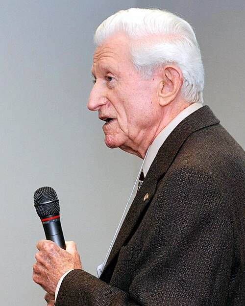
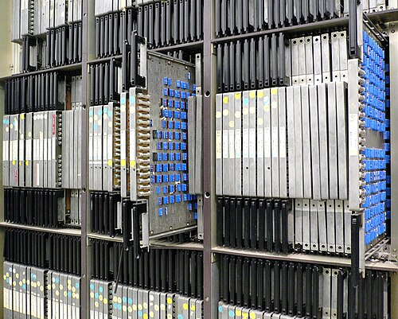
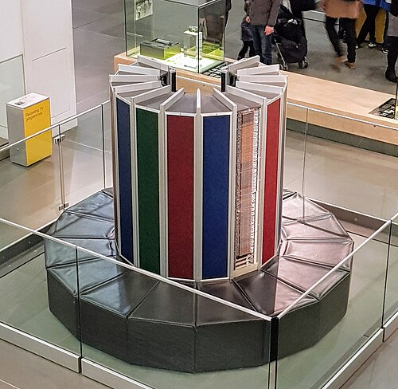
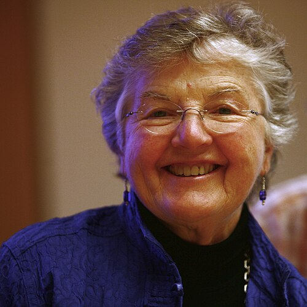
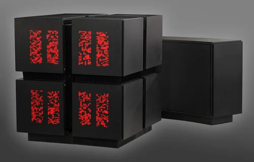

# Many hands

*Session 12 · Parallel Programming · a historical background ·
[slides](../../Slides/12-ParallelProgramming/ICSS-2026-12-ParallelProgramming.qmd)*

> Amdahl's law was an argument he lost at the time and won afterwards. The
> compilers that let ordinary programs use many processors were built by the
> first woman to receive the Turing Award. And the free lunch the lecture says
> is over was noticed to be ending in 2005, in a magazine article.

## The law, and the argument it came from

<!-- FIG -->
<figure class="side"><figcaption><b>Gene Amdahl (1922–2015).</b> Photo: Perry Kivolowitz (Pkivolowitz at en.wikipedia), CC BY 3.0, via <a href="https://commons.wikimedia.org/wiki/File:Amdahl_march_13_2008.jpg">Wikimedia Commons</a>.</figcaption></figure>
<!-- /FIG -->
Gene Amdahl designed the IBM System/360, the machine that made computing an
industry, and in 1967 stood up at a conference to argue against a proposal
from the University of Illinois for a computer made of sixty-four processors
working in lockstep. His point, made with a back-of-the-envelope formula, was
that the sequential parts of any real program would cap the speed-up no
matter how many processors were added, which is the law that ends session
12. The Illinois machine was built anyway, ran through the 1970s, and largely
proved him right; it also trained a generation of programmers in what
parallel hardware demanded of software. Amdahl left IBM in 1970 to build
compatible mainframes under his own name, and his law outlived both
<!-- FIG -->
<figure class="side wide"><figcaption><b>ILLIAC IV, the sixty-four-processor machine Amdahl argued against.</b> Photo: Steve Jurvetson from Menlo Park, USA, CC BY 2.0, via <a href="https://commons.wikimedia.org/wiki/File:ILLIAC_4_parallel_computer.jpg">Wikimedia Commons</a>.</figcaption></figure>
<!-- /FIG -->
companies. The rebuttal came in 1988: people with more processors do not run
the same program faster, they run bigger problems in the same time, and for
bigger problems the serial fraction shrinks. Both laws are right, since they
answer different questions, and the practical advice of the lecture, to
measure the serial fraction before buying nodes, is what they agree on.

## The kinds of machine

<!-- FIG -->
<figure class="side wide"><figcaption><b>A Cray-1 in the Deutsches Museum; the bench around the base hides the power supplies.</b> Photo: Irid Escent, CC BY-SA 2.0, via <a href="https://commons.wikimedia.org/wiki/File:Science_Museum_20180227_132902_(49362732462).jpg">Wikimedia Commons</a>.</figcaption></figure>
<!-- /FIG -->
The four-way classification of session 12, single or multiple instruction
streams and single or multiple data streams, was proposed in 1966, and for
the next thirty years the fastest computers in the world were of the
single-instruction, multiple-data kind: vector supercomputers, of which the
Cray-1 of 1976, with its curved cabinet and padded bench, is the emblem. The
GPU inside a modern laptop, the example of the lecture, is that design in a
different package. The 1980s added the other approach, very many small
processors each with its own instruction stream, in machines built explicitly
for artificial-intelligence work, and the argument between the two approaches
is the argument between Amdahl and Illinois continued. Gordon Moore wrote the
1965 magazine article that predicted transistor counts would double every
year, revised to two years in 1975, co-founded Intel in 1968, and watched his
forecast hold for fifty years. The opening point of the lecture, that clock
speeds stopped rising around 2005 and the extra transistors went into cores
instead, was announced to programmers that year in an article titled "The
Free Lunch Is Over": from then on, a program would get faster only if someone
made it parallel.

## Making programs parallel

<!-- FIG -->
<figure class="side"><figcaption><b>Frances Allen (1932–2020), first woman to receive the Turing Award.</b> Photo: Rama, CC BY-SA 2.0 fr, via <a href="https://commons.wikimedia.org/wiki/File:Allen_mg_2528-3750K-b.jpg">Wikimedia Commons</a>.</figcaption></figure>
<!-- /FIG -->
Someone had been working on that since 1957. Frances Allen joined IBM that
year to teach FORTRAN to its scientists and stayed for forty-five years. Her
1966 paper *Program Optimization* laid out how a compiler could analyze the
structure of a program, its loops and its data dependences, and rearrange it
for speed without changing what it computed. Her work of the 1970s extended
that across whole programs, and in the 1980s she led the project whose aim
was the one the lecture now sets every programmer: take an ordinary
sequential program and find the parallelism in it automatically. Much of what
a modern compiler does to make array-style code fast is descended from her
analyses. She was the first woman to be made an IBM Fellow, in 1989, and in
2006 the first woman to receive the Turing Award.

<!-- FIG -->
<figure class="side wide"><figcaption><b>A Connection Machine CM-2: many small processors, each with its own instruction stream.</b> Photo: Logg Tandy, CC BY 4.0, via <a href="https://commons.wikimedia.org/wiki/File:Connection_Machine_CM-2_and_DataVault_at_The_Mimms_Museum_of_Technology_and_Art.webp">Wikimedia Commons</a>.</figcaption></figure>
<!-- /FIG -->
The other route was to change the programming model rather than the
compiler. A 2004 paper from Google described MapReduce: run a computation over
data spread across thousands of ordinary machines by moving the program to
the data, letting each machine work on its own chunk with no shared state,
and combining the results, with the system handling machines that failed
halfway. Its example was counting words, exactly the example of this course.
Open-source reimplementations made the technique available to anyone with a
rack of cheap computers, which is how the distributed statistics of the last
section of the lecture became routine in social research.

## The thread to the lecture

Session 12 runs from Moore's law to Amdahl's law by way of the kinds of
parallel machine and MapReduce. The history is a fifty-year argument about
whether many slow processors can beat one fast one, resolved in practice by
two things: compilers that could find parallelism a human had not written,
which is Allen's work, and a programming model that made shared state
impossible, which is MapReduce. The race condition among the examples of this
session is the bug that model was designed to prevent.

## Further reading

- Amdahl, G. M. (1967), "Validity of the single processor approach to
  achieving large scale computing capabilities", *AFIPS Conference
  Proceedings* 30, three pages.
- Allen, F. E. (2006), Turing Award lecture, "Compiling for Performance: A
  Personal Tour", online at the ACM.
- Sutter, H. (2005), "The Free Lunch Is Over", *Dr. Dobb's Journal* 30(3).
