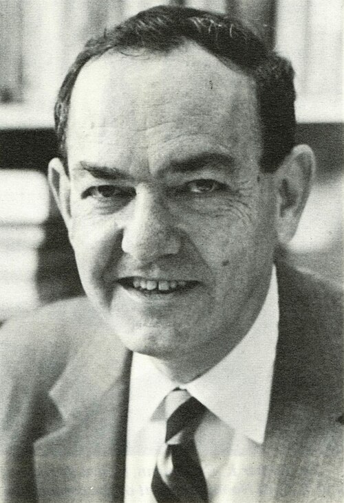
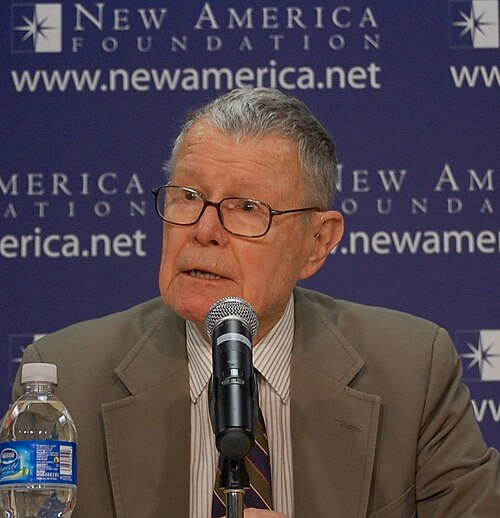
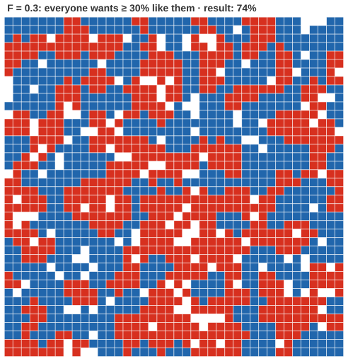
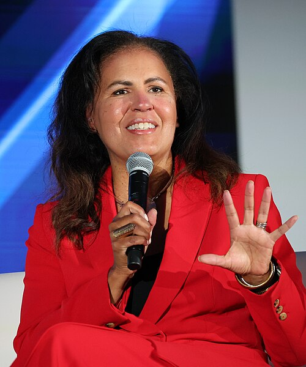

# Society as computation

*Session 13 · Social Science Applications · a historical background ·
[slides](../../Slides/13-SocialScienceApplications/ICSS-2026-13-SocialScienceApplications.qmd)*

> Computational social science has a founder who was also a founder of
> artificial intelligence, a founding paper with fifteen authors, and a
> critical tradition, led largely by Black women scholars, that arrived
> almost as soon as the enthusiasm did.

## Simon and the artificial

<!-- FIG -->
<figure class="side"><figcaption><b>Herbert Simon (1916–2001): political scientist, AI founder, Nobel and Turing laureate.</b> Photo: Rochester Institute of Technology, Public domain, via <a href="https://commons.wikimedia.org/wiki/File:Herbert_Simon,_RIT_NandE_Vol13Num11_1981_Mar19_Complete.jpg">Wikimedia Commons</a>.</figcaption></figure>
<!-- /FIG -->
The course opens, in session 1, with Herbert Simon's phrase *the sciences of
the artificial*, and it is fitting that session 13 returns to him. Simon was
a political scientist by training who concluded in the 1940s that the
rational actor of economics did not describe how anyone actually decided
anything, proposed *bounded rationality* in its place, and then, needing a
way to study how people actually solve problems, built computer programs
that solved them. The 1956 program that gave the history of session 3 the
linked list was his; he was among the founders of the workshop that named
artificial intelligence that year; he received the Turing Award in 1975 and
the Nobel Prize in economics in 1978. His 1969 book argued that minds,
organizations and social systems are designed things that can be studied by
simulating them, which is the "generative" meaning of *computational* in the
lecture.

## Schelling and the model

<!-- FIG -->
<figure class="side"><figcaption><b>Thomas Schelling (1921–2016).</b> Photo: New America, CC BY 2.0, via <a href="https://commons.wikimedia.org/wiki/File:Thomas_C._Schelling_(cropped).jpg">Wikimedia Commons</a>.</figcaption></figure>
<!-- /FIG -->
Thomas Schelling was an economist and Cold War strategist, whose work on
deterrence shaped nuclear policy, who in 1969 sat down with a chessboard and
two kinds of coins to ask how much individual preference it took to produce
a segregated city. The answer, in the lecture's own example, was very little.
*Dynamic Models of Segregation* (1971) is usually counted as the first
agent-based model in social science, and its lesson, that macro patterns do
not reveal micro motives, is the one the session ends on. Schelling received
the Nobel Prize in 2005. The field that grew from his chessboard added
computer tournaments in the 1980s showing that simple cooperation beat
sophisticated strategies, and artificial societies in the 1990s in which
trade, migration and inequality emerged from a few rules.

<!-- FIG -->
<figure class="side wide"><figcaption>The lecture's Schelling grid after settling: macro segregation from mild micro preference.</figcaption></figure>
<!-- /FIG -->
The digital half of the field has its own founding moment. Social-network
research had been done with letters and questionnaires since the 1960s, from
the "six degrees" experiment that the Erdős example of this course recalls
to the finding that acquaintances rather than friends bridge social distance.
Two papers of 1998 and 1999 showed with models and data that a few random
long-range links make any clustered network a small world, and that growth
with preferential attachment produces the heavy-tailed networks seen
everywhere; network science dates from them. In 2009 *Science* published the
two-page manifesto the lecture quotes, *Computational Social Science*, with
fifteen authors: the digital traces people leave made it possible to observe
social behavior at a resolution no survey could match, and the field needed
institutions, data access and ethics to make use of it. The hype curve of the
lecture, data, then theory, then methods, is the decade that followed, told
in retrospect.

## The critics who arrived early

<!-- FIG -->
<figure class="side"><figcaption><b>Safiya Umoja Noble, author of Algorithms of Oppression.</b> Photo: Jennifer 8. Lee, CC BY-SA 4.0, via <a href="https://commons.wikimedia.org/wiki/File:Safiyah_Noble_at_Essence_Festival_Global_Black_Economic_Forum_2025_5_(cropped).jpg">Wikimedia Commons</a>.</figcaption></figure>
<!-- /FIG -->
The enthusiasm produced its own scholarship of what could go wrong, and much
of the most influential work came from outside computer science, from
ethnographers of social-media use, from a 2012 essay titled *Critical
Questions for Big Data* that is the source of several of the cautions of the
lecture about representation and context, and from scholars of race. Safiya
Umoja Noble's *Algorithms of Oppression* (2018) documented how search engines
encoded and amplified racist and sexist associations, the "algorithmic
confounding" of the lecture seen from the side of the people confounded, and
gave a generation of researchers the vocabulary to ask whose behavior a
platform's data actually records. The argument was extended the following
year to the systems that reproduce discrimination while claiming neutrality,
and it is now part of how the field defines itself: the call for ethics in
the 2009 manifesto was answered largely by people the manifesto had not
counted among its authors. The lecture's own case studies belong to this
history. The book the session recommends, *Bit by Bit* (2017), came out of
experiments on how popularity forms in online markets, and *The Parable of
Google Flu*, which this course uses as a motivating example, was written in
2014 by the lead author of the 2009 manifesto about a project that manifesto
had cited as a model, the field auditing its own founding example five years
on.

## The thread to the lecture

Session 13 gives three meanings of *computational*, digital, computerized and
generative, and a set of risks. The history puts a person or a paper on each.
The generative meaning is Simon's and Schelling's, the digital meaning is the
2009 paper's, and the risks were articulated first and most sharply by
critics such as Noble. A field barely fifteen years old as a named discipline
already has founders, critics and a canon, and the insistence of the lecture
that theory comes first is the position its own founding paper took.

## Further reading

- Simon, H. A. (1969; 3rd ed. 1996), *The Sciences of the Artificial*, MIT
  Press.
- Lazer, D. et al. (2009), "Computational Social Science", *Science*
  323(5915), two pages.
- Noble, S. U. (2018), *Algorithms of Oppression*, NYU Press.
- Salganik, M. J. (2017), *Bit by Bit*, free at bitbybitbook.com.
