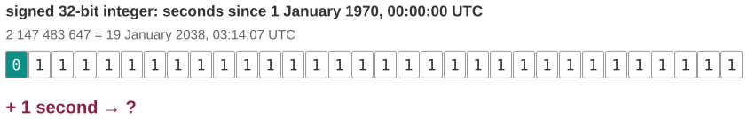
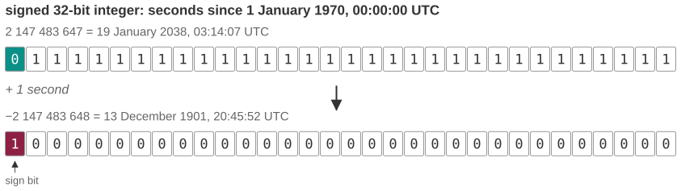
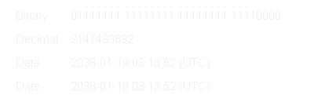

# The clock that ends on 19 January 2038

*Session 2 · Information Coding · example X02-A ·
[notebook](../notebooks/X02-A.ipynb) ·
[slides](../../Slides/Examples/02-Examples/ICSS-2026-02-Examples.qmd)*

> At 03:14:07 UTC on 19 January 2038, a great many computers will believe that
> it is suddenly December 1901. There is nothing mysterious about it: one bit,
> in the wrong place.

## The puzzle

<!-- FIG -->
<figure class="full"><figcaption>The counter one second before it overflows: a 0 followed by 31 ones.</figcaption></figure>
<!-- /FIG -->
Most operating systems and a great deal of software count time in the same
way, as the number of seconds since 1 January 1970, 00:00:00 UTC, a reference
point known as the *Unix epoch*. For decades that count was stored in a 32-bit
signed integer. At 03:14:07 UTC on 19 January 2038 the counter holds
2 147 483 647, and one second later something goes wrong. Two questions: why
that specific second, and what date will the computer report at 03:14:08?

## Try it first

Open the [notebook](../notebooks/X02-A.ipynb). It prints the largest value of
the counter as a date, shows its bit pattern, and then does the one thing
Python never does on its own, which is to add 1 the way a 32-bit integer
would. You do not need to know two's complement to run it; the point is to
watch the wrap happen.

## What is going on

Two facts from the lecture are enough. The first is that a type has a fixed
size. A 32-bit integer has exactly $2^{32}$ patterns of bits and no more, and
if the type is *signed*, half of those patterns have to stand for negative
numbers, so the largest positive value is $2^{31} - 1$:

```
0111 1111 1111 1111 1111 1111 1111 1111   = 2 147 483 647
```

That is about 68 years' worth of seconds. Counting from 1970, the counter runs
out on 19 January 2038, which is where the date comes from. Nothing about the
date itself is special; it is simply $2^{31}$ seconds after the epoch.

<!-- FIG -->
<figure class="full"><figcaption>Adding one carries into the sign bit; the same 32 bits now mean 13 December 1901.</figcaption></figure>
<!-- /FIG -->
The second fact is that two's complement uses the first bit as the sign. Add
1 to the pattern above and the carry ripples all the way into that first bit:

```
1000 0000 0000 0000 0000 0000 0000 0000   = −2 147 483 648
```

In two's complement a leading 1 means a negative number, and this particular
pattern is the most negative value the type can hold. So the counter does not
reset to zero. It jumps to 2 147 483 648 seconds *before* 1970, which is
20:45:52 UTC on 13 December 1901. The two's-complement wheel in the lecture
makes this visual: the largest positive number sits right next to the most
negative one, and adding 1 steps across the boundary.

## The answer

Why that second? Because $2^{31} - 1$ seconds after 1 January 1970 is exactly
then. What date afterwards? 13 December 1901, so time runs backwards by 136
years. The fix is not clever: use 64 bits. The same overflow is then $2^{63}$
seconds away, which is about 292 billion years, as the notebook computes.
Linux completed the switch to a 64-bit counter on 32-bit hardware in 2020. The
remaining problem is the embedded devices, file formats and databases that
store 32-bit timestamps and will never be updated.

## Why this matters if you work with data

<!-- FIG -->
<figure class="side wide"><figcaption><b>How the 32-bit Unix time counter wraps in 2038</b> Photo: Monaneko, Public domain, via <a href="https://commons.wikimedia.org/wiki/File:Year_2038_problem.gif">Wikimedia Commons</a>.</figcaption></figure>
<!-- /FIG -->
Overflow is silent. Nothing raised an error at 03:14:08; the counter simply
holds a valid-looking negative number, and any code that computes "days since
the event" will produce a confident, plausible and wrong result. This bites
social scientists in two places. The first is dates stored as integers in old
file formats. SPSS counts seconds since 14 October 1582, Stata counts days
since 1 January 1960 and Excel counts days since 1 January 1900, each with its
own width, and converting between them is where dates in 1901 appear in a
dataset. The second is durations computed from timestamps that cross a
boundary of the type. The 2038 problem is the famous case, but the same thing
happens with every counter: Windows 95 and 98 hung after 49.7 days because a
32-bit count of milliseconds wrapped, and in 2015 the FAA ordered every
Boeing 787 to be powered down at least once every 248 days because a counter
in its generator control units overflowed after that long. The general habit
is to know the range of every numeric type you rely on, and to ask what
happens one step past it.

## What we used from the lecture

- [Positional number systems](../../Transcripts/02-InformationCoding.md#4-positional-number-systems):
  reading the bit pattern.
- [Negative numbers and two's complement](../../Transcripts/02-InformationCoding.md#6-negative-numbers):
  why `1000…0` is the most negative value, and the wheel.
- [Data types and their size](../../Transcripts/02-InformationCoding.md#10-data-types-and-bitwise-operations):
  why 32 bits was a choice, and 64 is another.

## Further reading

- LWN, "Approaching the kernel year-2038 deadline" (2019), on the Linux
  kernel's `time_t` widening.
- Wikipedia, *Year 2038 problem*, for the running list of incidents that have
  already happened with dates computed decades ahead.
- FAA Airworthiness Directive 2015-09-07, the 248-day power-down order for the
  Boeing 787.
