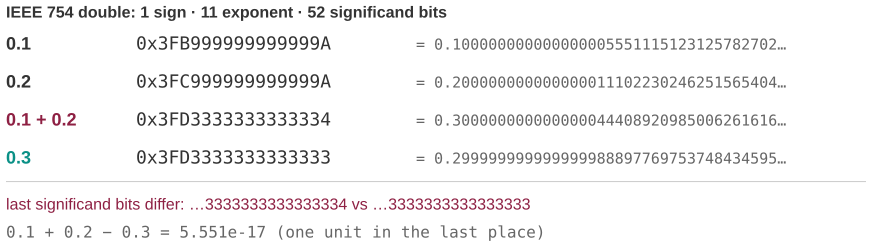

# 0.1 + 0.2 is not 0.3

*Session 2 · Information Coding · example X02-B ·
[notebook](../notebooks/X02-B.ipynb) ·
[slides](../../Slides/Examples/02-Examples/ICSS-2026-02-Examples.qmd)*

> Every language, every spreadsheet, every calculator app. It is not a bug, it
> will never be fixed, and once you see the bits it is obvious.

## The puzzle

```python
>>> 0.1 + 0.2 == 0.3
False
>>> 0.1 + 0.2
0.30000000000000004
```

Why does the error show up in the 17th decimal place and not, say, the third?
What is the computer actually storing when you type `0.1`?

## Try it first

The [notebook](../notebooks/X02-B.ipynb) prints the *exact* decimal value of
each of the four numbers involved, their hexadecimal bit patterns, and the
difference between the two sides. Then it adds `0.1` to itself ten times and
compares the result with `1.0`.

## What is going on

<!-- FIG -->
<figure class="full"><figcaption>The four numbers as IEEE 754 doubles: none is the decimal you typed, and the sum differs from 0.3 in the last bit.</figcaption></figure>
<!-- /FIG -->
A Python float is an IEEE 754 *double*: 1 sign bit, 11 exponent bits and 52
significand bits. A number is stored as
$\pm 1.\!\underbrace{b_1 b_2 \ldots b_{52}}_{\text{significand}} \times 2^{e}$,
and the consequence the lecture draws from this layout is that only numbers
whose fractional part is a sum of powers of $\tfrac12$, the *dyadic
rationals*, can be stored exactly. $0.5$, $0.25$, $0.125$ and $192.125$ are
exact. $0.1 = \tfrac{1}{10}$ is not: the denominator has a factor of 5, so in
binary it is $0.0\overline{0011}$, repeating forever. The 52 bits cut it off,
and the cut is rounded. What is stored is therefore not $0.1$ but the nearest
representable number, and the same holds for the other two operands:

| you typed | stored (exact) | direction |
|---|---|---|
| `0.1` | 0.1000000000000000055511151231257827… | slightly high |
| `0.2` | 0.2000000000000000111022302462515654… | slightly high |
| `0.3` | 0.2999999999999999888977697537484345… | slightly low |

Now add the stored `0.1` and the stored `0.2`. The exact sum,
0.3000000000000000166…, is not representable either, and it rounds *up* to
0.3000000000000000444…, while the stored `0.3` rounded *down*. The two results
are one unit apart in the last bit, $2^{-54}$, about $5.5 \times 10^{-17}$,
which is precisely what the notebook prints as the difference. That is why
the error is in the 17th place: it is one bit at the end of a 52-bit
significand. Nothing about 0.1 is special, and the same happens for almost
every decimal you can type.

## The answer

The computer stores the closest binary fraction it can, and every addition
rounds again. `0.1 + 0.2` and `0.3` are two different roundings of nearly the
same number. Three practical consequences follow, and the notebook shows each
of them. Never compare floats with `==`; use `math.isclose` or a tolerance you
choose. Errors accumulate: adding `0.1` ten times gives 0.9999999999999999
rather than 1.0, so a loop that runs "until the total reaches 1.0" may never
stop. And money and counts do not belong in floats; Python's `Decimal` and
`Fraction` do exact arithmetic, and so do integers in cents.

## Why this matters if you work with data

<!-- FIG -->
<figure class="side"><figcaption><b>Spreadsheets store numbers as the same IEEE 754 doubles and hide the last digits when displaying them.</b> Photo: Microsoft, Public domain, via <a href="https://commons.wikimedia.org/wiki/File:Microsoft_Office_Excel_(2025%E2%80%93present).svg">Wikimedia Commons</a>.</figcaption></figure>
<!-- /FIG -->
Regression software, survey weights, currency conversions and percentage
calculations all live in floating point, and most of the time the 17th
decimal is irrelevant. It stops being irrelevant in three situations. The
first is when you compare computed values for equality, as in `if weight ==
1.0`. The second is when you sum millions of small numbers: the rounding
drifts, and it drifts in one direction if the numbers share a sign, which is
exactly the Vancouver Stock Exchange story among the candidate openings of the
main deck. The third is when you subtract two large, nearly equal numbers,
which throws away most of the correct digits at once. The lecture's phrase for
this is *loss of precision*, and the defense is the same each time: know which
of your numbers are exact and which are approximate, and never test an
approximate number for equality.

## What we used from the lecture

- [Floating-point numbers: IEEE 754](../../Transcripts/02-InformationCoding.md#7-floating-point-numbers-ieee-754):
  the layout, and why only dyadic rationals are exact.
- [When rounding errors matter](../../Transcripts/02-InformationCoding.md#8-when-rounding-errors-matter):
  accumulation and comparison.

## Further reading

- <https://0.30000000000000004.com>, the same three lines in forty languages.
- Goldberg, D. (1991), "What Every Computer Scientist Should Know About
  Floating-Point Arithmetic", *ACM Computing Surveys* 23(1). Long, but the
  first ten pages are all you need.
