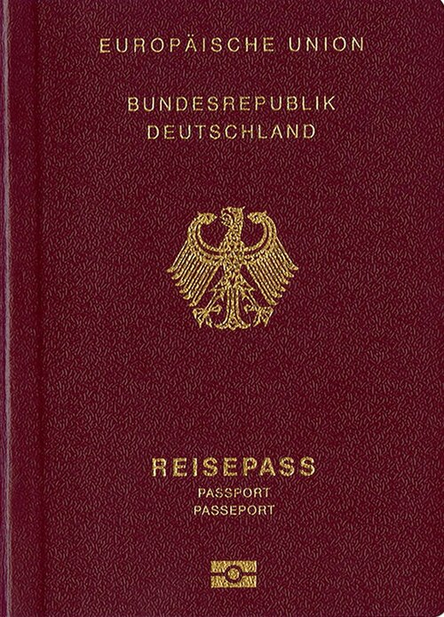
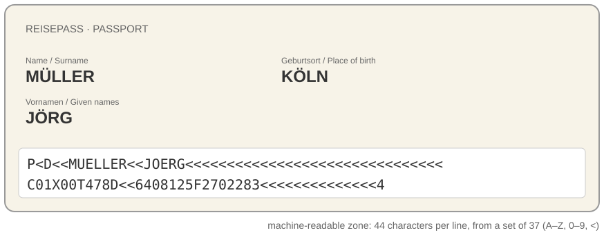

# Why your boarding pass spells you MUELLER

*Session 2 · Information Coding · example X02-C ·
[notebook](../notebooks/X02-C.ipynb) ·
[slides](../../Slides/Examples/02-Examples/ICSS-2026-02-Examples.qmd)*

> A passport issued in 2020 cannot spell an umlaut. Neither can half the systems
> your survey data passes through, and unlike the passport, they do not warn
> you.

## The puzzle

<!-- FIG -->
<figure class="side wide"><figcaption><b>A German passport: the two lines at the bottom are the machine-readable zone.</b> Photo: Bundesrepublik Deutschland, Bundesministerium de, Public domain, via <a href="https://commons.wikimedia.org/wiki/File:Reisepass_Bundesrepublik_Deutschland_%E2%80%93_Einband_Vorderseite_2017.jpg">Wikimedia Commons</a>.</figcaption></figure>
<!-- /FIG -->
Look at the bottom of a German passport. The two lines of capitals and `<`
symbols are the *machine-readable zone*, and they render *Jörg Müller* as
`MUELLER<<JOERG` and *Çağla* as `CAGLA`. Airlines and border systems copy that
spelling, which is why the name on your boarding pass is not quite yours. Why
can a modern document not spell ö? And, the more useful question, what
happens when two programs that *can* spell it disagree about how?

## Try it first

The [notebook](../notebooks/X02-C.ipynb) encodes a name in three ways, shows
what happens when UTF-8 bytes are read as Latin-1 (the classic `Müller`),
shows ASCII refusing outright, and builds a machine-readable-zone line from a
name.

## What is going on

<!-- FIG -->
<figure class="full"><figcaption>The MRZ transliterates the name into a 37-symbol alphabet; every reader in the world decodes it identically.</figcaption></figure>
<!-- /FIG -->
Everything on a computer is a number, and a *text encoding* is the convention
that says which number means which character. The lecture walks through three
generations of that convention, and the passport sits at the oldest one by
design. ASCII, from 1963, uses 7 bits: 128 codes, enough for English letters,
digits and punctuation, with no ö, no ç and no ß. The machine-readable zone
goes further and restricts itself to 37 symbols, A to Z, 0 to 9 and `<`,
because the requirement is that a reader anywhere in the world, in any decade,
decodes the line identically. The standard of the International Civil
Aviation Organization therefore *transliterates*: ö becomes OE, ß becomes SS
and ç becomes C. The spelling is wrong on purpose, and the standard says
exactly how.

The code pages of the 1980s kept one byte per character, 256 codes, and used
the upper 128 differently in each region. Byte 246 is ö in ISO-8859-1, the
Western European table, and ц in ISO-8859-5, the Cyrillic one. A file does not
say which code page it uses, so the reader has to know or guess. Unicode and
UTF-8, from the 1990s, give every character in every script one number, and
UTF-8 stores the ASCII range in one byte and everything else in two to four;
ö is the two bytes `C3 B6`. Now the failure that the notebook reproduces.
Write *Müller* in UTF-8 and the bytes are `M`, `C3`, `BC`, `l`, `l`, `e`,
`r`. Read those bytes as ISO-8859-1, one character per byte, and `C3` is `Ã`,
`BC` is `¼`, and the name is `Müller`. The bytes never changed; only the
assumption did, and since both strings are valid, nothing raises an error.

## The answer

The passport cannot spell ö because its alphabet was deliberately limited to
37 symbols so that decoding could never be ambiguous. Your other systems *can*
spell it, and they go wrong precisely because they can: each one assumes an
encoding, and when the assumptions differ, characters outside ASCII are
silently mangled.

## Why this matters if you work with data

Mojibake is not cosmetic. Suppose a survey exported from one system and read
in another turns `Köln` into `Köln` for some rows and not for others, which
happens whenever data is merged from two sources. A `GROUP BY city` then
splits Cologne into two categories, neither of them significant. A join
against a reference table of cities fails exactly for the rows with umlauts,
a systematic rather than a random loss. And the failure is invisible in any
summary statistic, because both spellings are perfectly valid strings. The
bias even has a direction: ASCII covers unaccented English, so the people at
risk are those with names and places outside it. The rule to take away is one
line long: say the encoding, every time. That means
`open(path, encoding="utf-8")` in Python, the `encoding=` argument of
`pandas.read_csv`, and the same option in every other tool you use. Guessing
is what produced every example above.

## What we used from the lecture

- [Storing information digitally](../../Transcripts/02-InformationCoding.md#3-storing-information-digitally):
  bytes are numbers, and meaning is a convention.
- [Character coding](../../Transcripts/02-InformationCoding.md#9-character-coding):
  ASCII, code pages, Unicode and UTF-8.

## Further reading

- ICAO Doc 9303, Part 3, the transliteration tables behind `MUELLER`.
- Spolsky, J. (2003), "The Absolute Minimum Every Software Developer
  Absolutely, Positively Must Know About Unicode and Character Sets", still
  the best short explanation.
