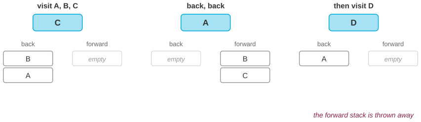

# Where does the Back button keep the pages?

*Session 3 · Data Structures · example X03-A ·
[notebook](../notebooks/X03-A.ipynb) ·
[slides](../../Slides/Examples/03-Examples/ICSS-2026-03-Examples.qmd)*

> Visit A, B, C. Go back twice. Open D. Now Forward does nothing, and B and C
> are gone. Every browser does this, and it is the correct behavior.

## The puzzle

Try it in any browser: open three pages in a row, press Back twice, then click
a link. The Forward button grays out. Where did the two pages go, and why is
throwing them away right rather than a bug?

## Try it first

The [notebook](../notebooks/X03-A.ipynb) implements a browser history in twenty
lines with two Python lists, replays the scenario, and then times 400,000
history operations to show that they cost almost nothing.

## What is going on

<!-- FIG -->
<figure class="full"><figcaption>Three states of the two-stack history: after C, after two Backs, and after opening D, which clears the forward stack.</figcaption></figure>
<!-- /FIG -->
The history is two *stacks*, one called *back* and one called *forward*. A
stack is the simplest data structure in the course after the array: you can
push an item on top and pop the top item off, and that is all. The order is
LIFO, last in, first out. The lecture builds it on a linked list, which is why
both operations cost $O(1)$ regardless of how much is stored. The three
browser actions map onto stack operations exactly:

| action | what happens |
|---|---|
| open a page | push the current page onto *back*; clear *forward* |
| Back | push the current page onto *forward*; pop *back* into current |
| Forward | push the current page onto *back*; pop *forward* into current |

Walk through the scenario. After A, B and C, the current page is C and the
back stack holds A and B. Two presses of Back make A current and leave C and
B on the forward stack, with C at the bottom because it went on first. Now
open D: the current page is D, the back stack holds A, and the forward stack
is emptied. That emptying is the answer to the "why". A stack can hold only
one sequence. After opening D from A there are two candidate futures, "forward
to B, then C" and "you are on D", and a stack has no way to represent a fork.
The browser resolves it by keeping the newest one, which is the one you just
chose.

## The answer

The Back and Forward buttons are two stacks. Opening a new page pushes the old
one onto *back* and discards *forward*; B and C were on the forward stack and
were discarded. That is the only consistent behavior for a structure that
holds a single line of history. Modern browsers actually keep a list of
session-history entries with a current index, and some keep a tree, so that
nothing is truly lost, but the buttons still present the two-stack view,
because that is what people can predict.

## Why this matters if you work with data

Stacks are everywhere once you know to look, and the value of this example is
in recognizing the shape. Undo in every editor and statistics package is a
stack of previous states; redo is the forward stack, and it is cleared when
you make a new edit, for exactly the reason above. The call stack that session
6 uses to explain recursion is the same structure: the most recently called
function is the one that returns first. And depth-first search, also in
session 6, is breadth-first search with the queue replaced by a stack, and
that one substitution changes which path you find. The contrast case is just
as important. A support helpline built on a stack would be a disaster, because
a helpline needs the *oldest* request served first, which is a queue. Same structure, opposite verdict, and the
deciding question is always what should come out next.

## What we used from the lecture

- [What a data structure is](../../Transcripts/03-DataStructures.md#1-what-a-data-structure-is-and-why-it-matters)
- [Linked lists](../../Transcripts/03-DataStructures.md#3-linked-lists): the
  structure a stack is built on, and why push and pop are $O(1)$.
- [Stacks and queues](../../Transcripts/05-Algorithms.md#6-abstract-data-structures-queues-and-stacks)
  (session 5): the formal definitions.

## Further reading

- The HTML Living Standard, section "Session history and navigation", where
  the rule that a new navigation discards the forward entries is normative.
