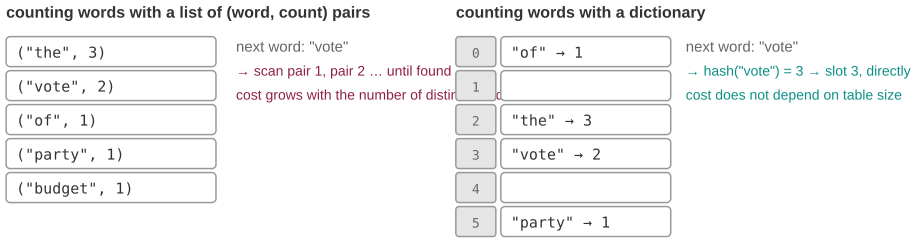
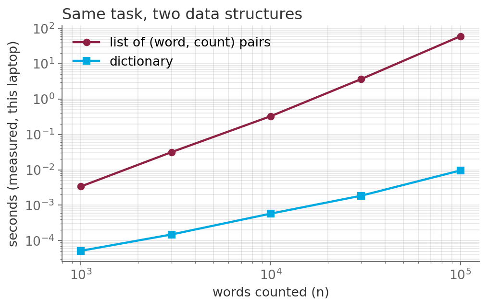

# Count a million words: 49 seconds or 0.01

*Session 3 · Data Structures · example X03-B ·
[notebook](../notebooks/X03-B.ipynb) ·
[slides](../../Slides/Examples/03-Examples/ICSS-2026-03-Examples.qmd)*

> Two five-line loops, the same answer, and a gap that gets wider every time
> the data grows. This is the single most useful thing to know about Python
> dictionaries.

## The puzzle

<!-- FIG -->
<figure class="full"><figcaption>The two containers: a list of pairs that must be searched, and a hash table that is addressed directly.</figcaption></figure>
<!-- /FIG -->
Two students count how often each word appears in a corpus of parliamentary
speeches. One keeps a list of (word, count) pairs and searches it for every
incoming word. The other keeps a dictionary. Both loops are five lines long
and produce identical counts. On 100,000 words one takes about 49 seconds and
the other about a hundredth of a second. Nothing changed except the
container. Where do the 49 seconds go?

## Try it first

The [notebook](../notebooks/X03-B.ipynb) contains both loops and times them on
1,000, 3,000, 10,000 and 30,000 words. Watch the ratio in the last column; it
is not constant.

## What is going on

<!-- FIG -->
<figure class="full"><figcaption>Measured time for both versions; on log axes the list has slope 2 and the dictionary slope 1.</figcaption></figure>
<!-- /FIG -->
Look at what each loop does when the next word arrives. The list has to find
the word. It starts at the first pair, compares, moves to the next, compares,
and so on until it finds a match or reaches the end. With $m$ distinct words
seen so far, that is up to $m$ comparisons, and $m$ grows as the loop
proceeds. Over $n$ words the total is roughly $n \times m$, and if a fixed
fraction of the words is distinct, that is proportional to $n^2$. Triple the
input and the time goes up by a factor of nine, which is exactly what the
notebook shows. The dictionary does not search. It computes a *hash* of the
word, a number derived from its characters, and uses that number to go
straight to a slot in an array. One computation, one look. The cost does not
depend on how many entries the dictionary already holds, so tripling the
input triples the time.

The name the lecture gives this structure is the *hash table*, and the
lecture spends some time on why the $O(1)$ is an average. Two words can hash
to the same slot, a *collision*, and the table needs a rule for that, either
chaining the entries in a list or probing along to the next free slot. A good
hash function spreads words evenly and collisions stay rare; a bad one, such
as the $2x \bmod 16$ of the exam question, which can only produce even slots,
makes the table degrade into exactly the list we started with.

## The answer

The 49 seconds are spent searching the list. The dictionary replaces search
with a computation, the hash, and that one change turns a quadratic loop into
a linear one. The log-log plot in the slides makes the difference visible as a
slope, 2 for the list and 1 for the dictionary. Session 8 will give this a
name and a notation, $O(n^2)$ against $O(n)$; for now the intuition is
enough. The gap is not a constant factor that a faster laptop could buy you
out of. It keeps widening.

## Why this matters if you work with data

Counting things is most of what data work is: word frequencies, respondents
per region, events per user, co-occurrences. Every one of those is the
question "is this key already in my collection?", asked millions of times. The
habit to build is simple. Whenever you write `for x in big_list: if x in
other_list`, stop, because `in` on a list is a search, and put `other_list`
in a set or a dictionary first. That single move, stop searching and start
indexing, returns in session 5 with adjacency lists, in session 7 with the
reasons to sort, in session 8 with the post-filtering question of the exam,
and in session 11 with database indexes. It is the same idea each time.

## What we used from the lecture

- [The editing-versus-searching trade-off](../../Transcripts/03-DataStructures.md#4-the-trade-off-editing-versus-searching)
- [Hashing and hash tables](../../Transcripts/03-DataStructures.md#8-hashing-and-hash-tables):
  hash functions, collisions, and why the average is $O(1)$.
- [Dictionaries](../../Transcripts/03-DataStructures.md#9-dictionaries): the
  Python interface.

## Further reading

- Cormen, Leiserson, Rivest and Stein (2009), *Introduction to Algorithms*,
  3rd ed., chapter 11, "Hash Tables".
- The Python wiki, "TimeComplexity": the cost of every operation on lists,
  sets and dicts, in one table.
