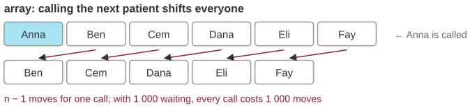
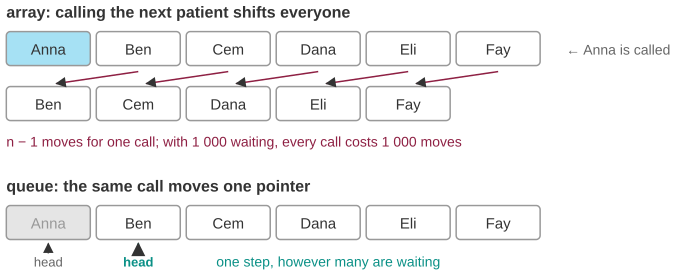

# The waiting room that gets slower the fuller it is

*Session 3 · Data Structures · example X03-C ·
[notebook](../notebooks/X03-C.ipynb) ·
[slides](../../Slides/Examples/03-Examples/ICSS-2026-03-Examples.qmd)*

> A clinic's software slows down exactly when the waiting room is fullest. The
> fix is one word, and understanding it is the whole of arrays versus lists.

## The puzzle

<!-- FIG -->
<figure class="full"><figcaption>Removing the front of an array shifts everyone behind it.</figcaption></figure>
<!-- /FIG -->
The software keeps the waiting patients in an array, in arrival order. When a
patient is called, the first entry is removed, and every remaining entry
shifts one place forward. With 1,000 people waiting, each call costs 1,000
moves. What has to change so that "call the next patient" costs the same
whether six people are waiting or six thousand?

## Try it first

The [notebook](../notebooks/X03-C.ipynb) times "serve everyone" for a Python
list (`pop(0)`) and for a `deque` (`popleft()`) at 10,000 to 80,000 patients.
Doubling the waiting room quadruples one of them.

## What is going on

<!-- FIG -->
<figure class="full"><figcaption>A queue moves one pointer instead; the cost no longer depends on the length.</figcaption></figure>
<!-- /FIG -->
The first structural fact of the lecture is that an *array* is contiguous:
element $k$ lives at a fixed offset from the start, which is why reading
`waiting[k]` costs $O(1)$. The price of that contiguity is that removing the
first element leaves a hole, and closing the hole means moving every later
element down by one, which is $O(n)$ work. Serve $n$ patients that way and
you have done $(n-1) + (n-2) + \cdots + 1 \approx n^2/2$ moves. That is the
quadratic behavior the notebook measures. A *linked list* gives up
contiguity. Each element points to the next, so removing the front is just
moving the head pointer to the second element, one operation however long the
list is, and adding at the tail is one operation too if you keep a tail
pointer.

A structure that supports "add at the back, remove from the front" is a
*queue*, FIFO, first in, first out, and it is the right abstraction for a
waiting room, a print spooler, a request buffer and, in session 5,
breadth-first search. Python's `collections.deque` is one; it is implemented
as a chain of small arrays and gets $O(1)$ at both ends. What was given up is
access by position. The third patient in a linked queue is found by walking
two links, whereas in an array it is `waiting[2]`. Nobody asks a waiting room
for its third patient, so the trade is free here, but it is still a trade,
and the point of the lecture is that every data structure is a decision about
which questions will be cheap.

## The answer

Replace the array with a queue, either a linked list with a head and a tail
or a `deque`. Calling the next patient becomes one pointer move, $O(1)$, and
the system no longer slows down as it fills.

## Why this matters if you work with data

The symptom is worth memorizing: when a program gets slower the bigger its
data gets, there is an $O(n)$ operation inside a loop. In analysis code that
is usually one of three things. It can be `list.pop(0)` or `list.insert(0, x)`
in a loop, which is this example. It can be `x in some_list` in a loop, which
is the previous example, X03-B. Or it can be growing a NumPy array or a
DataFrame one row at a time with `append`, which copies the whole thing each
time. Each has a one-line fix once you know which structure to reach for. The
habit is to ask, before the loop, what this operation costs on this container,
and the trade-off table of the lecture is the answer sheet.

## What we used from the lecture

- [Arrays](../../Transcripts/03-DataStructures.md#2-arrays): contiguity and
  constant-time indexing.
- [Linked lists](../../Transcripts/03-DataStructures.md#3-linked-lists)
- [The trade-off: editing versus searching](../../Transcripts/03-DataStructures.md#4-the-trade-off-editing-versus-searching)
- [Queues and stacks](../../Transcripts/05-Algorithms.md#6-abstract-data-structures-queues-and-stacks)
  (session 5).

## Further reading

- Python documentation, `collections.deque`: "Deques support thread-safe,
  memory efficient appends and pops from either side of the deque with
  approximately the same O(1) performance in either direction."
- Cormen, Leiserson, Rivest and Stein (2009), *Introduction to Algorithms*,
  3rd ed., section 10.1, "Stacks and queues".
