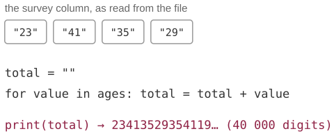
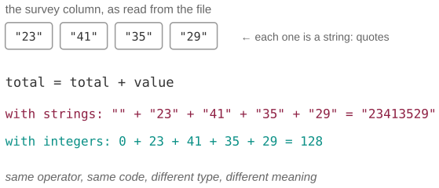

# The survey whose ages summed to a 40,000-digit number

*Session 4 · Software · example X04-A ·
[notebook](../notebooks/X04-A.ipynb) ·
[slides](../../Slides/Examples/04-Examples/ICSS-2026-04-Examples.qmd)*

> No error, no warning, four correct lines, and a total that begins
> `23413529…` and goes on for pages. This is the most common beginner's bug in
> data code, and the type system is the name of the lesson.

## The puzzle

<!-- FIG -->
<figure class="full"><figcaption>The loop as written, and the output it produced.</figcaption></figure>
<!-- /FIG -->
A student loads a survey of 20,000 respondents, loops over the *age* column
adding each value to a running total, and prints the sum. Instead of a number
around 800,000, the program prints a 40,000-digit value. What did the program
compute, and what one word from the lecture names the mistake?

## Try it first

The [notebook](../notebooks/X04-A.ipynb) reads four rows of CSV, runs the loop
as the student wrote it, then adds one function call and runs it again. It
also shows the one case Python does refuse, and the pandas one-liner that
makes the same mistake without a loop.

## What is going on

<!-- FIG -->
<figure class="full"><figcaption>Same operator, same code: on strings + concatenates, on integers it adds.</figcaption></figure>
<!-- /FIG -->
The lecture introduces the *type system* as the part of a language that
decides what an operation means. The symbol `+` is not one operation but a
family: on integers it adds, on strings it concatenates, on lists it joins
them, and which one runs depends on the types of the operands. A CSV file is
text, so every field a CSV reader hands you is a string unless you convert
it, `"23"` with quotes rather than `23`. The student's loop therefore
computed

```
"" + "23" + "41" + "35" + "29"  =  "23413529"
```

which is correct, for strings. Twenty thousand two-digit ages make a
40,000-character string, and the program printed it faithfully.

Why did Python not complain? Because Python is *dynamically typed*: the
operator is chosen at run time from whatever types show up, and two strings
are a perfectly valid pair for `+`. The one combination it refuses is a mixed
one, since `0 + "23"` raises a `TypeError`, which is why the bug appears when
the accumulator starts as the empty string and disappears when it starts as
`0`. The notebook shows both, and it shows the version that catches most
people in practice: the `.sum()` of a pandas column that holds text
concatenates the strings without a word of warning. A statically typed
language such as Java, Rust or C would have refused to compile the string
version, because the declared type of the total would not match. That is the
trade the lecture describes. Static typing catches this class of error before
the program runs, at the cost of writing the types down.

## The answer

The program concatenated strings. The one word is *type*: the values were
strings, `+` on strings is concatenation, and the fix is `int(value)` before
adding.

## Why this matters if you work with data

This bug has a hundred faces and one shape, a value whose type is not what you
assumed. Ages, incomes and years arrive as strings, as in this example. A
`"1,5"` is one and a half in a German locale and fifteen in an American one. A
column that is numeric except for one `"n/a"` turns into a column of strings.
Booleans arrive as the strings `"True"` and `"False"`, both of which count as
true in a condition. The debugging habit the lecture teaches is the right one
here: when a result looks wrong, do not re-read the code, print the value and
its type. That is `type(x)` in Python, `.dtypes` on a DataFrame and `str()` in
R. Most impossible results stop being impossible the moment you see that the
number is a string.

## What we used from the lecture

- [Object-oriented programming](../../Transcripts/04-Software.md#4-object-oriented-programming):
  the same `+` is a different method for each class (polymorphism).
- [Specifications](../../Transcripts/04-Software.md#requirements): say what type the input is
  before you compute with it.
- [Testing](../../Transcripts/04-Software.md#testing): one test with a known answer would have
  caught the 40,000-digit sum.

## Further reading

- The exam pool item `DS-14`, a slow dictionary loop, is the same lesson in
  another costume: look at what the value *is*.
