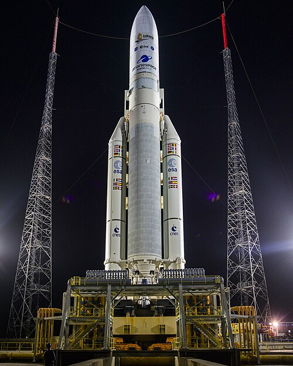
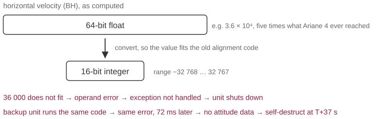

# The rocket that exploded because a number did not fit

*Session 4 · Software · example X04-B ·
[notebook](../notebooks/X04-B.ipynb) ·
[slides](../../Slides/Examples/04-Examples/ICSS-2026-04-Examples.qmd)*

> Ariane 5, 4 June 1996. Code that had flown since 1988, a new rocket that
> flew faster, and a 16-bit integer. Thirty-seven seconds.

## The puzzle

<!-- FIG -->
<figure class="side wide"><figcaption><b>An Ariane 5 on the pad at Kourou. Flight 501 in 1996 was the type's maiden flight.</b> Photo: Chris Gunn, Public domain, via <a href="https://commons.wikimedia.org/wiki/File:Ariane_5_with_James_Webb_Space_Telescope_Prelaunch_(51773093465).jpg">Wikimedia Commons</a>.</figcaption></figure>
<!-- /FIG -->
On its maiden flight, the European Ariane 5 launcher veered off course about
37 seconds after lift-off and destroyed itself. The inertial guidance software
was reused from Ariane 4, where it had worked without fault since 1988.
Nothing in the code had changed. What could have gone wrong, and why did the
backup computer fail in exactly the same way?

## Try it first

The [notebook](../notebooks/X04-B.ipynb) converts a 64-bit float to a 16-bit
integer the way the flight software did, once for an Ariane 4-sized value and
once for an Ariane 5-sized one. NumPy shows both failure modes, the silent
wrap-around and the raised exception. Then it adds the one check that was
missing.

## What is going on

<!-- FIG -->
<figure class="full"><figcaption>A 64-bit float squeezed into a 16-bit integer: the Ariane 5 value did not fit.</figcaption></figure>
<!-- /FIG -->
The report of the inquiry board is short and reads like a lecture on types.
The guidance unit computed a quantity called the *horizontal bias*, a measure
of sideways velocity, as a 64-bit floating-point number, and at one point
converted it to a 16-bit signed integer for a piece of alignment code that
dated from Ariane 4. A 16-bit signed integer holds $-32\,768$ to $32\,767$.
On Ariane 4 the value never exceeded that. Ariane 5 is a bigger, faster
rocket: 37 seconds after launch its horizontal velocity was several times what
Ariane 4 ever reached at that point, and the number to convert did not fit.

What happens when a conversion does not fit depends on the language. Some
wrap silently, so that the array conversion in the notebook turns 36,000 into
$-29\,536$ and the program carries on with nonsense. Some raise an exception.
The software of Ariane, written in Ada, raised, the exception was not handled,
and the inertial reference unit did what it was designed to do on an unhandled
error: it shut down. There were two such units, an active one and a backup,
running the same code on the same data, which is what a hot backup is. The
backup failed first, at 36.7 seconds after the countdown's zero, and the
active unit failed for the same reason 50 milliseconds later. When the main
computer tried to switch to the backup, it had already stopped. Redundancy
protects against hardware failures and does nothing against a deterministic
software fault. With no attitude data the rocket commanded a full nozzle
deflection, broke up under aerodynamic load at about 39 seconds, and
triggered its own destruct.

The detail that turns this from an anecdote into a lesson is that the
conversion was unprotected on purpose. Of seven such conversions in the code,
four had range checks and three did not, on the basis of an analysis showing
that the values were physically bounded, which was true for Ariane 4. The
assumption was correct, documented, and stored in a report rather than in the
program. The alignment function itself was not even needed after lift-off; it
kept running for 40 seconds because of an old requirement from Ariane 4.

## The answer

The code was unchanged, but the inputs changed. A 16-bit integer type has a
range, the new rocket exceeded it, the conversion raised, and the exception
was unhandled. The backup failed identically because it was identical.

## Why this matters if you work with data

You will reuse analysis code, and when you do, every line of it carries
assumptions about the data, its range, its units, its missing-value coding and
its number of categories, most of which are written nowhere. Three habits
follow from this story. Put the assumption in the code: the `to_int16_checked`
function of the notebook is one `if`, and an `assert values.max() < 32768` or
`assert df.year.between(1990, 2030).all()` costs nothing and fails loudly at
the right moment. Prefer loud failures to silent ones: a raised error 37
seconds in is bad, but a silently wrapped value that produces a plausible
wrong table is worse, because it reaches the paper. And do not assume that a
second run catches it: re-running the same script on the same data
reproduces the same bug, which is reproducibility working as intended.

## What we used from the lecture

- [Software engineering](../../Transcripts/04-Software.md#5-software-engineering): reused code
  carries the requirements of the system it was written for.
- [Specifications](../../Transcripts/04-Software.md#6-requirements-specifications-and-design): the range of a value is part of
  the specification, and it changed with the new rocket.
- [Testing](../../Transcripts/04-Software.md#7-testing): the reused code was never tested with
  Ariane 5 flight data.

## Further reading

- Lions, J.-L. et al. (1996), *Ariane 5 Flight 501 Failure: Report by the
  Inquiry Board*, ESA/CNES. Short, public, and worth reading in full.
