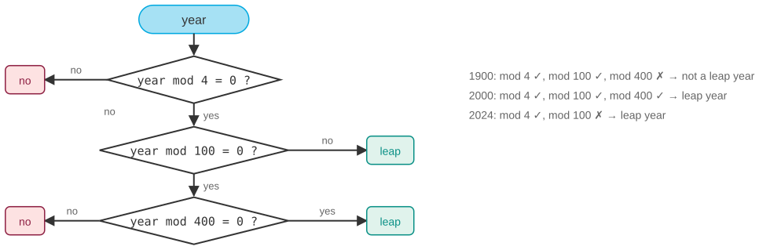

# Was 1900 a leap year? Excel says yes

*Session 4 · Software · example X04-C ·
[notebook](../notebooks/X04-C.ipynb) ·
[slides](../../Slides/Examples/04-Examples/ICSS-2026-04-Examples.qmd)*

> A three-condition rule, a bug from 1983 that a spreadsheet keeps on purpose,
> and the reason to write your parentheses.

## The puzzle

Type `=DATE(1900,2,29)` into Excel and it accepts it. 29 February 1900 did
not exist, because 1900 was not a leap year, although 2000 was and 2024 was.
Excel's day count before 1 March 1900 is off by one, and Microsoft has
documented that this will never be fixed. Write the rule that decides whether
a year is a leap year. Why is "divisible by 4" not enough, and why did a
1980s spreadsheet get it wrong deliberately?

## Try it first

The [notebook](../notebooks/X04-C.ipynb) has the naive rule and the correct
one, tests them on 1900, 2000, 2024 and 2100, checks the correct one against
Python's `calendar.isleap` for three thousand years, and then reproduces the
serial-date bug of Excel so that you can see day 60.

## What is going on

<!-- FIG -->
<figure class="full"><figcaption>The rule as a flowchart: three nested conditions, and where 1900, 2000 and 2024 come out.</figcaption></figure>
<!-- /FIG -->
The Gregorian calendar of 1582 fixes the drift of the Julian one by skipping
three leap years every four hundred years: a year is a leap year if it is
divisible by 4, except century years, unless they are divisible by 400. Three
conditions, nested:

```python
year % 4 == 0 and (year % 100 != 0 or year % 400 == 0)
```

This is control flow in its purest form, the `if`, `and` and `or` material of
the lecture, and the flowcharts of session 5 are what the slide draws. Two
things about the line deserve the attention the exam gives them. The first is
that every parenthesis matters. Python reads `A and B or C` as `(A and B) or
C`, because `and` binds tighter than `or`. For this particular rule that
grouping happens to give the same answers as the intended one, since a year
divisible by 400 is also divisible by 4, and that coincidence is precisely why
relying on precedence is dangerous: it works until it does not, and a reader
who assumes the other grouping reads a different rule. Write the grouping you
mean. The second is that the naive rule fails rarely. `year % 4 == 0` is wrong
only for 1900, 2100, 2200, 2300 and their kind, one year in four hundred, and
right for every year most people will ever test. That is what makes it
survive.

Now Excel. Lotus 1-2-3, released in 1983, counted 1900 as a leap year, either
as a simplification or as a bug. Excel for Windows (1987) had to open Lotus
files without changing any dates, so it reproduced the error. Its serial
number 60 is the phantom 29 February 1900, weekdays and day differences that
cross that date are off by one, and the choice has been kept for forty years
because changing it would silently alter every old spreadsheet.
Compatibility beat correctness, knowingly, and the decision is defensible.

## The answer

Divisible by 4, except century years, unless divisible by 400. "Divisible by
4" is wrong for 1900 because 1900 is a century year not divisible by 400.
Excel is wrong on purpose because Lotus was wrong first and files had to stay
compatible.

## Why this matters if you work with data

<!-- FIG -->
<figure class="side"><figcaption><b>Excel keeps 1900 as a leap year for compatibility with Lotus 1-2-3 files.</b> Photo: Microsoft, Public domain, via <a href="https://commons.wikimedia.org/wiki/File:Microsoft_Office_Excel_(2025%E2%80%93present).svg">Wikimedia Commons</a>.</figcaption></figure>
<!-- /FIG -->
Dates are where analysis code goes to die. Beyond leap years there are time
zones, daylight-saving transitions that make a day 23 or 25 hours long, the
1582 switchover, and four different epochs among the tools you use: Excel
counts from 1900, Excel for Mac historically from 1904, Unix from 1970, and
SAS and Stata from 1960. Three consequences follow. Never implement calendar
rules yourself in real code; use the library, `datetime`, `calendar` or
pandas, because the function in the notebook exists to teach control flow,
not to be deployed. When merging data from Excel, check the dates, since a
one-day offset in early records is exactly the kind of error that survives
into a historical dataset unnoticed. And read the parentheses. The point of
the lecture's section on syntax and semantics is that the machine executes
what you wrote, not what you meant, and a misplaced `or` is a semantics bug
with valid syntax.

## What we used from the lecture

- [Specifications](../../Transcripts/04-Software.md#6-requirements-specifications-and-design): the rule has three clauses, and
  the edge cases are where implementations disagree.
- [Imperative programming: conditions](../../Transcripts/04-Software.md#3-imperative-programming)
- [Testing](../../Transcripts/04-Software.md#7-testing): 1900 and 2000 are the boundary cases.
- [Flowcharts](../../Transcripts/05-Algorithms.md#5-flowcharts) (session 5):
  the rule as a diagram.

## Further reading

- Microsoft support, "Excel incorrectly assumes that the year 1900 is a leap
  year" (KB 214326), the vendor's own account.
