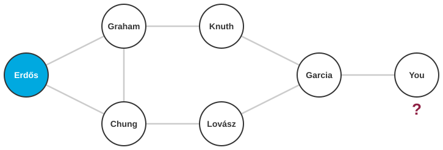
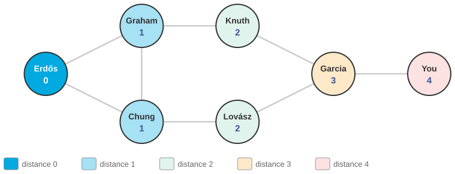

# What is your Erdős number?

*Session 5 · Algorithms · example X05-A ·
[notebook](../notebooks/X05-A.ipynb) ·
[slides](../../Slides/Examples/05-Examples/ICSS-2026-05-Examples.qmd)*

> "Six degrees of separation" is a claim about a graph. Here is the procedure
> that checks it, and the reason it can promise that the answer is the
> shortest.

## The puzzle

<!-- FIG -->
<figure class="full"><figcaption>A small co-authorship graph. What is the distance from Erdős to You?</figcaption></figure>
<!-- /FIG -->
Paul Erdős wrote about 1 500 papers with 500 co-authors. Your *Erdős number*
is the length of the shortest chain of co-authorships from you to him:
co-authors have 1, their co-authors 2, and so on. Kevin Bacon numbers do the
same for actors. Given the whole co-authorship graph, two million authors and
ten million edges, what exact procedure computes your number? And how do you
know that the chain it finds is the shortest?

## Try it first

The [notebook](../notebooks/X05-A.ipynb) holds a small co-authorship graph as
a dictionary, runs breadth-first search from Erdős, prints every author's
distance, reconstructs the chain for one of them, and then swaps the queue for
a stack to show what goes wrong.

## What is going on

<!-- FIG -->
<figure class="full"><figcaption>Breadth-first search assigns distances layer by layer; the first discovery is the shortest.</figcaption></figure>
<!-- /FIG -->
The definition of an algorithm in the lecture asks for *definiteness*: every
step must be unambiguous. "Find the shortest chain" is a goal, not a step.
Turning it into steps forces four questions, and answering them is the
algorithm. What is the next thing to look at? Start at Erdős and look at all
his co-authors, who are everyone at distance 1. Then look at all of their
co-authors not yet seen, who are at distance 2, then theirs, and so on. The
rule is to finish a whole layer before starting the next, and the data
structure that enforces this is a *queue*: newly discovered authors join at
the back, and you always take from the front, so nobody at distance 3 is
examined until everyone at distance 2 has been. How do you avoid going round
in circles? Co-authorship is full of cycles, so mark each author when first
discovered and never enqueue them again. How do you know the distance? Record
it at the moment of discovery, as one more than the distance of the author
who led you there. And how do you get the chain, not just its length? Record
who discovered whom, the *parent*, and walk the parents back from you to
Erdős.

That is *breadth-first search*, and the notebook version is a dozen lines.
The guarantee comes from the layer rule: an author is first reached in layer
$k$ only if no path of length less than $k$ exists, because every such path
would have put them in an earlier layer. First discovery is shortest
discovery. The last cell of the notebook replaces the queue with a stack, so
that the newest discovery is taken instead of the oldest, and the procedure
becomes depth-first search. It still finds a chain, but no longer the
shortest one, because it dives down one line of co-authors before looking
sideways.

## The answer

Breadth-first search from Erdős, with a queue, a visited set and a distance
recorded at first discovery. It touches each author once and each
co-authorship once, so on ten million edges it takes seconds. The distance it
reports is provably minimal, because of the order in which the queue releases
vertices.

## Why this matters if you work with data

<!-- FIG -->
<figure class="side"><figcaption><b>Paul Erdős (1913–1996), with more co-authors than any mathematician in history.</b> Photo: Kmhkmh, CC BY 3.0, via <a href="https://commons.wikimedia.org/wiki/File:Erdos_budapest_fall_1992_(cropped).jpg">Wikimedia Commons</a>.</figcaption></figure>
<!-- /FIG -->
Distances in networks are a basic quantity in social science, in diffusion, in
the small-world effect and in questions such as how far a voter is from an
opinion leader, and the naive way to compute them, following chains and
hoping, gives wrong answers quietly. Three things carry over. Breadth-first
search is the tool for unweighted distance; Facebook's estimate of 3.57
average degrees of separation among 1.59 billion people, the candidate
opening of the main deck, rests on a probabilistic version of the same
layer-by-layer expansion. The representation matters as much as the
procedure, because "all co-authors of $u$" has to be cheap, which means
adjacency lists, as X05-C shows. And queue versus stack is not a detail. It
decides whether you get shortest paths or just paths, and session 6 makes the
stack version a topic in its own right.

## What we used from the lecture

- [Graphs](../../Transcripts/05-Algorithms.md#7-graphs) and
  [representing them](../../Transcripts/05-Algorithms.md#8-representing-graphs)
- [Breadth-first search](../../Transcripts/05-Algorithms.md#9-breadth-first-search):
  the queue, the visited marks, and why first discovery is shortest.
- [Graphs in social science](../../Transcripts/05-Algorithms.md#10-graphs-in-social-science)

## Further reading

- The Erdős Number Project, Oakland University, which holds the actual data.
- Edunov, S. et al. (2016), "Three and a half degrees of separation", Facebook
  Research.
