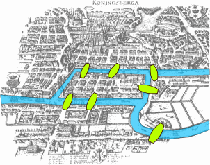
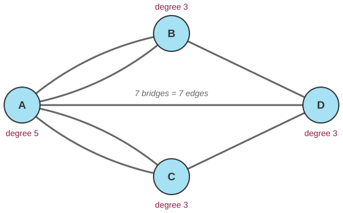
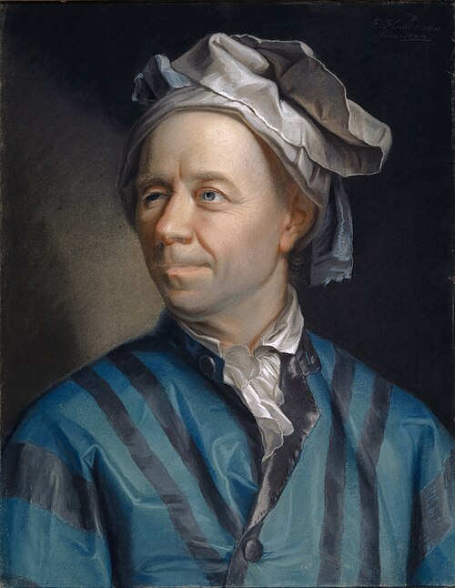

# The seven bridges of Königsberg

*Session 5 · Algorithms · example X05-B ·
[notebook](../notebooks/X05-B.ipynb) ·
[slides](../../Slides/Examples/05-Examples/ICSS-2026-05-Examples.qmd)*

> The townspeople tried every route. Euler reduced the city to four land
> masses and seven bridges and proved that no route existed. The difference
> between those two activities is the subject of this session.

## The puzzle

<!-- FIG -->
<figure class="side wide"><figcaption>Königsberg's seven bridges, on a map of the time. Map: Bogdan Giuşcă, CC BY-SA 3.0, via Wikimedia Commons.</figcaption></figure>
<!-- /FIG -->
Königsberg, now Kaliningrad, had seven bridges joining the two banks of the
Pregel and two islands. The puzzle everyone in town knew was to cross every
bridge exactly once. Nobody managed it, and in 1736 Leonhard Euler proved
that nobody ever would. How do you prove that no route exists, without trying
them all? And what is the right way to write the city down?

## Try it first

The [notebook](../notebooks/X05-B.ipynb) does both things. It tries all 5 040
orderings of the seven bridges and finds zero valid walks. Then it counts
degrees, removes one bridge, and shows that 48 walks appear.

## What is going on

<!-- FIG -->
<figure class="full"><figcaption>The city as a graph: four vertices, seven edges, and every degree odd.</figcaption></figure>
<!-- /FIG -->
Euler's move, the one the lecture is about, is *representation*. The map is
full of irrelevant information, the shape of the islands, the length of the
bridges, the streets. Reduce it to what matters: each land mass is a *vertex*
and each bridge an *edge*, so Königsberg is four vertices and seven edges.
The map has become a graph, and the puzzle has become the question whether
there is a walk that uses every edge exactly once. Now the argument. Every
time your walk passes through a land mass, you arrive by one bridge and leave
by another, so two bridges are used. For every vertex except where you start
and where you end, the number of bridges touching it must therefore be even,
and at most two vertices may have an odd number. Königsberg's four vertices
have degrees 5, 3, 3 and 3, all four odd. No walk exists, and not in the
sense that none has been found, but in the sense that none can.

This is a proof, and the brute force of the notebook is an algorithm, and it
is worth holding the two side by side. The brute force checks 5 040 orderings
and reports zero. It is correct, it is finite, and it tells you nothing about
a city with eight bridges. Euler's argument takes one line and settles every
city there will ever be. Session 9 is largely about the fact that computing
has both kinds of thing in it, procedures that produce answers and arguments
that some answers are impossible.

## The answer

Write the city as a graph. A walk over every edge needs at most two vertices
of odd degree, Königsberg has four, and therefore no walk exists. This holds
for any graph, which is what "prove" means here. The last cell of the
notebook removes the bridge between the south bank and the east island. Two
vertices become even, only two odd ones remain, and the brute-force search
finds 48 valid walks: the theorem cuts both ways.

## Why this matters if you work with data

<!-- FIG -->
<figure class="side"><figcaption><b>Leonhard Euler (1707–1783), whose 1736 paper on the bridges founded graph theory.</b> Photo: Jakob Emanuel Handmann, Public domain, via <a href="https://commons.wikimedia.org/wiki/File:Leonhard_Euler_-_Jakob_Emanuel_Handmann_(Kunstmuseum_Basel).jpg">Wikimedia Commons</a>.</figcaption></figure>
<!-- /FIG -->
Two lessons follow, one obvious and one less so. The obvious one is that
graphs are a representation, and choosing it is the first step of an
analysis. A friendship network, a citation network, a trade network and a
co-voting network each start with the question of what a vertex is and what
an edge is, and the answer decides what can be computed afterwards; the
adjacency lists and matrices of the lecture are the next step. The less
obvious one is that an impossibility result saves you the search. Before
building an algorithm to find something, it is worth asking whether a
counting argument shows that it does not exist. The exam question about
sorting eight things in ten comparisons has the same shape, and so does much
of session 9.

## What we used from the lecture

- [Graphs: vertices, edges, degree](../../Transcripts/05-Algorithms.md#7-graphs)
- [Representing graphs](../../Transcripts/05-Algorithms.md#8-representing-graphs)
- [The properties an algorithm must have](../../Transcripts/05-Algorithms.md#2-the-properties-an-algorithm-must-have):
  the brute force is one; Euler's argument is something else.

## Further reading

- Euler, L. (1736), *Solutio problematis ad geometriam situs pertinentis*,
  eight pages and the birth of graph theory. An English translation is in
  Biggs, Lloyd and Wilson (1976), *Graph Theory 1736–1936*.
