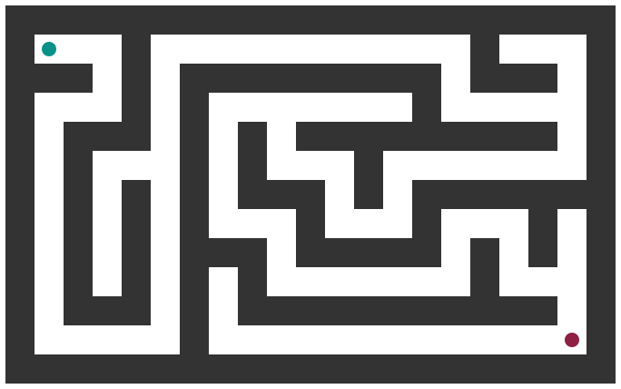
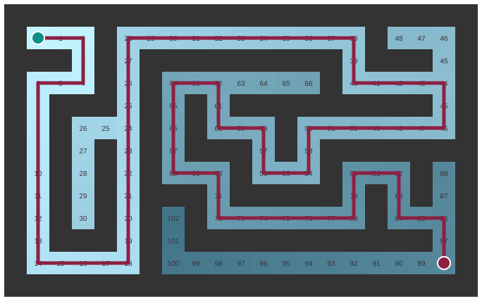

# Solve the maze without luck

*Session 5 · Algorithms · example X05-C ·
[notebook](../notebooks/X05-C.ipynb) ·
[slides](../../Slides/Examples/05-Examples/ICSS-2026-05-Examples.qmd)*

> A person solves a maze by looking. A program has to be told what to do at
> every junction, and then it can promise that the way out is the shortest.

## The puzzle

<!-- FIG -->
<figure class="full"><figcaption>The maze. Green in, red out.</figcaption></figure>
<!-- /FIG -->
Green in, red out. Write the rule: which cell do you look at next? How do you
avoid going round in circles? And how do you know that the path you found is
the shortest one?

## Try it first

The [notebook](../notebooks/X05-C.ipynb) has a small maze as text. Breadth-first
search solves it and prints the path; depth-first search solves the same maze
and prints a different, longer path. Change the maze and run it again.

## What is going on

<!-- FIG -->
<figure class="full"><figcaption>BFS distances from the entrance, shaded, and the shortest path found by following parent pointers back from the exit.</figcaption></figure>
<!-- /FIG -->
The first step is the one from X05-B: the maze is a graph. Every open cell is
a vertex, and two cells that share a side are joined by an edge. Once you see
that, "solve the maze" becomes "find a path from the start vertex to the goal
vertex", and the lecture has already given you the procedure. Breadth-first
search explores in order of distance. Put the start cell in a queue.
Repeatedly take the front cell, look at its neighbors, and enqueue any you
have not seen, recording for each one its distance, one more than the current
cell's, and its parent, the current cell. Stop when you dequeue the goal. The
numbers on the solved figure in the slides are exactly those recorded
distances, the search spreading outwards like a wave, and the red path is
what you get by following parents back from the exit. Why is that path
shortest? Because the queue releases cells in non-decreasing order of
distance, so the goal is first reached at the smallest distance at which it
can be reached. It is the same argument as for Erdős numbers, on a different
graph.

The second solver in the notebook swaps the queue for a stack. Now the newest
cell is explored first, so the search dives down one corridor as far as it
goes and backtracks only at dead ends. It still finds the exit, because the
visited set guarantees termination, but the path it reports is whatever
corridor it happened to commit to, and it is usually longer. Both procedures
are correct algorithms; only one answers the question "shortest".

## The answer

Breadth-first search with a queue, a visited set and parent pointers. It looks
at each reachable cell once, so the cost is proportional to the size of the
maze, and the first time it reaches the exit it has found a shortest path, by
construction rather than by luck.

## Why this matters if you work with data

A maze is a stand-in for any *state space*: positions in a game, sequences of
policy steps, configurations of a system, moves in a negotiation model. The
same three questions, what next, how to avoid revisiting and how to know you
are done, arise in every one of them, and BFS is the standard first answer.
The contrast between the two searches is worth keeping in mind for its own
sake:

| | breadth-first | depth-first |
|---|---|---|
| next cell | oldest discovered (queue) | newest discovered (stack) |
| finds | the shortest path | *a* path |
| memory | the whole frontier | one path |
| typical use | distances, contact tracing, Erdős numbers | recursion, cycle detection, exhaustive search |

Session 6 makes DFS a topic in its own right, because a recursive procedure
is a depth-first search of its call tree.

## What we used from the lecture

- [Representing algorithms](../../Transcripts/05-Algorithms.md#3-representing-algorithms)
  and [pseudocode](../../Transcripts/05-Algorithms.md#4-pseudocode): the rule
  has to be written down exactly.
- [Graphs](../../Transcripts/05-Algorithms.md#7-graphs),
  [representing graphs](../../Transcripts/05-Algorithms.md#8-representing-graphs),
  [breadth-first search](../../Transcripts/05-Algorithms.md#9-breadth-first-search).

## Further reading

- Cormen, Leiserson, Rivest and Stein (2009), *Introduction to Algorithms*,
  3rd ed., sections 22.2 and 22.3, breadth-first and depth-first search with
  worked traces.
