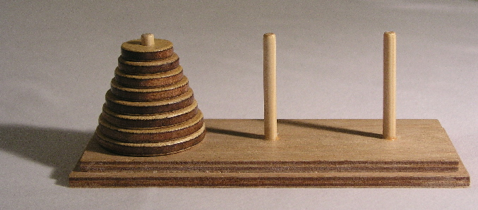
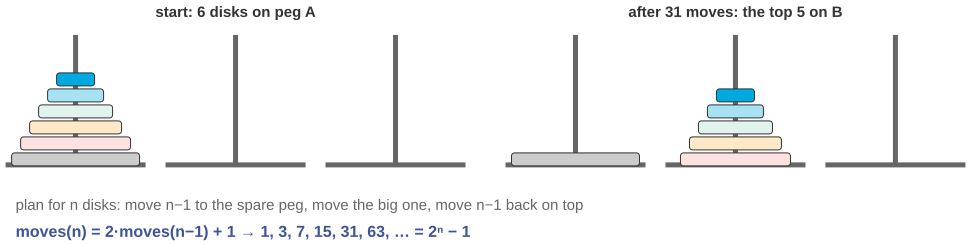
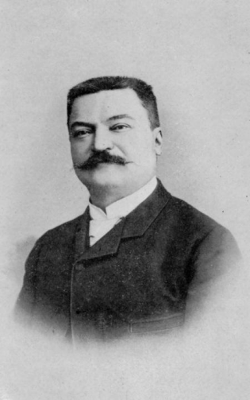

# The monks, the 64 disks, and the end of the world

*Session 6 · Recursion · example X06-A ·
[notebook](../notebooks/X06-A.ipynb) ·
[slides](../../Slides/Examples/06-Examples/ICSS-2026-06-Examples.qmd)*

> The procedure is four lines. The number of moves is exactly
> 18 446 744 073 709 551 615. Both facts come from the same recursion.

## The puzzle

<!-- FIG -->
<figure class="side wide"><figcaption>The puzzle as sold: three pegs, a stack of disks. Photo: CC BY-SA 3.0, via Wikimedia Commons.</figcaption></figure>
<!-- /FIG -->
The legend, invented by Édouard Lucas in 1883 along with the puzzle, goes
like this: in a temple, monks move 64 golden disks from one peg to another,
one disk at a time, never placing a larger disk on a smaller one, and when
they finish, the world ends. With three disks it takes 7 moves; with four,
15. How many moves for 64, and, the harder question, how do you write down
the procedure for moving them, for any number of disks?

## Try it first

The [notebook](../notebooks/X06-A.ipynb) solves three disks and prints every
move, counts the moves for one to ten disks, converts $2^{64}-1$ seconds into
years, and measures how deep the recursion actually goes.

## What is going on

<!-- FIG -->
<figure class="full"><figcaption>The recursive plan: move n−1 aside, move the largest, move n−1 back.</figcaption></figure>
<!-- /FIG -->
Try to write the procedure as a loop and you get stuck immediately: which
disk moves first depends on $n$, and the pattern of moves for 5 disks is not a
simple extension of the pattern for 4. Now describe the plan instead of the
moves. To move $n$ disks from A to C, move the top $n-1$ disks from A to B, out
of the way; move the largest disk from A to C; and move the $n-1$ disks from B
to C, on top of it. The first and the third step are the same problem, one
disk smaller, which is the *recursive case* of the lecture, and when $n = 0$
there is nothing to do, which is the *base case* that stops the descent. Four
lines of code, and they work for any $n$, because the plan is self-similar:
the solution to the big problem is built out of two solutions to a smaller
one.

The move count falls out of the same structure. If $M(n)$ is the number of
moves for $n$ disks, the plan says $M(n) = 2M(n-1) + 1$ with $M(1) = 1$. Unroll
it and you get 1, 3, 7, 15, 31, 63 and so on, which is $2^n - 1$. For 64 disks
that is $2^{64} - 1 = 18\,446\,744\,073\,709\,551\,615$, and at one move per
second it takes about 585 billion years, some forty times the current age of
the universe. The world is safe. One more thing the notebook measures, because
students conflate the two: the recursion is $n$ levels deep but $2^n - 1$
calls wide. The program stack never holds more than 64 frames, which is
trivial; it is the number of calls that explodes. Exponential work and linear
depth, and the fractal tree of X06-B makes the same point with a picture.

## The answer

$2^{64} - 1$ moves. The procedure: move $n-1$ disks aside, move the largest,
move the $n-1$ back, with "move zero disks" as the base case. The recurrence
$M(n) = 2M(n-1)+1$ is read straight off the code.

## Why this matters if you work with data

<!-- FIG -->
<figure class="side"><figcaption><b>Édouard Lucas (1842–1891), who invented the puzzle and its legend in 1883.</b> Photo: unknown author, Public domain, via <a href="https://commons.wikimedia.org/wiki/File:Elucas_1.png">Wikimedia Commons</a>.</figcaption></figure>
<!-- /FIG -->
Hanoi is the cleanest possible example of the thing the lecture wants you to
recognize, a problem whose solution contains smaller copies of itself. When
you see that shape, recursion is not a trick but the natural way to write the
solution, and the iterative version is the contortion. Data with that shape is
everywhere in social science: organizational hierarchies, nested comment
threads, family trees, file systems, grammatical parses, and the recursive
definition of a citizen of Simpleland in the main deck. The count is also a
warning. A correct recursive procedure can do an exponential amount of work;
session 8 gives the notation, and the dynamic-programming section of session
6 gives the cure when the subproblems overlap.

## What we used from the lecture

- [The three parts of a recursive definition](../../Transcripts/06-Recursion.md#2-the-three-parts-of-a-recursive-definition)
- [How recursion runs: the program stack](../../Transcripts/06-Recursion.md#4-how-recursion-runs-the-program-stack)
- [Types of recursion](../../Transcripts/06-Recursion.md#7-types-of-recursion):
  two recursive calls make this tree recursion.

## Further reading

- Lucas, É. (1883), the original puzzle, sold under the name "Tower of Hanoi"
  with the legend printed on the box.
- Graham, Knuth and Patashnik (1994), *Concrete Mathematics*, 2nd ed.,
  chapter 1, where the recurrence is solved properly and a lower bound shows
  that $2^n - 1$ cannot be beaten.
