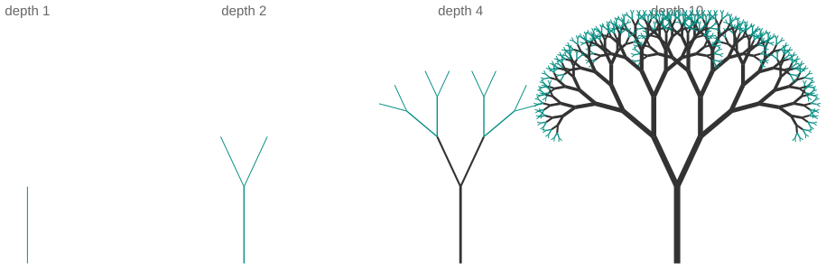

# Draw this tree in five lines

*Session 6 · Recursion · example X06-B ·
[notebook](../notebooks/X06-B.ipynb) ·
[slides](../../Slides/Examples/06-Examples/ICSS-2026-06-Examples.qmd)*

> A tree is a segment with two smaller trees on top. Write that sentence as
> code and the picture draws itself.

## The puzzle

<!-- FIG -->
<figure class="full"><figcaption>The same five-line procedure at depths 1, 2, 4 and 10.</figcaption></figure>
<!-- /FIG -->
The slide shows four drawings of a branching tree; the last has 512 branch
tips and 1 023 segments. A loop that draws it would need to know how many
levels there are, where every branch starts and what angle it points at. What
is the shortest program that draws it, and why does it look so much like a
definition of a tree?

## Try it first

The [notebook](../notebooks/X06-B.ipynb) draws four trees with one five-line
function, counts the segments, and prints the depth of the recursion beside
the number of calls. Change the angle and the shrink factor at the top and
run it again to grow a different species.

## What is going on

Describe the picture recursively: a tree of depth $d$ is a line segment, with
a tree of depth $d-1$ growing from its tip at 25° to the left and another at
25° to the right, each 0.72 times as long, and a tree of depth 0 is nothing.
That sentence is the program:

```
Procedure TREE(x, y, angle, length, depth)
Inputs:
      x, y: where the segment starts
      angle, length: its direction and size
      depth: how many levels remain
Result: a tree of the given depth is drawn
If depth = 0
      then return                                    # base case
draw a segment from (x, y) at angle, of length; its end is tip
TREE(tip, angle − 25°, 0.72 · length, depth − 1)
TREE(tip, angle + 25°, 0.72 · length, depth − 1)
```

Two recursive calls per level make this *tree recursion* in the
classification of the lecture, the same shape as Hanoi in X06-A and as
depth-first search on a tree. Each level doubles the number of segments, so a
tree of depth $d$ has $2^d - 1$ segments and $2^{d-1}$ tips, and depth 10 gives
1 023 and 512. The last cell of the notebook separates two numbers that are
easy to confuse. The work, the number of segments drawn, is exponential in the
depth. But the program stack only ever holds the calls that are currently
waiting, one per level, so at most `depth` frames. At depth 20 that is a
million segments and twenty stack frames: exponential work, linear memory.
When a recursion blows Python's default limit of about 1 000 frames, it is
because the recursion is deep, not because it does a lot of work.

## The answer

The five-line procedure above. It looks like the definition of the tree
because it is the definition of the tree, read as instructions: base case,
draw, recurse left, recurse right.

## Why this matters if you work with data

This is the example to remember when you meet self-similar structure, because
you will recognize the code before you recognize the data. Rendering a nested
comment thread is a post, then each reply rendered as a thread. Computing the
size of a directory is this file's size plus the size of each subdirectory.
The headcount below a manager is one plus the headcount below each report.
Evaluating an arithmetic or logical expression is this operator applied to
the evaluation of each subexpression. In each case the loop version needs to
know the depth in advance and the recursive version does not, and in each
case the depth of the data, not its total size, is what bounds the stack.

## What we used from the lecture

- [Base case and recursive case](../../Transcripts/06-Recursion.md#2-the-three-parts-of-a-recursive-definition)
- [The program stack](../../Transcripts/06-Recursion.md#4-how-recursion-runs-the-program-stack)
- [Types of recursion](../../Transcripts/06-Recursion.md#7-types-of-recursion):
  tree versus linear.

## Further reading

- Mandelbrot, B. (1982), *The Fractal Geometry of Nature*, where the
  vocabulary of self-similarity comes from.
- Python's `turtle` module draws the same tree interactively; search for
  "turtle fractal tree" for a dozen one-page versions.
