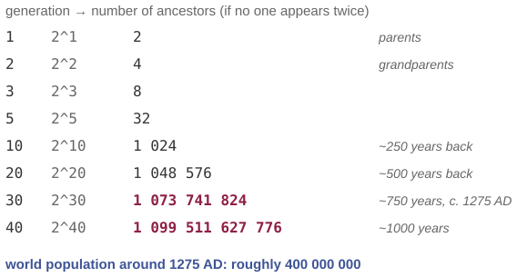

# You have more ancestors than there were people

*Session 6 · Recursion · example X06-C ·
[notebook](../notebooks/X06-C.ipynb) ·
[slides](../../Slides/Examples/06-Examples/ICSS-2026-06-Examples.qmd)*

> Two parents, four grandparents, a billion ancestors in the year 1275, in a
> world of 400 million. The recursion is correct. Find the assumption.

## The puzzle

<!-- FIG -->
<figure class="full"><figcaption>Ancestor slots double every generation; the population does not.</figcaption></figure>
<!-- /FIG -->
Thirty generations back is roughly the year 1275. Doubling each generation,
that is $2^{30} \approx 1.07$ billion ancestors. The world's population at the
time was about 400 million. Where is the mistake? Write the recursive
definition that produced $2^{30}$, and find the assumption that makes it wrong.

## Try it first

The [notebook](../notebooks/X06-C.ipynb) prints the doubling table, then
simulates forty generations of a small closed population in which every
person has two parents drawn from the previous generation, and counts
distinct ancestors of one person generation by generation. The last cell
fixes the count with a visited set.

## What is going on

The definition is short and, as a recursion, correct:

$$\text{ancestors}(0) = 1, \qquad \text{ancestors}(g) = 2 \cdot \text{ancestors}(g-1).$$

It counts ancestor slots, the positions in a family tree. The unstated
assumption is that every slot is filled by a different person, in other words
that the family tree is a tree. It is not. Far enough back, your mother's line
and your father's line share people, and further back still the same
individual turns up in thousands of slots. This is *pedigree collapse*, and it
is universal rather than a sign of anything unusual in your family: with
$2^{30}$ slots and fewer than $2^{29}$ people alive, collapse is arithmetically
unavoidable. The graph of the genealogists is a *directed acyclic graph*, a
DAG, wearing a tree's name. The simulation makes this visible in a population
of 500. For the first five generations the count of distinct ancestors
doubles exactly as the recursion predicts; from the sixth it falls behind,
and by the twelfth it has saturated near the population size. The slots keep
doubling and the people do not.

Now the connection to the rest of the session. Tree recursion over a DAG
over-counts shared nodes, because it visits the same grandparent once for
each path leading to them. The depth-first search of the lecture carries a
visited set for precisely this reason, and the last cell of the notebook uses
one: DFS over forty generations of the ancestry graph counts 12 461 distinct
people where tree recursion would have counted $2^{41} - 2$ slots. Dynamic
programming is the same idea one step further. When the subproblems overlap,
compute each once and remember it, which is what turns the exponential
Fibonacci into a linear one.

## The answer

The recursion is right for a tree, and your ancestry is not a tree: the same
people occupy many slots, and the count of distinct ancestors saturates at the
population. To count correctly you count each person once, with a visited set
in DFS or with memoization in dynamic programming.

## Why this matters if you work with data

The general form of the mistake is assuming that the data has a shape it does
not have, and it is common in network and genealogical data. Counting the
people within two steps of someone without removing duplicates double-counts
everyone reachable by two routes. Summing the sizes of subdirectories
double-counts hard links. A recursive "total influence" score over a citation
network that is not a tree counts a paper once per path to it and explodes.
The fix is always to ask what happens when two paths reach the same node, and
to keep a visited set if the answer is that it gets counted twice.

## What we used from the lecture

- [The three parts of a recursive definition](../../Transcripts/06-Recursion.md#2-the-three-parts-of-a-recursive-definition),
  including what the definition assumes about its data.
- [Depth-first search](../../Transcripts/06-Recursion.md#6-depth-first-search):
  the visited set.
- [Dynamic programming](../../Transcripts/06-Recursion.md#8-dynamic-programming):
  overlapping subproblems, computed once.

## Further reading

- Chang, J. T. (1999), "Recent common ancestors of all present-day
  individuals", *Advances in Applied Probability* 31(4): with enough
  generations, everyone alive shares an ancestor only about $\log_2 n$
  generations back.
- Shoumatoff, A. (1985), *The Mountain of Names*, pedigree collapse for a
  general reader.
