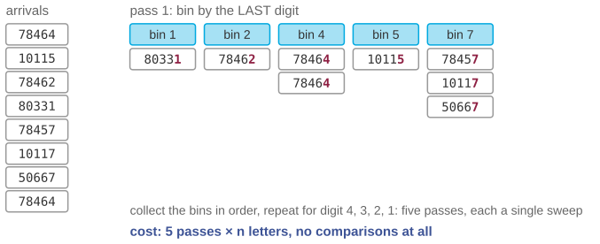
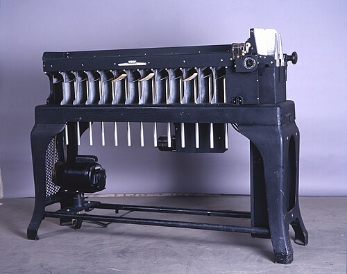

# How the post office sorts 20 million letters a night

*Session 7 · Sorting Algorithms · example X07-A ·
[notebook](../notebooks/X07-A.ipynb) ·
[slides](../../Slides/Examples/07-Examples/ICSS-2026-07-Examples.qmd)*

> Mergesort needs half a billion comparisons for twenty million letters. The
> sorting machines make none. The trick is more than a century old, and it
> only works because each pass is stable.

## The puzzle

<!-- FIG -->
<figure class="side wide"><figcaption><b>A postal sorting center: letters routed by postcode, no two ever compared.</b> Photo: Mike Peel, CC BY-SA 2.0 uk, via <a href="https://commons.wikimedia.org/wiki/File:BLW_Automated_postal_sorting_equipment_(2).jpg">Wikimedia Commons</a>.</figcaption></figure>
<!-- /FIG -->
Deutsche Post sorts on the order of 20 million letters a night by their
five-digit postcode, tens of thousands per hour per machine, far faster than
any comparison between two letters could be made. Mergesort would need about
$n \log_2 n \approx 5 \times 10^8$ comparisons. The machines do none. How?

## Try it first

The [notebook](../notebooks/X07-A.ipynb) sorts eight postcodes one digit at a
time and prints the pile after every pass. Then it breaks the algorithm by
making one pass unstable, and finally times it against Python's built-in sort
on 300 000 codes.

## What is going on

<!-- FIG -->
<figure class="full"><figcaption>The first pass of radix sort: bin by the last digit, collect the bins in order, repeat.</figcaption></figure>
<!-- /FIG -->
The method is *radix sort*, and it is older than computers: Hollerith's
tabulating equipment sorted punched cards this way from the 1890 US census
on. Put each letter into one of ten bins according to its last digit. Collect
the bins in order, 0 to 9. Now repeat for the fourth digit, then the third,
the second and the first. After five passes the pile is sorted. No letter is
ever compared with another; the digit is used directly as a bin number. The
cost is five passes over $n$ letters, $O(d \cdot n)$ with $d$ the number of
digits, which is linear in $n$. That looks like a contradiction of the lower
bound in the lecture, and this is the point worth understanding: the bound of
$n \log n$ applies to *comparison* sorts, which learn about the input only by
asking whether $a < b$. Radix sort knows something extra, that the keys are
short strings over a small alphabet, and uses it. Extra knowledge about the
input is what lets you go under the bound.

Now the subtle part, which is why this example belongs in the session on
stability. Why sort by the last digit first? Because after the second pass,
on the fourth digit, letters with the same fourth digit must still be in the
order the first pass gave them, or the ordering by the last digit is
destroyed. That is exactly the definition of a *stable* sort: equal keys keep
their relative order. Each pass must be stable, and the bins must be
collected in order, or the earlier passes are undone. The version in the
notebook that inserts at the front of each bin reverses the order within the
bins, and the whole thing silently fails to sort.

## The answer

Radix sort: bin by each digit from the last to the first, keeping each pass
stable. Five linear passes instead of $n \log n$ comparisons, possible because
the keys are five decimal digits and the machine can use a digit as an
address.

## Why this matters if you work with data

<!-- FIG -->
<figure class="side"><figcaption><b>A punched-card sorter, the same algorithm in hardware from the 1890s to the 1960s.</b> Photo: Tekniska museet, CC BY 4.0, via <a href="https://commons.wikimedia.org/wiki/File:IBM_080_(2).jpg">Wikimedia Commons</a>.</figcaption></figure>
<!-- /FIG -->
Three things follow. Stability is not a footnote. The example in the lecture
is sorting a table by region and then by age and expecting the regions to
stay grouped within each age, and radix sort is the same requirement iterated
five times. Python's `sorted` is stable and says so; many library sorts are
not, and most do not say. Counting-based sorts are the practical tool for
small keys. Sorting a million respondents by age, by region code or by a
Likert score is a counting sort, linear, and NumPy's stable sort uses a radix
sort for 16-bit and smaller integer keys; the counting-sort trace in the exam
pool is the one-digit case of this algorithm. And lower bounds have
preconditions. "You cannot sort faster than $n \log n$" is true of comparison
sorts and false the moment you know more about the keys. Knowing which
assumptions a theorem makes is the difference between being stuck and being
done.

## What we used from the lecture

- [Stable and unstable sorting](../../Transcripts/07-SortingAlgorithms.md#3-stable-and-unstable-sorting)
- [Why sorting matters for us](../../Transcripts/07-SortingAlgorithms.md#9-why-sorting-matters-for-us),
  and the comparison lower bound it escapes.

## Further reading

- Cormen, Leiserson, Rivest and Stein (2009), *Introduction to Algorithms*,
  3rd ed., chapter 8, "Sorting in Linear Time": counting sort, radix sort,
  and the proof that stability is required.
