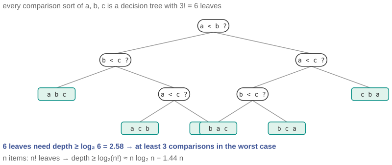

# Can you sort 8 things in 10 comparisons?

*Session 7 · Sorting Algorithms · example X07-B ·
[notebook](../notebooks/X07-B.ipynb) ·
[slides](../../Slides/Examples/07-Examples/ICSS-2026-07-Examples.qmd)*

> A colleague claims an algorithm that sorts any eight items in ten
> comparisons. You have not seen it. You can still prove that it does not
> exist.

## The puzzle

Selection sort needs 28 comparisons for 8 elements; mergesort about 17. A
colleague says they have a comparison-based algorithm that sorts any 8
elements in at most 10. What is the smallest number of comparisons any
algorithm needs in the worst case, and how can you know that about
algorithms nobody has written yet?

## Try it first

The [notebook](../notebooks/X07-B.ipynb) prints $\lceil \log_2 n! \rceil$ for
$n$ up to 10, then runs mergesort on every permutation of up to seven
elements with a counting comparator and shows that its worst case never dips
below the bound.

## What is going on

<!-- FIG -->
<figure class="full"><figcaption>The full decision tree for sorting three elements: six leaves, so depth at least three.</figcaption></figure>
<!-- /FIG -->
The argument is the lower-bound proof of the lecture, and it is short enough
to carry in your head. Any comparison sort, whatever its code, does the
following: it asks whether $a_i < a_j$, branches on the answer, asks another
question, branches again, and eventually stops and declares an order. Draw
every possible run as a *decision tree*: internal nodes are comparisons, the
two children are the two answers, and each leaf is a final ordering. To be
correct, the algorithm must be able to output every one of the $n!$ possible
orderings, because any of them might be the right one, so the tree needs at
least $n!$ leaves. A binary tree with $L$ leaves has depth at least $\log_2
L$, and the depth of the tree is the number of comparisons in the worst
case. Therefore

$$\text{worst-case comparisons} \;\ge\; \lceil \log_2 n! \rceil.$$

For $n = 8$, $8! = 40\,320$ and $\log_2 40\,320 = 15.3$, so at least 16. A
tree of depth 10 has at most $2^{10} = 1\,024$ leaves, nowhere near enough;
ten comparisons cannot distinguish forty thousand cases. Stirling's
approximation turns this into the familiar statement $\log_2 n! \approx n
\log_2 n - 1.44\,n$, which is why $O(n \log n)$ is not just what mergesort
achieves but the best any comparison sort can do. The notebook shows the
measured worst case of mergesort sitting at the bound for $n$ up to 4 and one
comparison above it for $n$ from 5 to 7. The true optimum for 8 is exactly
16, reached by a specialized algorithm, Ford-Johnson, that nobody uses in
practice.

## The answer

At least 16 comparisons for 8 elements, in the worst case, for every
comparison-based algorithm that exists or ever will. The proof is a counting
argument about decision trees, and it does not need to see the code.

## Why this matters if you work with data

<!-- FIG -->
<figure class="side"><figcaption><b>Donald Knuth, whose Art of Computer Programming vol. 3 settles the small cases exactly.</b> Photo: Alex Handy, CC BY-SA 2.0, via <a href="https://commons.wikimedia.org/wiki/File:Donald_Ervin_Knuth_(cropped).jpg">Wikimedia Commons</a>.</figcaption></figure>
<!-- /FIG -->
The rhetorical point is the important one: this is a statement about every
possible program, proved on one slide. Session 9 is built out of statements
like that, about what finite automata cannot recognize and what no program
can decide, and this is the first one you meet in the course. It is worth
noticing how different it feels from timing a script. The practical points
are three. Sorting is essentially solved: mergesort and its relatives are
within a constant of optimal, there is no clever algorithm waiting to be
discovered that beats them by more than that, and time spent looking for one
is wasted. The bound has a precondition, the word *comparison*; X07-A shows
how to go under it by using the keys as addresses, and knowing what a theorem
assumes tells you where to look for an escape. And intuition at small $n$
misleads: 28 against 17 against 16 sounds like there is room, and the bound
says there is almost none.

## What we used from the lecture

- [The formal sorting problem](../../Transcripts/07-SortingAlgorithms.md#2-the-formal-problem)
- [Mergesort](../../Transcripts/07-SortingAlgorithms.md#6-mergesort)
- [Why sorting matters for us](../../Transcripts/07-SortingAlgorithms.md#9-why-sorting-matters-for-us):
  the lower-bound argument.

## Further reading

- Knuth, D. E. (1998), *The Art of Computer Programming*, vol. 3, 2nd ed.,
  section 5.3.1, the exact minimum number of comparisons for small $n$ and
  the history of finding them.
