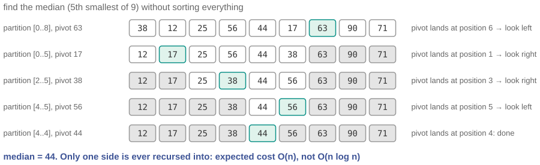

# The median of a billion salaries, without sorting

*Session 7 · Sorting Algorithms · example X07-C ·
[notebook](../notebooks/X07-C.ipynb) ·
[slides](../../Slides/Examples/07-Examples/ICSS-2026-07-Examples.qmd)*

> You asked for one number. Sorting gives you a billion sorted positions and
> throws away all but one. The partition step of quicksort can be pointed at
> the one you want.

## The puzzle

A ministry wants the median income across a billion records. The obvious
plan, sort and take the middle, costs about $30 \times 10^9$ comparisons and
a full copy of the data. But the median is one value, and the other
999 999 999 sorted positions are discarded. Is there a way to find the $k$-th
smallest element without putting all the others in order? What in the toolkit
of this session gets you halfway?

## Try it first

The [notebook](../notebooks/X07-C.ipynb) implements Quickselect on top of the
partition function from the quicksort slides, checks it against `sorted`, and
counts comparisons on random data of growing size: about $3n$, against
$n \log_2 n$ for a sort.

## What is going on

<!-- FIG -->
<figure class="full"><figcaption>Quickselect on nine numbers: each partition narrows the active region until the pivot lands on the median.</figcaption></figure>
<!-- /FIG -->
The halfway tool is PARTITION from quicksort. Given a subarray, it picks a
pivot, moves everything smaller to the left and everything larger to the
right, and puts the pivot in its final sorted position $q$, all in one pass.
Quicksort then recurses on both sides. Here is the observation, due to Hoare
in 1961: if you only want the element at position $k$, you only need to
recurse on the side that contains $k$. If $q = k$, the pivot is the answer and
you are done. If $q > k$, the answer is somewhere to the left, and the right
side never needs to be touched, let alone sorted. If $q < k$, symmetrically.
The trace on the slide shows the active region shrinking with every partition
until the pivot lands on position 5 of 9. That one change, recursing on one
side instead of two, changes the cost class. Each partition costs the length
of the current region, and on average the region halves each time, so the
total is about $n + n/2 + n/4 + \cdots$, a geometric series that sums to less
than $2n$. Linear, not $n \log n$; the notebook measures roughly $3n$
comparisons for the median in practice, and the exact expectation is about
$3.4n$. The worst case is the same as for quicksort: bad pivots shrink the
region by one element at a time and the cost is $O(n^2)$. In practice random
pivots make that vanishingly rare, and in theory the median-of-medians pivot
rule makes the worst case linear too, at a constant factor nobody wants to
pay.

## The answer

Quickselect: partition, then recurse into only the side containing the
position you want. Expected $O(n)$, a single pass's worth of work, instead of
$O(n \log n)$, and no copy of the data. It is quicksort with one recursive
call deleted.

## Why this matters if you work with data

<!-- FIG -->
<figure class="side"><figcaption><b>Tony Hoare, who published Find (quickselect) in 1961 alongside quicksort.</b> Photo: Rama, CC BY-SA 2.0 fr, via <a href="https://commons.wikimedia.org/wiki/File:Sir_Tony_Hoare_IMG_5125.jpg">Wikimedia Commons</a>.</figcaption></figure>
<!-- /FIG -->
Medians, quartiles and percentiles are the bread and butter of descriptive
statistics, and they are order statistics, exactly what Quickselect computes.
NumPy's `partition`, `percentile` and `median` use this algorithm rather than
a full sort, while Python's own `statistics.median` simply sorts, which is
fine at the sizes it is meant for. On a billion records the difference
between $n$ and $n \log n$ is the difference between one pass and thirty. The
broader lesson is the one this session keeps returning to: do not compute
what you did not ask for. Sorting is a means, and when the end is a single
value there may be a shorter route. The same question, whether you need the
whole ordering or one fact about it, applies to membership, where session 3
gives you a hash set rather than a sort, to the maximum, which is one pass,
and to the top ten, which is a heap of size ten.

## What we used from the lecture

- [Divide and conquer](../../Transcripts/07-SortingAlgorithms.md#5-divide-and-conquer)
- [Quicksort](../../Transcripts/07-SortingAlgorithms.md#7-quicksort): the
  PARTITION procedure.
- The geometric series is [session 8](../../Transcripts/08-TimeComplexity.md).

## Further reading

- Hoare, C. A. R. (1961), "Algorithm 65: Find", *Communications of the ACM*
  4(7), half a page.
- Blum, Floyd, Pratt, Rivest and Tarjan (1973), "Time bounds for selection",
  *Journal of Computer and System Sciences* 7(4), the deterministic
  linear-time version.
