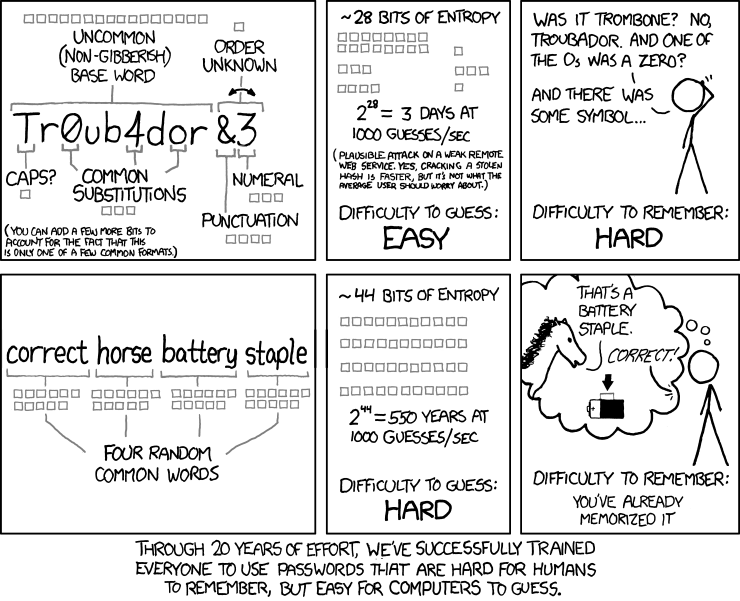
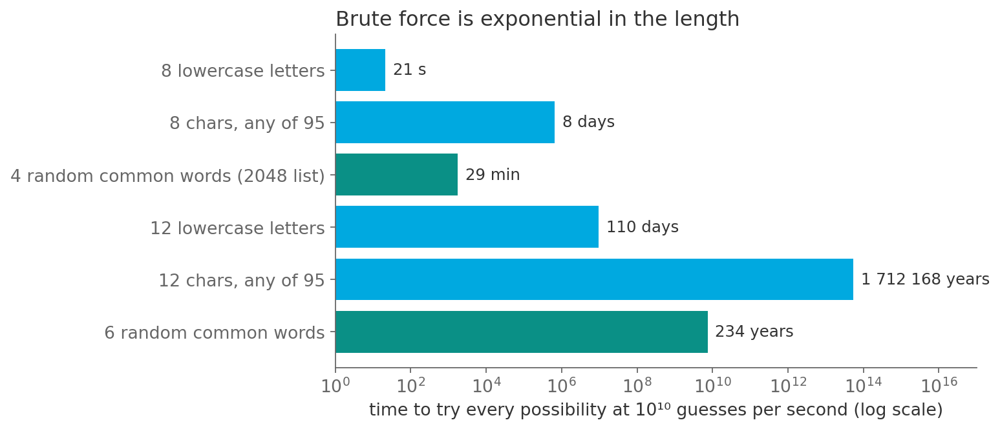

# Tr0ub4dor&3 or correct horse battery staple?

*Session 8 · Time Complexity · example X08-A ·
[notebook](../notebooks/X08-A.ipynb) ·
[slides](../../Slides/Examples/08-Examples/ICSS-2026-08-Examples.qmd)*

> Which password is stronger, and why "strong" is a growth rate. The comic is
> right, and the reason is the whole of this session in one formula.

## The puzzle

<!-- FIG -->
<figure class="full"><figcaption>XKCD 936, the comic that started the argument. Randall Munroe, CC BY-NC 2.5, xkcd.com/936.</figcaption></figure>
<!-- /FIG -->
XKCD 936 puts two passwords side by side: `Tr0ub4dor&3`, eleven characters
with a capital, a digit and a symbol, and `correct horse battery staple`,
four common words. The comic claims that the second is stronger and easier
to remember. Is that true? What does "strong" measure, and why does adding
one more word do more than adding a symbol?

## Try it first

The [notebook](../notebooks/X08-A.ipynb) computes the time to try every
possibility for six kinds of password, then actually brute-forces three-,
four- and five-letter passwords and times it, so that you can watch each
extra letter multiply the time by 26.

## What is going on

<!-- FIG -->
<figure class="full"><figcaption>Time to try every possibility at ten billion guesses per second, on a log axis.</figcaption></figure>
<!-- /FIG -->
Guessing a password is a search. If the password is $L$ symbols long from an
alphabet of $|A|$ symbols, there are $|A|^L$ possibilities, and an attacker
who tries them all needs $|A|^L$ guesses. The thing to stare at is where the
two numbers sit: the alphabet is the base and the length is the exponent. At
$10^{10}$ guesses per second, a realistic rate for an offline attack on a
weakly hashed password file, the table in the notebook reads:

| password | possibilities | time |
|---|---|---|
| 8 lowercase letters | $26^8 \approx 2 \times 10^{11}$ | 21 seconds |
| 8 characters from 95 symbols | $95^8 \approx 7 \times 10^{15}$ | 8 days |
| 4 words from a 2 048-word list | $2048^4 = 2^{44}$ | 29 minutes |
| 12 lowercase letters | $26^{12}$ | 110 days |
| 6 words from a 2 048-word list | $2048^6 = 2^{66}$ | 234 years |

Four random words are weaker than eight random symbols, since the comic's own
numbers assume a slower online attacker, but six words beat everything above
them. Two extra words multiplied the work by $2048^2 \approx 4$ million,
whereas adding a symbol to an 8-character password multiplied it by about 95.
That asymmetry is exponential growth. Every extra character multiplies the
attacker's work by $|A|$, and every improvement in hardware only divides it by
a constant. A 100× faster attacker turns 234 years into 2.3 years, and one
more word turns 2.3 years back into 4 800. The exponent always wins in the
end, which is the point the lecture makes about $2^n$ against every
polynomial. The "easy to remember" half of the comic is the same fact from
the other side: humans remember words, and a word from a 2 048-word list
carries 11 bits of unpredictability, as much as two random characters, at a
fraction of the effort.

## The answer

The comic is right. Strength is the number of possibilities, $|A|^L$; length
is the exponent, so adding a word multiplies the search by 2 048 where adding
a symbol multiplies it by 95. And because the growth is exponential, no
foreseeable hardware improvement catches up with a couple of extra words.

## Why this matters if you work with data

Beyond choosing a password, this is the shape to recognize whenever a problem
has a length. Brute-force search over sequences, whether assignments,
schedules or model specifications, costs $|A|^L$ and becomes impossible at
modest $L$, which is why the NP-complete problems of session 9 are hard.
Enumerating all subsets of $n$ variables is $2^n$, so trying every combination
of controls stops being a plan at about $n = 30$. A grid search over $k$
hyperparameters with $m$ values each is $m^k$. The defense is always the same:
change the exponent, or find a method that does not enumerate. Speeding up the
enumeration is a constant factor and does not help.

## What we used from the lecture

- [Why it matters: some numbers](../../Transcripts/08-TimeComplexity.md#3-why-it-matters-some-numbers)
- [Asymptotic behavior and O-notation](../../Transcripts/08-TimeComplexity.md#8-asymptotic-behavior-and-o-notation):
  polynomial versus exponential.
- [Using O-notation](../../Transcripts/08-TimeComplexity.md#9-using-o-notation)

## Further reading

- XKCD 936 (CC BY-NC 2.5), the comic itself; the "explain xkcd" wiki works
  through the entropy calculation.
- The Hashcat benchmark tables, with real guess rates per hash algorithm,
  which shift every row of the table above by up to six orders of magnitude.
