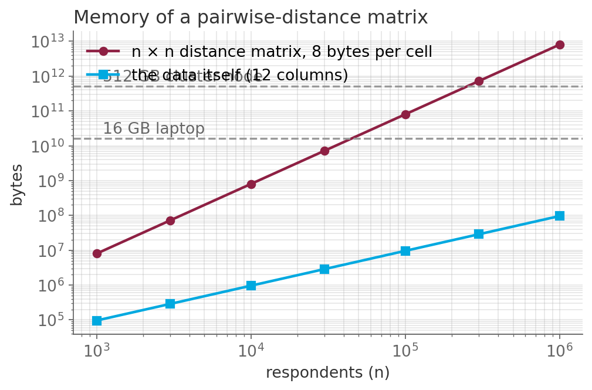

# The clustering script that ran out of memory at 100 000

*Session 8 · Time Complexity · example X08-B ·
[notebook](../notebooks/X08-B.ipynb) ·
[slides](../../Slides/Examples/08-Examples/ICSS-2026-08-Examples.qmd)*

> It worked on the pilot. Ten times the data asked for a hundred times the
> memory, and an allocation that does not fit never starts. Complexity is not
> only about time.

## The puzzle

A student clusters survey respondents by computing the distance between every
pair and feeding the matrix to a clustering routine. The 10 000-respondent
pilot takes a minute. The full 100 000 crash:

```
MemoryError: Unable to allocate 74.5 GiB for an array
with shape (100000, 100000) and data type float64
```

Ten times the data asked for a hundred times the memory. Which number in the
code decides that, and what does the full million-respondent panel need?

## Try it first

The [notebook](../notebooks/X08-B.ipynb) computes the matrix size for four
values of $n$, allocates the matrix for the safe ones and prints their byte
counts, then runs one step of K-means on 100 000 rows to show what an
algorithm that never forms the matrix costs instead.

## What is going on

<!-- FIG -->
<figure class="full"><figcaption>Memory of an n × n distance matrix against the data itself, with a laptop and a cluster node marked.</figcaption></figure>
<!-- /FIG -->
$n$ respondents have $n^2$ pairs. A distance for every pair, at 8 bytes per
double, is $8n^2$ bytes:

| $n$ | matrix | the data itself (12 columns) |
|---|---|---|
| 10 000 | 0.8 GB | 1 MB |
| 100 000 | 80 GB | 10 MB |
| 1 000 000 | 8 TB | 96 MB |

The data grows linearly and stays tiny; the matrix grows quadratically and
outruns any machine at around a quarter of a million rows. The number in the
code that decides this is the exponent, the $n \times n$ in the array shape,
and it is visible before you run anything. This is *memory complexity*, the
second kind of complexity in the lecture, and it is in one way harsher than
time complexity: a slow job finishes late, but an oversized allocation does
not start at all, and there is no "wait longer".

The escape is an algorithm with a different shape. K-means compares each
point with $K$ centers rather than with every other point, so its memory per
step is $O(nK)$. For $n = 100\,000$ and $K = 5$ that is 4 MB where the pairwise
matrix was 80 GB. Hierarchical clustering, which genuinely needs pairwise
distances, is limited to tens of thousands of points for exactly this reason,
and approximate nearest-neighbor methods exist to break that limit by never
computing most of the pairs. The general lesson the lecture draws is the one
that hurt here: a pilot on a subsample cannot reveal a quadratic term. The
pilot ran fine because $8 \times 10^8$ bytes fit, and nothing about that run
hinted at $8 \times 10^{10}$. Only reading the code does.

## The answer

The $n^2$ in the shape of the distance matrix. At $10^6$ respondents it needs
8 terabytes. Use an algorithm that does not materialize all pairs, such as
K-means at $O(nK)$, or accept a subsample for the pairwise method.

## Why this matters if you work with data

Quadratic memory hides in ordinary operations. Pairwise distances, correlation
matrices of observations rather than of variables, and the linkage matrix of
hierarchical clustering are all $n \times n$. A Cartesian join, which session
11 meets, pairs every row of one table with every row of another. One-hot
encoding of a high-cardinality categorical variable is $n$ times the number
of categories and can quietly be a hundred gigabytes. Before running on the
full data, write down the size of the largest object the code creates as a
function of $n$. If the exponent is 2, decide now whether the full $n$ fits.

## What we used from the lecture

- [Three kinds of complexity](../../Transcripts/08-TimeComplexity.md#2-three-kinds-of-complexity):
  time and memory.
- [Asymptotic behavior and O-notation](../../Transcripts/08-TimeComplexity.md#8-asymptotic-behavior-and-o-notation)
- [Using O-notation](../../Transcripts/08-TimeComplexity.md#9-using-o-notation):
  reading the $n^2$ off the code.
- K-means itself is [session 10](../../Transcripts/10-MachineLearning.md#10-unsupervised-learning-and-clustering).

## Further reading

- The scikit-learn user guide, section on hierarchical clustering, on why
  agglomerative clustering does not scale to large samples without
  connectivity constraints.
