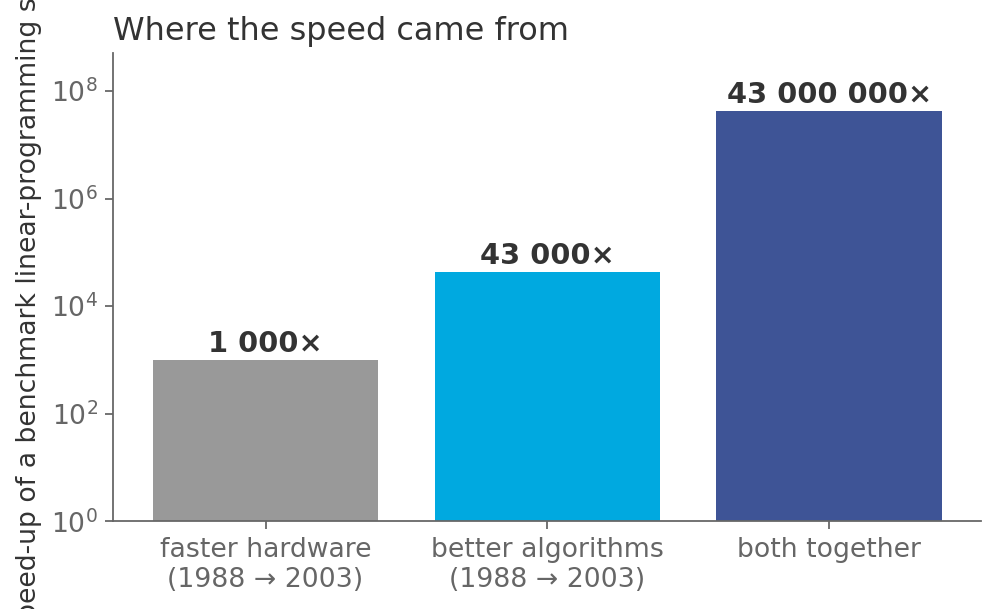

# Computers got 1 000× faster. Solving got 43 000 000× faster.

*Session 8 · Time Complexity · example X08-C ·
[notebook](../notebooks/X08-C.ipynb) ·
[slides](../../Slides/Examples/08-Examples/ICSS-2026-08-Examples.qmd)*

> Where did the other 43 000× come from? Not from Moore's law. A better
> algorithm is a factor that keeps growing with the problem, and this
> notebook measures one.

## The puzzle

A 2010 report to the US President compared how long a benchmark optimization
problem took to solve in 1988 and in 2003. Processors had become about 1 000
times faster. The problem was solved about 43 000 000 times faster. Same kind
of problem, same kind of machine, same field. Where did the missing factor of
43 000 come from?

## Try it first

The [notebook](../notebooks/X08-C.ipynb) times two correct solutions to the
same counting problem, one with a loop inside a loop and one with a hash
table, on inputs of 1 000 to 8 000 items. Watch the speed-up column: it
roughly doubles every time $n$ does.

## What is going on

<!-- FIG -->
<figure class="full"><figcaption>Where the 1988–2003 speed-up came from, according to the PCAST report.</figcaption></figure>
<!-- /FIG -->
The report quotes Martin Grötschel on a production-planning problem: with the
machines and algorithms of 1988 it would have taken 82 years, and by 2003 it
took a minute. Of the 43-million-fold improvement, hardware accounts for
about 1 000 and algorithms for about 43 000, in the form of better
linear-programming solvers, better data structures inside them and better
numerical methods. The framework of the lecture explains why the algorithmic
share is so large, and why it has to be. Hardware improves a program by a
constant factor: a machine that is 1 000× faster runs every step 1 000×
faster, at every input size, and no more. An algorithmic improvement changes
the growth rate. Going from $O(n^2)$ to $O(n)$ is a speed-up of roughly $n$,
which is 1 000× at $n = 10^3$, a million at $n = 10^6$, and keeps growing. The
notebook shows the measured version: the advantage of the hash-table solution
roughly doubles each time the input doubles, because the ratio of the two
costs is itself $n$.

That is the whole difference in one sentence: hardware is a one-off gift, and
a better exponent keeps giving. The two factors also compound. The 43 000 000
in the report is the two multiplied, with the algorithmic one dominating
because it grew with the problems people were actually trying to solve. The
pattern is not special to optimization. Sorting went from $n^2$ to $n \log n$,
as session 7 showed. The fast Fourier transform turned $n^2$ into $n \log n$
and made digital signal processing possible. SAT solvers, the workhorse
behind the hard problems of session 9, improved by orders of magnitude
between 2000 and 2010 on unchanged hardware.

## The answer

From algorithms. Hardware gives a constant factor; a better algorithm gives a
factor that grows with the problem size, and at the sizes people care about it
dwarfs the hardware factor. The toy version in the notebook gives a few
hundred times at $n = 1\,000$, over a thousand at $n = 8\,000$, and rising.

## Why this matters if you work with data

<!-- FIG -->
<figure class="side"><figcaption><b>Gordon Moore (1929–2023). His law gave the constant factor; algorithms gave the rest.</b> Photo: Intel Free Press, CC BY-SA 2.0, via <a href="https://commons.wikimedia.org/wiki/File:Gordon_Moore_1978_(cropped).png">Wikimedia Commons</a>.</figcaption></figure>
<!-- /FIG -->
This is the argument for the whole session, and it lands on your own work
directly. Buying a bigger machine is the last resort, not the first: if your
script is too slow, the exponent in the inner loop is the first thing to
check, because a rented 64-core node gives you 64× at best while replacing
`in list` by `in set` can give you 10 000×. The gains are yours to choose,
since hardware improves whether or not you understand it while algorithmic
improvements happen only if someone looks at the code, which for your
analysis is you. And model fitting is algorithms. The reason a mixed model on
a million rows fits in seconds is not the processor but thirty years of
numerical linear algebra, and when a fit is slow, the question of which
algorithm the library is using is a real question with a real answer.

## What we used from the lecture

- [Why it matters: some numbers](../../Transcripts/08-TimeComplexity.md#3-why-it-matters-some-numbers)
- [Asymptotic behavior and O-notation](../../Transcripts/08-TimeComplexity.md#8-asymptotic-behavior-and-o-notation):
  why a growth rate beats a constant.
- [Why this matters for us](../../Transcripts/08-TimeComplexity.md#10-why-this-matters-for-us)

## Further reading

- PCAST (2010), *Report to the President and Congress: Designing a Digital
  Future*, p. 71, the source of the numbers.
- Bixby, R. E. (2002), "Solving Real-World Linear Programs: A Decade and More
  of Progress", *Operations Research* 50(1), the detailed history for linear
  programming.
