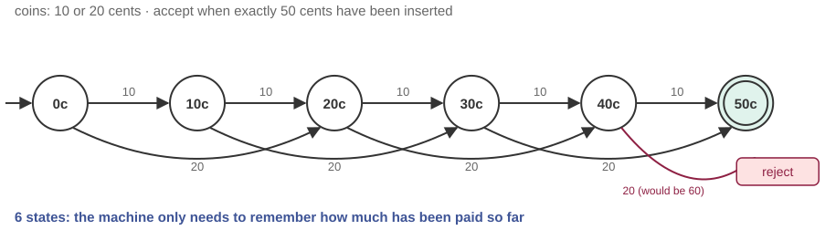

# Design a coffee machine that cannot be cheated

*Session 9 · Theoretical Computer Science · example X09-A ·
[notebook](../notebooks/X09-A.ipynb) ·
[slides](../../Slides/Examples/09-Examples/ICSS-2026-09-Examples.qmd)*

> Ten-cent and twenty-cent coins, a fifty-cent coffee, no change. The smallest
> machine that gets it right every time has one state per amount paid, and
> "every time" is a theorem, not a hope.

## The puzzle

The machine accepts 10-cent and 20-cent coins. A coffee costs exactly 50
cents; overpaying is not allowed and there is no change. It must accept
`10 20 20`, `20 20 10` and five tens, and reject `20 20 20` the moment the
third coin lands. It has no memory beyond what state it is in. How many
states does it need? Draw it. Is there any sequence of coins your drawing gets
wrong?

## Try it first

The [notebook](../notebooks/X09-A.ipynb) writes the machine as a Python
dictionary from (state, coin) to state, runs it on several coin sequences,
prints the 5-tuple, checks that every state has an arrow for every coin, and
shows that no two of the amount states can be merged.

## What is going on

<!-- FIG -->
<figure class="full"><figcaption>The six-state automaton: coins move between amounts, and any coin past 50 goes to reject.</figcaption></figure>
<!-- /FIG -->
This is the *deterministic finite automaton* of the lecture, built from a
specification, which is the direction the exam asks for. The design question
is always the same: what does the machine have to remember? Not the coins
themselves, only the amount paid so far, and only up to 50. That gives six
states, 0, 10, 20, 30, 40 and 50, with 50 accepting, plus a reject state for
"too much". The 5-tuple, made explicit in the notebook, is $Q = \{0, 10, 20,
30, 40, 50, \text{reject}\}$, the states; $\Sigma = \{10, 20\}$, the input
alphabet; $\delta$, the transition function, which sends amount $s$ on coin
$c$ to $s + c$ if that is at most 50 and to reject otherwise, and sends reject
to reject; $q_0 = 0$; and $X = \{50\}$, the accepting states.

Two properties make the phrase "cannot be cheated" precise. The machine is
*deterministic*: for every state and every coin there is exactly one next
state, so a coin sequence has exactly one outcome. And it is *complete*: there
is no (state, coin) pair the table forgets, which the notebook checks in one
line. Together they mean that the table is the specification. There is no
sequence it does not cover, so its correctness can be checked by inspecting
seven rows rather than by trying coins. Why seven? The last cell of the
notebook shows that any two amounts can be told apart by some future sequence
of coins, since 20 and 30 differ on a single 20-cent coin, so no two of the
amount states can be merged, and the reject state, which accepts nothing, is
distinct from all of them. Seven is the minimum for a complete machine, and
that argument is the beginning of automaton minimization.

## The answer

One state per amount paid so far, six of them, plus a reject state, with a
complete deterministic transition table. The drawings students produce
usually go wrong in one of two ways: they forget the reject arrows, which
gives an incomplete machine that is silently undefined on `20 20 20`, or they
try to remember which coins came in, which is more than the problem needs and
more than a finite machine should carry.

## Why this matters if you work with data

<!-- FIG -->
<figure class="side"><figcaption><b>Michael Rabin, who with Dana Scott gave finite automata their modern definition in 1959.</b> Photo: Konrad Jacobs, Erlangen, Copyright is MFO, CC BY-SA 2.0 de, via <a href="https://commons.wikimedia.org/wiki/File:M_O_Rabin.jpg">Wikimedia Commons</a>.</figcaption></figure>
<!-- /FIG -->
Finite automata are the formal version of a *state machine*, and state
machines are how you describe any process that goes through stages in
response to events: the path of a respondent through a survey, the lifecycle
of a case in an administrative dataset, a parser for a log-file format, the
matching of a regular expression. The discipline this example teaches
transfers directly. Name the states and ask what each one needs to remember.
Write the transition for every (state, event) pair, including the ones you
think cannot happen, because those are the bugs. Accept or reject explicitly.
The follow-up question, what if the machine had to accept as many 10s as 20s,
has a different answer, and X09-B is about it.

## What we used from the lecture

- [Finite-state automata](../../Transcripts/09-TheoreticalCS.md#2-finite-state-automata):
  the 5-tuple and transition diagrams.
- [Nondeterministic automata](../../Transcripts/09-TheoreticalCS.md#3-nondeterministic-automata):
  what determinism buys.
- [Regular languages](../../Transcripts/09-TheoreticalCS.md#5-regular-languages)

## Further reading

- Sipser, M. (2012), *Introduction to the Theory of Computation*, 3rd ed.,
  chapter 1, which opens with an automatic-door controller built the same
  way; the state-distinguishing argument is Problem 1.52.
