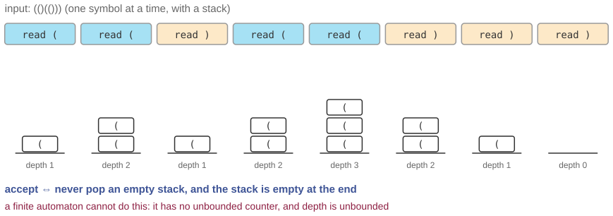
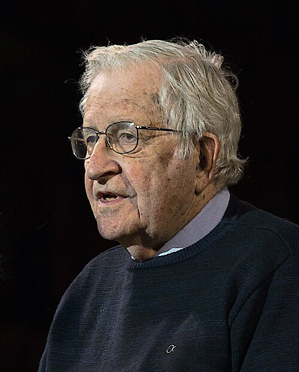

# Can a finite machine check your brackets?

*Session 9 · Theoretical Computer Science · example X09-B ·
[notebook](../notebooks/X09-B.ipynb) ·
[slides](../../Slides/Examples/09-Examples/ICSS-2026-09-Examples.qmd)*

> Your editor spots a missing parenthesis instantly. The machine that does it
> is one step up the hierarchy from the coffee machine, and the step is a
> stack.

## The puzzle

Your editor knows at once that `((a + b) * (c − d)` is missing a bracket and
that `(()(()))` is fine. A JSON file with forty thousand nested objects is
validated in milliseconds. Session 9 has just given you a machine with
finitely many states. Can a finite-state automaton decide whether the
brackets in a string are balanced? If not, what is the smallest addition that
makes it possible?

## Try it first

The [notebook](../notebooks/X09-B.ipynb) has a stack-based checker that works,
a "finite" checker with $k$ states that works up to depth $k$ and then fails,
and a tiny grammar that generates balanced strings at random.

## What is going on

<!-- FIG -->
<figure class="full"><figcaption>A stack reading (()(())): depth rises and falls, and ends at zero.</figcaption></figure>
<!-- /FIG -->
Try to design the automaton. You need to know, at every point, how many
brackets are open, because a closing bracket with none open is an error, and
the string is balanced only if the count ends at zero. So the state must hold
a count. But a finite automaton has finitely many states, say $k$, and can
therefore distinguish at most $k$ different counts. Feed it $k+1$ opening
brackets and it has lost track: it cannot tell depth $k$ from depth $k+1$, and
the $k$-state checker of the notebook accepts `((((()))` and rejects
`(((())))` for exactly that reason. Since nesting depth is unbounded, no
finite automaton works. The formal statement in the lecture is that $a^n b^n$
is not a regular language.

The smallest fix is a *stack*. Push on `(`, pop on `)`, reject if you ever
pop an empty stack, and accept if the stack is empty at the end. The stack
can grow without bound, which is the one capability the finite machine
lacked. A finite automaton with a stack is a *push-down automaton*, and the
languages it recognizes are the *context-free* languages, one level up the
Chomsky hierarchy from the regular ones. The grammar makes the same point from
the generating side:

$$S \to (\,S\,)\,S \;\mid\; \varepsilon$$

A rule that puts $S$ inside brackets that it also produces is recursive in a
way no regular grammar can be, and the generator in the notebook is that rule
run at random.

## The answer

No: balanced brackets require unbounded counting, and a finite automaton can
count only up to its number of states. Add a stack, which gives a push-down
automaton, and the problem is solved in a dozen lines. Balanced brackets are
context-free, not regular.

## Why this matters if you work with data

<!-- FIG -->
<figure class="side"><figcaption><b>Noam Chomsky, whose hierarchy of grammars places brackets one level above what finite automata can do.</b> Photo: Σ, retouched by Wugapodes and Jonnmann, CC BY-SA 4.0, via <a href="https://commons.wikimedia.org/wiki/File:Noam_Chomsky_portrait_2017_retouched.jpg">Wikimedia Commons</a>.</figcaption></figure>
<!-- /FIG -->
The practical version of this result is a famous mistake: you cannot parse
HTML, JSON or code with a regular expression. Nested structure is
context-free, regular expressions recognize regular languages, and the moment
your data has brackets inside brackets a regex is the wrong tool and will fail
on some depth you did not test. Use a parser, which is a push-down automaton
in disguise, usually one that borrows the program's own call stack from
session 6. The pairing with X09-A is deliberate. The coffee machine needs to
remember a bounded quantity, so a finite automaton suffices and its
guarantees are strong. Brackets need an unbounded one. Learning to tell those
two cases apart is the skill: it decides whether a regex, a state machine, a
parser or, in the later sections of session 9, a full program is called for.

## What we used from the lecture

- [Finite-state automata](../../Transcripts/09-TheoreticalCS.md#2-finite-state-automata),
  and their limit.
- [Formal languages and grammars](../../Transcripts/09-TheoreticalCS.md#4-formal-languages-and-grammars)
- [Regular languages](../../Transcripts/09-TheoreticalCS.md#5-regular-languages):
  what they cannot express, and the Chomsky hierarchy.

## Further reading

- Sipser, M. (2012), *Introduction to the Theory of Computation*, 3rd ed.,
  chapters 1 and 2; the pumping lemma is the formal proof that $a^n b^n$ is
  not regular.
- The Stack Overflow answer "You can't parse [X]HTML with regex", the
  internet's most upvoted version of this lesson.
