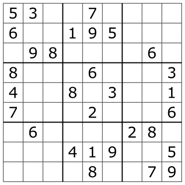
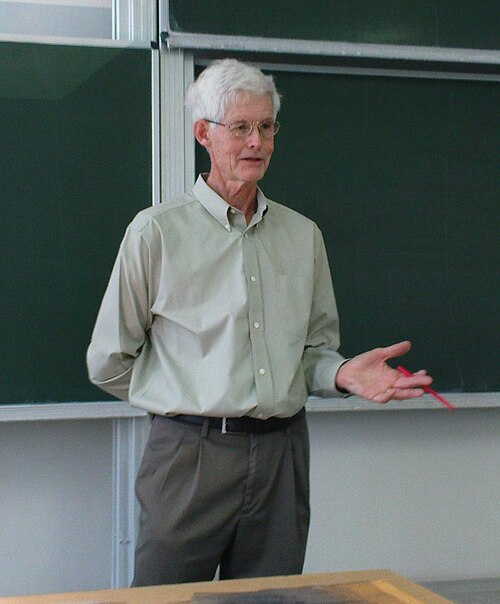

# Is there a fast way to solve any Sudoku?

*Session 9 · Theoretical Computer Science · example X09-C ·
[notebook](../notebooks/X09-C.ipynb) ·
[slides](../../Slides/Examples/09-Examples/ICSS-2026-09-Examples.qmd)*

> Checking a filled grid takes microseconds. Filling one takes search. That
> asymmetry is the definition of NP, and a fast Sudoku solver would be worth
> a million dollars.

## The puzzle

<!-- FIG -->
<figure class="side wide"><figcaption>A newspaper Sudoku. Public domain, via Wikimedia Commons.</figcaption></figure>
<!-- /FIG -->
You can check a finished Sudoku in seconds: every row, column and box has 1
to 9. Solving one is another matter, and $9 \times 9$ is only the newspaper
size. On an $n^2 \times n^2$ grid, does the solving time stay reasonable? Is
there an algorithm that solves any Sudoku in time polynomial in the grid size?
What would it mean if you found one, and why has nobody?

## Try it first

The [notebook](../notebooks/X09-C.ipynb) has a verifier, a few set
comparisons, and a backtracking solver. It solves a real puzzle, counts how
many placements the search tried, and times both; the check is thousands of
times faster than the search.

## What is going on

Two functions, and the gap between them is the central idea of the lecture.
The first, `valid(grid)`, is a *verifier*: given a filled grid, it checks 27
constraints and answers yes or no. Its cost is polynomial in the grid size,
a few hundred operations for $9 \times 9$. Problems whose solutions can be
checked in polynomial time form the class NP, and Sudoku is in NP by virtue
of that one function. The second, `solve(grid)`, is a *search*. It fills the
first empty cell with the first digit that does not conflict, moves on, and
backtracks when it gets stuck. In the worst case it explores a number of
partial grids that grows exponentially with the number of cells. For
$9 \times 9$ that is fine, since the puzzle in the notebook falls in a fraction
of a second, but nothing about the method gets better as the grid grows.

Is the search necessary? That is the question. Yato and Seta (2003) proved
that generalized Sudoku is *NP-complete*: not only is it in NP, but every
other problem in NP can be translated into a Sudoku in polynomial time. So a
polynomial-time Sudoku solver would, by composition, solve satisfiability,
timetabling, the traveling salesman problem and every other NP problem in
polynomial time. That is the statement P = NP, one of the Clay Millennium
Prize problems, and the consensus expectation is that it is false. Nobody has
a fast general solver because, most likely, none exists. The fine print
matters for the exam: the NP-completeness is for the $n^2 \times n^2$
generalization. The $9 \times 9$ game is a fixed finite problem, technically
constant time since there are finitely many puzzles, and the hardest known
ones still fall to backtracking in milliseconds.

## The answer

Almost certainly not. Sudoku is in NP, because it is fast to verify, and
NP-complete, because it is as hard as anything in NP, so a polynomial-time
solver would prove P = NP. The newspaper size is solved by backtracking
search, exponential in the worst case and instant in practice.

## Why this matters if you work with data

<!-- FIG -->
<figure class="side"><figcaption><b>Stephen Cook, who proved the first problem NP-complete in 1971.</b> Photo: Jiří Janíček Pokud hodláte některou z mých fotog, CC BY-SA 3.0, via <a href="https://commons.wikimedia.org/wiki/File:Prof.Cook.jpg">Wikimedia Commons</a>.</figcaption></figure>
<!-- /FIG -->
"Verify fast, find slow" is a shape you will meet outside puzzles. Assigning
students to seminars under preferences and capacities is timetabling, which
is NP-complete. Choosing the subset of variables that best explains an
outcome is subset selection, which is NP-hard. Finding the community
structure that maximizes modularity in a network is NP-hard as well. Knowing
that a problem is NP-complete is useful rather than discouraging: it tells
you to stop looking for the exact fast algorithm and to choose deliberately
among approximation, heuristics, restriction to a tractable special case, or
solving smaller instances exactly. The lecture's word is reduction; the
practical phrase is "know when to stop".

## What we used from the lecture

- [Computability](../../Transcripts/09-TheoreticalCS.md#7-computability):
  what can be computed at all, as distinct from what can be computed fast.
- [Complexity classes](../../Transcripts/09-TheoreticalCS.md#9-complexity-classes):
  P, NP, verifiers, NP-completeness and reduction.

## Further reading

- Yato, T. and Seta, T. (2003), "Complexity and completeness of finding
  another solution and its application to puzzles", *IEICE Transactions on
  Fundamentals* E86-A(5).
- The problem statement of the Clay Mathematics Institute for P versus NP,
  two pages and readable.
