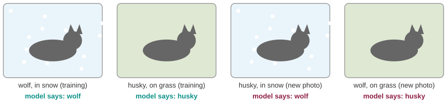
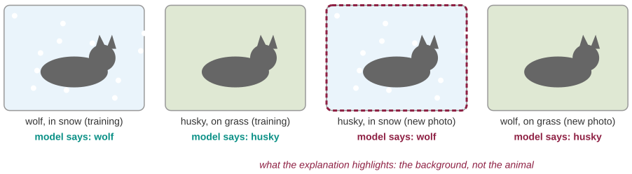
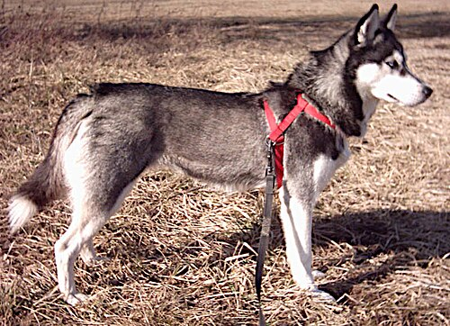

# The wolf detector that only saw snow

*Session 10 · Machine Learning · example X10-A ·
[notebook](../notebooks/X10-A.ipynb) ·
[slides](../../Slides/Examples/10-Examples/ICSS-2026-10-Examples.qmd)*

> Eight out of ten on the test set, useless at the zoo. The model learned
> something true about the photos and nothing about the animals, and the test
> set could not tell.

## The puzzle

<!-- FIG -->
<figure class="full"><figcaption>The four cases: two the model saw in training, two it met later.</figcaption></figure>
<!-- /FIG -->
Researchers trained a classifier to tell wolves from huskies from photos. On
the held-out test images it got eight out of ten right. Then it failed on the
obvious ones: a husky in a snowy garden was a wolf, a wolf on grass was a
husky. The model passed its test. What did it actually learn, and what
question would have caught it before deployment?

## Try it first

The [notebook](../notebooks/X10-A.ipynb) builds the situation on purpose with
two numeric features, a weak real signal (ear shape) and a shortcut (snow in
the background) that correlates with the label in the training data. It fits
a logistic regression, scores it on a test set with the same bias, then on
"the zoo" where the shortcut is gone, and prints the coefficients so that you
can see which feature the model leaned on.

## What is going on

<!-- FIG -->
<figure class="full"><figcaption>What the explanation highlights: the background.</figcaption></figure>
<!-- /FIG -->
In the original study, the wolf photos had been picked so that they showed
snow and the husky photos so that they did not. Snow is a large, uniform,
easy-to-detect region of an image, whereas fur texture and ear shape are
subtle. A learning algorithm that minimizes training error takes the cheapest
route to low error, and the cheapest route was snow. In the vocabulary of the
lecture, the model learned a *feature* that was correlated with the label in
the training distribution, not the concept. The uncomfortable part is that
the test set did not catch it. The test set was drawn from the same photos,
so it had the same bias, and a model that classifies by snow does well there
too. The test score was honest, since it measured generalization to more
photos like these, and useless, because the deployment photos were not like
these. This is the point of the lecture about *generalization* taken one
step further: a held-out test set protects you against memorizing the
training rows, not against a spurious feature that runs through the whole
dataset.

What caught it in the study was an explanation method, LIME, that highlights
the pixels driving each decision. It highlighted the background. The version
of that in the notebook is simply printing the coefficients: the snow feature
carries several times the weight of the real one. The final cell of the
notebook shows the cure. Train where the shortcut does not exist, and the
model is forced onto the real signal, does worse on the biased test set, and
works at the zoo.

## The answer

It learned "snow means wolf". The question that would have caught it: does the
feature the model relies on exist, with the same meaning, where the model
will be used? Interrogate the feature, not the score, which is what the right
to an explanation in the ethics section of the lecture is for.

## Why this matters if you work with data

<!-- FIG -->
<figure class="side"><figcaption><b>A Siberian husky on snow, which is the problem.</b> Photo: xJaM (talk · contribs), CC BY-SA 3.0, via <a href="https://commons.wikimedia.org/wiki/File:Husky_L.jpg">Wikimedia Commons</a>.</figcaption></figure>
<!-- /FIG -->
Spurious features are the normal case rather than the exception, and in
social data they are often more embarrassing than snow. A dropout-risk model
learns the campus WiFi log, because students who are present are logged, so
the feature is attendance rather than risk. A text classifier for political
tweets learns the year, because the labeled sample came from one election.
Google Flu Trends learned "winter" from basketball-season searches, which is
the candidate example of the main deck. The habits are to look at which
features carry the weight, to hold out a test set that differs from training
in the way deployment will, and to treat a suspiciously good score as a
symptom until you know why it is good.

## What we used from the lecture

- [Features](../../Transcripts/10-MachineLearning.md#4-features): what the
  model can see.
- [Generalization: the train/test split](../../Transcripts/10-MachineLearning.md#6-generalization-the-traintest-split),
  and why the split alone is not enough.
- [Overfitting, bias and variance](../../Transcripts/10-MachineLearning.md#8-overfitting-underfitting-bias-and-variance)
- [Ethics and responsible AI](../../Transcripts/10-MachineLearning.md#12-ethics-and-responsible-ai):
  trust and explanation.

## Further reading

- Ribeiro, M. T., Singh, S. and Guestrin, C. (2016), "Why Should I Trust
  You? Explaining the Predictions of Any Classifier", *KDD 2016*; the
  husky/wolf experiment is section 6.4.
