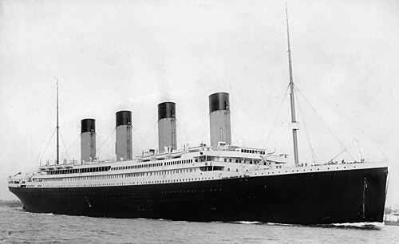
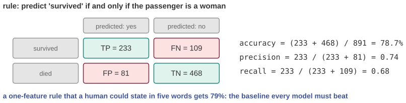
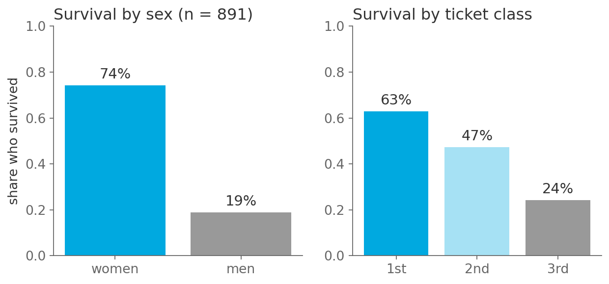

# Predict who survived the Titanic in five words

*Session 10 · Machine Learning · example X10-B ·
[notebook](../notebooks/X10-B.ipynb) ·
[slides](../../Slides/Examples/10-Examples/ICSS-2026-10-Examples.qmd)*

> A rule anyone could state gets 79%. Every model you ever build has to beat
> the rule first, and most first attempts do not.

## The puzzle

<!-- FIG -->
<figure class="side wide"><figcaption><b>RMS Titanic leaving Southampton, 10 April 1912.</b> Photo: Francis Godolphin Osbourne Stuart, Public domain, via <a href="https://commons.wikimedia.org/wiki/File:RMS_Titanic_3_(cropped_to_ship).jpg">Wikimedia Commons</a>.</figcaption></figure>
<!-- /FIG -->
The Titanic passenger list is the standard first dataset in machine learning:
891 passengers with sex, age, ticket class, fare and whether they survived.
Before any model, the survival rates by sex and by class are on the slide.
State a prediction rule in five words. What accuracy does it get, and how
would you know whether a neural network with ten thousand parameters is
actually better?

## Try it first

The [notebook](../notebooks/X10-B.ipynb) loads the data with pandas, prints
the two rate tables, applies the rule, fills in the confusion matrix, computes
accuracy, precision and recall, and compares with the majority-class baseline
and one slightly better rule.

## What is going on

<!-- FIG -->
<figure class="full"><figcaption>The confusion matrix of the five-word rule on 891 passengers.</figcaption></figure>
<!-- /FIG -->
"Women survive, men do not." On the 891 passengers:

| | predicted survived | predicted died |
|---|---|---|
| actually survived | TP = 233 | FN = 109 |
| actually died | FP = 81 | TN = 468 |

Accuracy is $(233 + 468)/891 = 78.7\%$, precision $233/314 = 0.74$ and recall
$233/342 = 0.68$. One feature, one rule, no fitting. This number is the
*baseline*, and the evaluation section of the lecture exists to make you
compute it. The trivial rule "everyone died" already scores 61.6%, the
majority class. A model that reports 80% has added a point over what a
passenger on the deck could have told you, and a model that reports 78% has
learned nothing at all, whatever its architecture. Published models on this
dataset plateau at 0.82 to 0.84, because survival was genuinely noisy, so the
entire contribution of machine learning here lives in a five-point window
above a five-word rule.

The confusion matrix is what turns "79%" into a diagnosis. The errors of the
rule are not symmetric: it misses 109 men who survived, the false negatives
behind the recall of 0.68, and wrongly predicts survival for 81 women who
died, the false positives behind the precision of 0.74. Which error matters
depends on what the prediction is for, which is the precision-recall
trade-off of the lecture, and no single accuracy figure can tell you.

## The answer

Women survive, men do not: 78.7% accuracy, precision 0.74, recall 0.68. A
model is better than that only if it beats those numbers on data it has not
seen, and the way to know is to compute the baseline first and the confusion
matrix second.

## Why this matters if you work with data

<!-- FIG -->
<figure class="full"><figcaption>Survival by sex and by ticket class in the training set.</figcaption></figure>
<!-- /FIG -->
The baseline habit is the cheapest and most skipped step in applied machine
learning, and skipping it is how a 93%-accurate model that identifies nobody
gets approved, as in the dropout example of the main deck. Before fitting
anything, ask three questions. What does predicting the most common outcome
score? That is the floor. What does the single best variable, thresholded,
score? That is the bar. And what does a domain fact score? "Women and
children first" is a historical claim, the rule tests it, and the confusion
matrix says where it fails. Then fit the model, and report its improvement
over the baseline, which is the honest measure of what the method added.

## What we used from the lecture

- [Supervised learning: the setup](../../Transcripts/10-MachineLearning.md#3-supervised-learning-the-setup):
  features, target, prediction.
- [Error, loss and the traps of accuracy](../../Transcripts/10-MachineLearning.md#5-error-loss-and-the-traps-of-accuracy):
  confusion matrix, precision, recall.
- [Generalization](../../Transcripts/10-MachineLearning.md#6-generalization-the-traintest-split):
  a score means nothing without a baseline.

## Further reading

- Kaggle, "Titanic: Machine Learning from Disaster", the competition and its
  leaderboard, which shows where the ceiling is.
- The data file used here is `data/titanic.csv`, a public mirror of the
  training set (datasciencedojo/datasets on GitHub).
