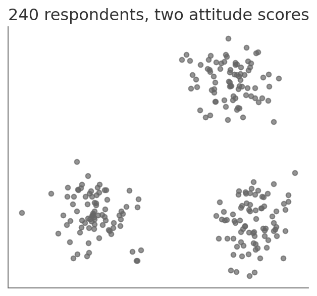
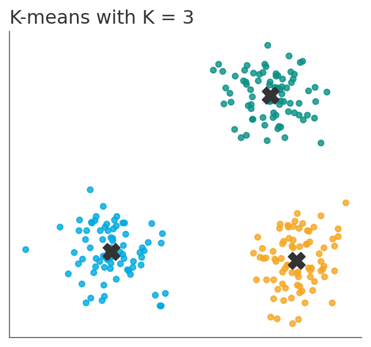
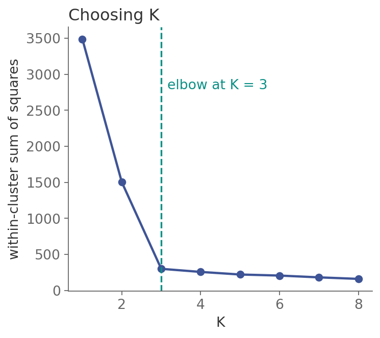
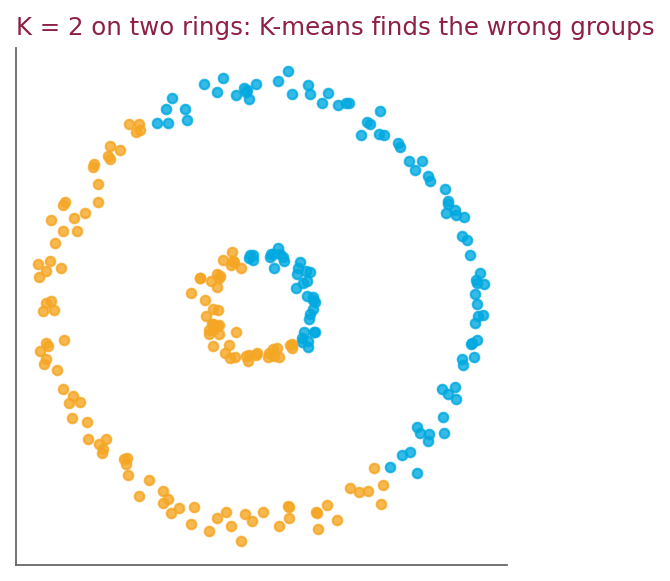

# How many groups are there?

*Session 10 · Machine Learning · example X10-C ·
[notebook](../notebooks/X10-C.ipynb) ·
[slides](../../Slides/Examples/10-Examples/ICSS-2026-10-Examples.qmd)*

> 240 respondents, two scores, no labels. The algorithm that finds the groups
> in twelve lines, and finds them just as confidently when there are none.

## The puzzle

<!-- FIG -->
<figure class="side wide"><figcaption>240 respondents, two scores, no labels.</figcaption></figure>
<!-- /FIG -->
Two attitude scores for 240 survey respondents, and nothing else: nobody has
said how many "types" of respondent exist or which respondent is which. Look
at the scatter plot and imagine it in twelve dimensions with 24 000 points.
Write the procedure that finds the groups. How do you choose how many? And
what does it do when the data has no groups at all?

## Try it first

The [notebook](../notebooks/X10-C.ipynb) implements K-means in twelve lines
of NumPy, runs it with $K = 3$, plots the within-cluster sum of squares for
$K = 1$ to $8$, and then runs $K = 2$ on two concentric rings.

## What is going on

<!-- FIG -->
<figure class="side wide"><figcaption>K-means with K = 3; the crosses are the centers.</figcaption></figure>
<!-- /FIG -->
This is *unsupervised* learning: there is an $X$ and no $Y$. The groups are
the output, not the input, so there is nothing to score against, which is the
source of everything difficult about it. K-means is the algorithm of the
lecture, and it alternates two steps until nothing changes:

```
Procedure K-MEANS(X, K)
Inputs:
      X: the n points x_1 … x_n
      K: the number of clusters
Result: a cluster C(i) for every point i, and K centers m_1 … m_K
choose K of the points as the initial centers m_1 … m_K
While the assignment changes:
      For i = 1 to n:
            C(i) ← the k whose center m_k is closest to x_i
      For k = 1 to K:
            m_k ← the mean of the points with C(i) = k
```

Each step can only lower the total within-cluster distance, so the procedure
always converges, to a local minimum, which is why the notebook runs it from
several starts and keeps the best.

<!-- FIG -->
<figure class="side wide"><figcaption>Within-cluster sum of squares against K: the elbow at 3.</figcaption></figure>
<!-- /FIG -->
The next question is how to choose $K$. The within-cluster sum of squares,
WSS, is what K-means minimizes, so it is tempting to pick the $K$ with the
lowest WSS. But WSS falls with every extra cluster by construction, all the
way to zero at $K = n$, where every point is its own cluster, so minimizing it
always picks the useless answer. The *elbow method* looks instead at where the
drop stops being steep. On the data of the notebook, WSS falls from 3 472 to
1 557 to 306 and then barely moves, an unambiguous elbow at 3, because the
data was built with three blobs. Real survey data rarely gives such a clean
bend, and that ambiguity is information: it often means that there is no
natural $K$.

<!-- FIG -->
<figure class="side wide"><figcaption>Two rings, K = 2: the algorithm splits them down the middle.</figcaption></figure>
<!-- /FIG -->
The rings are the warning. K-means can only make convex, roughly round
clusters, because each point goes to the nearest center, so on two
concentric rings with $K = 2$ it draws a line through the middle and reports
two half-rings. It never says "these are not two groups". It was asked for
two and it delivered two.

## The answer

K-means, with $K$ chosen at the elbow of the WSS curve, here 3, and a
qualification that is part of the answer: K-means returns exactly $K$ clusters
whatever the data looks like. A clustering is a hypothesis about structure,
and checking that the structure is real is the researcher's job, not the
algorithm's.

## Why this matters if you work with data

Typologies of voters, respondents, countries or documents are a staple of
social research, and clustering is how they are produced from data. The traps
are all in this example. The number of types is a choice, and the elbow is a
heuristic for making it, not a test. The shape assumption matters, since
K-means assumes round groups of similar size; use a different method, density
based or hierarchical, when that is false, and check with a plot when you can.
And the output is always confident, so validate a typology against something
outside the clustering, an external variable, a hold-out sample or plain
interpretability, before reporting it as found.

## What we used from the lecture

- [What machine learning is: the three families](../../Transcripts/10-MachineLearning.md#2-what-machine-learning-is)
- [Unsupervised learning and clustering](../../Transcripts/10-MachineLearning.md#10-unsupervised-learning-and-clustering):
  K-means and the elbow method.
- [Ethics and responsible AI](../../Transcripts/10-MachineLearning.md#12-ethics-and-responsible-ai):
  what a model's output is evidence of.

## Further reading

- Hastie, T., Tibshirani, R. and Friedman, J. (2009), *The Elements of
  Statistical Learning*, 2nd ed., section 14.3, K-means and its relatives,
  free online.
- MacQueen, J. (1967), "Some methods for classification and analysis of
  multivariate observations", where the name comes from.
