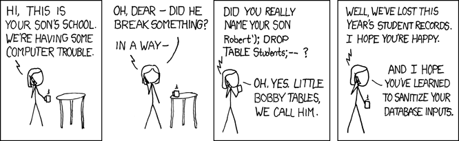
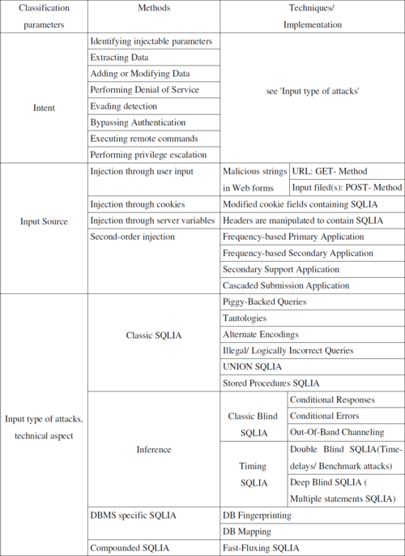

# Little Bobby Tables

*Session 11 · Databases · example X11-A ·
[notebook](../notebooks/X11-A.ipynb) ·
[slides](../../Slides/Examples/11-Examples/ICSS-2026-11-Examples.qmd)*

> A boy's name deletes a school's records. The bug is one line, the fix is one
> character, and the lesson is the same one as mojibake and `eval`: data that
> gets treated as code.

## The puzzle

<!-- FIG -->
<figure class="full"><figcaption>XKCD 327, Exploits of a Mom. Randall Munroe, CC BY-NC 2.5, xkcd.com/327.</figcaption></figure>
<!-- /FIG -->
XKCD 327: a school enrolls a child whose registered name is
`Robert'); DROP TABLE Students;--`, and shortly afterwards has no student
records. What did the school's software do with that name? Which single line
was wrong, and what is the correct version?

## Try it first

The [notebook](../notebooks/X11-A.ipynb) uses SQLite in memory, so there is
nothing to install. It builds a query by string concatenation, shows the
`' OR '1'='1` injection returning every row, runs Bobby's name through
`executescript` to drop the table, and then does it properly with a
parameterized query.

## What is going on

The school's code, which is everyone's first version of this code, pastes the
name into the query text:

```python
query = "INSERT INTO Students (name) VALUES ('" + name + "')"
```

With an ordinary name that produces one statement. With Bobby's name it
produces this:

```sql
INSERT INTO Students (name) VALUES ('Robert'); DROP TABLE Students;--')
```

The `'` closes the string the programmer opened, `)` closes the value list,
`;` ends the statement, `DROP TABLE Students` is a second, complete statement,
and `--` starts a comment that swallows the programmer's trailing `')` so
that the whole thing parses cleanly. The name was data, and concatenation
made it code. The database did exactly what it was told. This is *SQL
injection*, and it has been in the top three web vulnerabilities for twenty
years because the concatenation version is the obvious one to write. The
comic's own advice, "sanitize your inputs", is slightly wrong: trying to
strip dangerous characters out of a name is a losing game. The robust fix
keeps data and code apart from the start:

```python
cursor.execute("INSERT INTO Students (name) VALUES (?)", (name,))
```

The `?` is a placeholder. The database parses the statement first, with the
placeholder in it, and only then binds the value, so the value is never
parsed as SQL, whatever characters it contains. The last cell of the notebook
inserts Bobby's full name as a perfectly ordinary string.

## The answer

The name was concatenated into the SQL text and became two statements. The
wrong line is the one with `+ name +`; the right one uses a parameterized
query with `?`, which is the only defense that works for every input.

## Why this matters if you work with data

<!-- FIG -->
<figure class="side"><figcaption><b>SQL injection is still in the OWASP top three, twenty years after the comic.</b> Photo: KDeltchev, CC BY-SA 3.0, via <a href="https://commons.wikimedia.org/wiki/File:KD_SQLIA_Classification_2010.png">Wikimedia Commons</a>.</figcaption></figure>
<!-- /FIG -->
There are two reasons, one immediate and one general. The immediate one is
that any script that builds SQL from a variable, a country name, a respondent
ID or a date typed by a user, is vulnerable, and research code that grew out
of a notebook is full of exactly that. Parameterized queries cost nothing and
every database library supports them. The general one is that this is the
third appearance of one failure pattern in the course. UTF-8 bytes read as
Latin-1 in session 2 is data misinterpreted. `eval` on a string from a file in
session 4 and SQL from a concatenated name here are data executed. The same
defense applies each time: decide explicitly what is data and what is code,
and never let the boundary be drawn by the content of a string.

## What we used from the lecture

- [SQL: what kind of language it is](../../Transcripts/11-Databases.md#8-sql-what-kind-of-language-it-is):
  text that can be executed.
- [Data definition and manipulation](../../Transcripts/11-Databases.md#10-data-definition-and-manipulation):
  `INSERT` and `DROP`.
- [SQL injection](../../Transcripts/11-Databases.md#13-sql-injection):
  parameterized queries.

## Further reading

- XKCD 327, "Exploits of a Mom" (CC BY-NC 2.5).
- OWASP, *SQL Injection Prevention Cheat Sheet*: parameterization first, then
  everything else.
