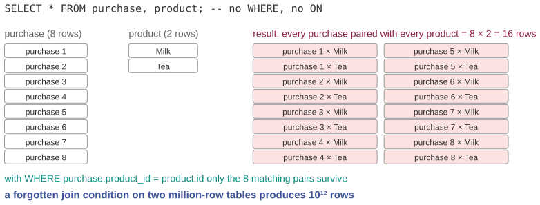

# The join that returned more rows than the table

*Session 11 · Databases · example X11-B ·
[notebook](../notebooks/X11-B.ipynb) ·
[slides](../../Slides/Examples/11-Examples/ICSS-2026-11-Examples.qmd)*

> Eight purchases, two products, sixteen rows, and total sales doubled in
> the report. Nothing crashed. The query did precisely what it said.

## The puzzle

An analyst joins the `purchase` table (8 rows) with `product` (2 rows) to put
product names on a sales report:

```sql
SELECT * FROM purchase, product;
```

The result has 16 rows, and total sales in the report have doubled. The
query ran without error and the numbers went to the board meeting. Where did
the extra rows come from, why is this correct behavior for the query as
written, and what did the analyst forget?

## Try it first

The [notebook](../notebooks/X11-B.ipynb) creates both tables in SQLite,
counts the rows of the join without a condition, computes the doubled total,
and then shows the two correct forms, and that a forgotten `ON` is a syntax
error while a forgotten `WHERE` is not.

## What is going on

<!-- FIG -->
<figure class="full"><figcaption>Eight purchases × two products = sixteen rows: the Cartesian product.</figcaption></figure>
<!-- /FIG -->
Two tables listed in `FROM` with no condition means every row of the first
paired with every row of the second. That is the Cartesian product, with
$|A| \times |B|$ rows, here $8 \times 2 = 16$. Each purchase appears once
with the price of milk and once with the price of tea, so `SUM(units *
price)` adds both, and the total roughly doubles. The manual-join slide of the
lecture asks exactly this question, how many rows there are with no `WHERE`,
and this is its answer. What the analyst forgot is the *join condition*, the
rule that says which pairs belong together:

```sql
SELECT * FROM purchase, product WHERE purchase.product_id = product.id;
```

This keeps the 8 pairs whose keys match and discards the other 8. The row
count in the notebook goes from 16 to 8 and the total is right. The better
habit is the explicit syntax:

```sql
SELECT * FROM purchase JOIN product ON purchase.product_id = product.id;
```

It gives the same result, but with a property worth paying for: if you forget
the `ON`, the database refuses to run the query. With the comma form,
forgetting the `WHERE` is not an error. It is a valid query with a different
meaning, and you find out at the board meeting.

## The answer

Two tables without a condition is the Cartesian product, and $8 \times 2 = 16$
is what was asked for. The missing piece is the join condition. Use `JOIN …
ON` so that leaving it out fails loudly, and check the row count of every
join against what it should be.

## Why this matters if you work with data

<!-- FIG -->
<figure class="side"><figcaption><b>Patricia Selinger, whose 1979 optimizer is why a correct join is also a fast one.</b> Photo: Jacek Ambroziak and Sam Madden, CC BY 4.0, via <a href="https://commons.wikimedia.org/wiki/File:01_Pat_Selinger_-_Stonebraker70_(cropped).jpg">Wikimedia Commons</a>.</figcaption></figure>
<!-- /FIG -->
The row-count habit is the transferable part, and it applies well beyond SQL.
`pandas.merge`, the `left_join` of R and the `merge` of Stata can all silently
multiply rows when the key is not unique on the side you thought it was, and
the symptom is always the same: a total that is too large, or a regression
with more observations than respondents. Two lines of defense follow. Print
the row count before and after every merge, because a join that changes the
row count in a way you did not predict is wrong until proven otherwise. And
know which side has the unique key, because a many-to-many join is sometimes
what you want, and a many-to-many join by accident is the bug. At scale the
same mistake is not a wrong total but an outage: two million-row tables
without a condition is $10^{12}$ rows, which is how a forgotten `WHERE` takes
down a database server.

## What we used from the lecture

- [Tables, tuples and schemas](../../Transcripts/11-Databases.md#9-tables-types-schemas-and-keys-in-sql)
- [Queries: selection](../../Transcripts/11-Databases.md#11-queries-selection-projection-aggregation)
- [Joins](../../Transcripts/11-Databases.md#12-joins): manual joins, `INNER
  JOIN`, and what happens without a condition.

## Further reading

- The exam pool items `DB-03` and `DB-04` restructure and query a similar
  purchases table; the row counts in the notebook are the kind of check they
  ask for.
