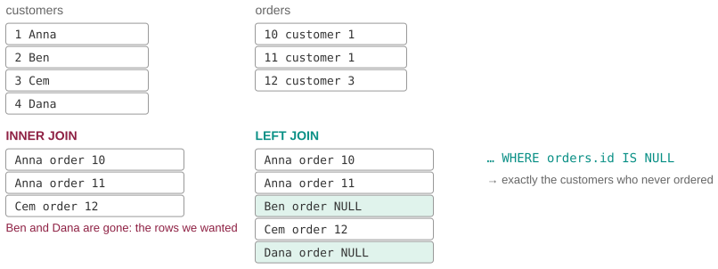

# Find the customers who never ordered

*Session 11 · Databases · example X11-C ·
[notebook](../notebooks/X11-C.ipynb) ·
[slides](../../Slides/Examples/11-Examples/ICSS-2026-11-Examples.qmd)*

> The query is short, reads correctly and returns zero rows, and it can never
> return anything else, whatever the data. The rows it is looking for were
> gone before it could see them.

## The puzzle

```sql
SELECT c.name
FROM customers c JOIN orders o ON o.customer_id = c.id
WHERE o.id IS NULL;
```

"Customers with no orders." Zero rows, while marketing is certain that there
are hundreds of inactive customers. Why can this query never return a row,
and what kind of join does the question actually need?

## Try it first

The [notebook](../notebooks/X11-C.ipynb) builds four customers and three
orders in SQLite, runs the query as written (zero rows) and with `LEFT JOIN`
(the two inactive customers), prints what each join produces, and ends with
the `COUNT(*)` versus `COUNT(o.id)` trap.

## What is going on

<!-- FIG -->
<figure class="full"><figcaption>What INNER JOIN and LEFT JOIN each produce; the NULL rows are the customers you were looking for.</figcaption></figure>
<!-- /FIG -->
The order in which a query is evaluated is the whole explanation. `FROM` and
`JOIN` run first and produce a set of rows, `WHERE` filters that set, and
`SELECT` picks columns from what survives. An `INNER JOIN` keeps only rows
that match in both tables. A customer with no orders has nothing to match,
because there is no `orders` row to pair them with, so they are not in the
joined set at all. `WHERE o.id IS NULL` then examines a set that, by
construction, contains only customers who have orders, and it can never be
true. The query is not wrong about anything; it is asking a question of the
wrong set. A `LEFT JOIN` keeps every row of the left table, every customer,
and, where there is no matching order, fills the order columns with `NULL`.
Now the inactive customers are present and marked, and `WHERE o.id IS NULL`
selects exactly them. That is the sentence of the lecture "if values are
missing from one of the columns, they are set to NULL" turned into a tool,
the anti-join pattern.

`NULL` deserves its own paragraph, because it is not a value. It means
absent, and it matches nothing, not even itself: `NULL = NULL` is not true,
which is why `IS NULL` exists as a separate operator. The last cell of the
notebook shows the consequence for counting. After a left join, `COUNT(*)`
counts the single NULL row of a customer as one order, while `COUNT(o.id)`
ignores NULLs and correctly says zero. The exam's `DB-09a` is that exact
trap.

## The answer

An inner join drops unmatched customers before `WHERE` runs, so the condition
has nothing to find. The question needs a `LEFT JOIN`, which keeps every
customer and marks missing orders with `NULL`; `WHERE o.id IS NULL` then
returns the inactive ones.

## Why this matters if you work with data

<!-- FIG -->
<figure class="side"><figcaption><b>Donald Chamberlin, co-designer of SQL in 1974.</b> Photo: Dicklyon, CC BY-SA 4.0, via <a href="https://commons.wikimedia.org/wiki/File:Don_Chamberlin_(cropped).jpg">Wikimedia Commons</a>.</figcaption></figure>
<!-- /FIG -->
"Who is not in the other table?" is one of the most common questions in data
work, whether respondents who did not answer wave 2, countries with no events
or users who never posted, and the inner-join version of the answer silently
returns nothing. The pattern to memorize is a left join on the key followed by
a `WHERE` that keeps the rows whose right-hand key is `NULL`. The same logic
holds in pandas, with `how="left"` followed by `.isna()`, and in R, with
`anti_join`. The counting trap generalizes too: after any left join, count a
column from the right table rather than rows, or every unmatched row becomes
a phantom observation.

## What we used from the lecture

- [Queries: selection happens after the join](../../Transcripts/11-Databases.md#11-queries-selection-projection-aggregation)
- [Joins](../../Transcripts/11-Databases.md#12-joins): INNER versus LEFT, and
  NULL for missing matches.

## Further reading

- The exam pool item `DB-09a`, which asks for order counts per customer
  including zeros: the `LEFT JOIN` and `COUNT(column)` idiom.
