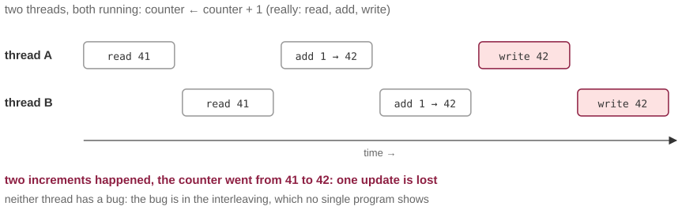

# One million increments, and the counter says 712 431

*Session 12 · Parallel Programming · example X12-A ·
[notebook](../notebooks/X12-A.ipynb) ·
[slides](../../Slides/Examples/12-Examples/ICSS-2026-12-Examples.qmd)*

> Four threads, one shared counter, no bugs in any of them, and a quarter of
> the additions gone. The bug lives between the programs, and no single
> program shows it.

## The puzzle

A program counts events in a stream. To go faster it uses four threads, each
handling a quarter of the events and adding one to a shared counter for each.
One million events go in, and the counter reads 712 431. Run it again:
698 202. Every run is different and every run is too low. No thread has a
bug. Where did the increments go, and why does the answer change every time?

## Try it first

The [notebook](../notebooks/X12-A.ipynb) runs four threads that increment a
shared counter 20 000 times in total, with the three steps, read, add and
write, made explicit, and loses most of the increments. Then it fixes the
problem twice, with a lock and with no shared state at all.

## What is going on

<!-- FIG -->
<figure class="full"><figcaption>Two threads interleaving read, add and write: one increment is lost.</figcaption></figure>
<!-- /FIG -->
`counter = counter + 1` looks like one action. To the machine it is three:
read the current value, add one, and write the result back. Between any two
of those steps the processor may switch to another thread, and the hardware
does this on its own, at moments no program controls. Now interleave two
threads. A reads 41. B reads 41. A writes 42. B writes 42. Two increments
happened, and the counter went up by one. That is a *race condition*, and it
has the property the lecture keeps pointing at: inspect the code of either
thread on its own and it is flawless. The defect exists only in the
interleaving, which is why it is invisible in code review and why the result
differs from run to run, because the interleaving does. A note on the
notebook: Python's interpreter lock happens to make tiny `+=` loops mostly
safe, so the demonstration inserts an explicit "let another thread run"
between the read and the write. That is not cheating; it makes visible what
the hardware does uninvited in C, Java, Go or any compiled numerical code.

There are two fixes, and the choice between them is most of session 12. The
first is a lock: wrap the three steps so that only one thread can be inside
at a time. That is correct, and the wrapped section is now serial. Amdahl's
law charges for that, because whatever fraction of the run is spent in locked
sections cannot speed up no matter how many cores you add. The second is no
shared state: give each thread its own counter and add the four at the end.
Nothing is shared, so nothing can race, and no locking is needed. This is the
design of MapReduce, map on private data and reduce once at the end, and the
framework exists in large part to make this figure impossible.

## The answer

An increment is read, add and write; threads interleave between the steps,
and concurrent writes overwrite each other. Serialize the critical section
with a lock, or, better, avoid shared mutable state and combine private
results at the end.

## Why this matters if you work with data

<!-- FIG -->
<figure class="side"><figcaption><b>Jeff Dean, co-author of MapReduce, a framework designed so that this figure cannot happen.</b> Photo: Cmichel67, CC BY-SA 4.0, via <a href="https://commons.wikimedia.org/wiki/File:Jeff_Dean_in_2025_x.jpg">Wikimedia Commons</a>.</figcaption></figure>
<!-- /FIG -->
The first time most researchers parallelize an analysis is with a
`multiprocessing.Pool` or a parallel `apply`, and the first bug is exactly
this one: workers appending to a shared list, incrementing a shared
dictionary of counts, or writing to the same output file. The symptoms,
results slightly too small and differing between runs, are easy to mistake
for randomness in the method. The rule that avoids it is that each worker
returns its result and the main process combines. Never let workers touch a
shared structure. That rule is also what makes the same code correct on a
cluster of separate machines, where there is no shared memory to race on in
the first place.

## What we used from the lecture

- [Types of parallelization](../../Transcripts/12-ParallelProgramming.md#4-types-of-parallelization):
  threads share memory.
- [Concurrency vs parallelism](../../Transcripts/12-ParallelProgramming.md#5-concurrency-vs-parallelism):
  the interleaving is not under your control.
- [Software parallelization and MapReduce](../../Transcripts/12-ParallelProgramming.md#9-software-parallelization-and-mapreduce)
- [Amdahl's law](../../Transcripts/12-ParallelProgramming.md#11-amdahls-law)

## Further reading

- The candidate opening M11-B of session 11, two seats on one airplane, is
  the same race at the level of a booking system; the answer there, a
  transaction, is a lock with better manners.
