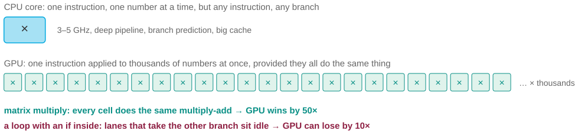
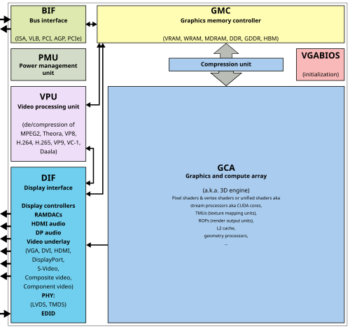

# Why is the GPU 50× faster, and 10× slower?

*Session 12 · Parallel Programming · example X12-B ·
[notebook](../notebooks/X12-B.ipynb) ·
[slides](../../Slides/Examples/12-Examples/ICSS-2026-12-Examples.qmd)*

> The same graphics card trains the model in an hour and runs your for-loop
> in a week. The principle is Flynn's taxonomy, and you can see it on a laptop
> with NumPy.

## The puzzle

A colleague moves a model-training script to the department's GPU: fifty
times faster. Encouraged, they move an agent-based simulation, a loop over
agents with an `if` inside, to the same GPU. It runs ten times slower than on
their laptop. Same card, same afternoon. What is a GPU actually good at, and
what property of the second program makes it a bad fit?

## Try it first

No GPU is required. The [notebook](../notebooks/X12-B.ipynb) times the same
arithmetic on a million numbers as a Python loop and as a NumPy expression,
then does the same with a branch inside, and finishes with an agent-step loop
that cannot be vectorized at all.

## What is going on

<!-- FIG -->
<figure class="full"><figcaption>One flexible core against thousands of lanes that must all do the same thing.</figcaption></figure>
<!-- /FIG -->
Flynn's taxonomy, from the lecture, sorts machines by how many instruction
streams and data streams they run at once. A CPU core is SISD, one
instruction and one datum at a time, but any instruction, with branch
prediction and a deep pipeline to make sequences of different instructions
fast. A GPU is SIMD, one instruction applied to thousands of data items at
the same moment, by thousands of simple lanes that all do the same thing.
Model training is matrix multiplication, in which every cell of the result
computes the same multiply-and-add on different inputs. That is SIMD work in
its purest form, and a GPU with thousands of lanes runs it fifty times faster
than a handful of cores. An agent loop with an `if` inside is the opposite
shape. Different agents take different branches, so there is no single
instruction to broadcast. On a GPU the lanes that took the other branch sit
idle while the first group runs, then the roles swap, so every branch costs
the time of both sides, and each lane is a slow, simple processor with none
of the machinery that makes a CPU core good at exactly this. A 3 GHz core
with branch prediction beats a 1.5 GHz lane that has to wait for its
neighbors.

NumPy on a laptop is the same principle at small scale. `x * 2 + 1` on a
million-element array is one operation over a lot of data, and the notebook
shows it running more than ten times faster than the equivalent Python loop,
because it is compiled, vectorized code applied without per-element
decisions. Add a branch and `np.where` computes both sides for every element
and selects, which is still fast but does the extra work a GPU would do. And
the agent-step loop, where each agent runs its own little program, has no
vectorized form at all.

## The answer

A GPU is fast at the same operation on a lot of data, which is SIMD, and slow
at different operations on different data, which is MIMD. Matrix arithmetic
is the first kind; a loop with branches is the second. Most social-science
simulation code is the second kind, and belongs on a CPU.

## Why this matters if you work with data

<!-- FIG -->
<figure class="side wide"><figcaption><b>A graphics processing unit: thousands of simple lanes on one card.</b> Photo: ScotXW, CC0, via <a href="https://commons.wikimedia.org/wiki/File:Generic_block_diagram_of_a_GPU.svg">Wikimedia Commons</a>.</figcaption></figure>
<!-- /FIG -->
The practical rule comes out of the notebook rather than the hardware:
vectorize before you buy anything. Code written as array operations, in
NumPy, pandas or R vectors, is SIMD code even on a CPU, and the speed-up over
element-by-element loops is typically one to two orders of magnitude for
free. If, after that, the work is still dominated by large regular array
arithmetic, a GPU will help. If it is dominated by per-item decisions, no GPU
will, and the path to speed is the algorithm, as in session 8, or more CPU
cores with no shared state, as in X12-A.

## What we used from the lecture

- [Flynn's taxonomy](../../Transcripts/12-ParallelProgramming.md#6-flynns-taxonomy):
  SISD, SIMD, MIMD.
- [Instruction-level parallelism](../../Transcripts/12-ParallelProgramming.md#7-instruction-level-parallelism):
  why branches are expensive.
- [Multi-core, GPUs and clusters](../../Transcripts/12-ParallelProgramming.md#8-multi-core-gpus-and-clusters)

## Further reading

- The section on "warp divergence" in any CUDA programming guide, the GPU
  vendor's own account of why branches hurt.
