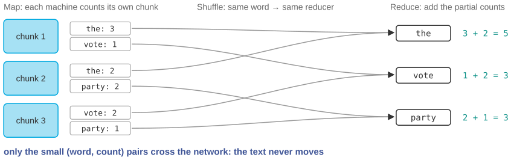

# Count every word in Wikipedia in two minutes

*Session 12 · Parallel Programming · example X12-C ·
[notebook](../notebooks/X12-C.ipynb) ·
[slides](../../Slides/Examples/12-Examples/ICSS-2026-12-Examples.qmd)*

> A hundred machines, no shared dictionary, and an answer that is exact.
> Then the reason it is not a hundred times faster, and the statistic for
> which the whole method breaks.

## The puzzle

English Wikipedia is about 20 GB of text. Counting how often every word
occurs takes a laptop about three hours, one pass with one dictionary from
session 3. A cluster of a hundred machines does it in about two minutes.
Three hours divided by a hundred is under two minutes, but not by much, and
adding a hundred more machines barely helps. How do a hundred machines share
one counting job without a shared dictionary? And where does the missing time
go?

## Try it first

The [notebook](../notebooks/X12-C.ipynb) implements the three phases in
plain Python, map on chunks, shuffle by word and reduce by adding, checks the
result against a direct count, runs the map phase in real parallel with a
process pool, and ends with the median, which does not survive the treatment.

## What is going on

<!-- FIG -->
<figure class="full"><figcaption>Map on chunks, shuffle by word, reduce by adding; only the small pairs travel.</figcaption></figure>
<!-- /FIG -->
MapReduce is the answer of the lecture, and its three phases each solve one
problem from earlier in the session. In the map phase, each machine counts
the words in its own chunk with its own dictionary. Nothing is shared, so
there is no race, as in X12-A, and no lock, and the text never moves, because
the code goes to where the data already is. In the shuffle, every
`(word, count)` pair is sent to the machine responsible for that word, all the
pairs for "the" to one reducer and all the pairs for "vote" to another. This
is the only phase where data crosses the network, and what crosses is the
small summaries, not the 20 GB. In the reduce phase, each reducer adds up the
counts it received, and that is all. In the notebook, 28 000 words become 63
pairs in transit, and that ratio is the whole economic argument for the
design.

Now the missing time. The map phase divides perfectly by the number of
machines. The shuffle is communication, and it does not shrink as machines
are added but grows, since more machines send more messages. The reduce is
partly serial. And the job finishes when the slowest machine finishes. That
is Amdahl's law with a communication term: the map fraction gets faster, the
rest sets a floor, and past some number of machines the floor is all that is
left. The final cell is the important caveat. Word count works because
addition is associative and commutative, so partial sums combine in any
order into the exact total. The mean has the same property if you ship sums
and counts. The median does not, since the median of the chunk medians is not
the median, as the two-chunk example shows, and neither do quantiles or the
number of distinct values. For those, one round of map, shuffle and reduce is
not enough.

## The answer

Map on private chunks, shuffle by key, reduce by adding: no shared state, an
exact result, and only the summaries travel. The missing time is the shuffle,
the reduce and the slowest worker, the serial fraction that no number of
machines removes.

## Why this matters if you work with data

<!-- FIG -->
<figure class="side"><figcaption><b>Wikipedia's article text is about 20 GB, the input of the example.</b> Photo: Version 1 by Nohat (concept by Paullusmagnus); W, CC BY-SA 3.0, via <a href="https://commons.wikimedia.org/wiki/File:Wikipedia-logo-v2.svg">Wikimedia Commons</a>.</figcaption></figure>
<!-- /FIG -->
Any analysis over data too large for one machine, a decade of tweets, a
national register or a corpus of parliamentary speeches, runs on this
pattern, whether the tool is called Spark, Dask or a shell script over a
hundred files. Two questions decide whether your analysis fits. Does the
per-chunk computation need only its chunk? Word counts, regressions on
partial sums and per-user statistics do; anything needing the whole ordering
of the data does not. And does the combining step have the right algebra?
Sums, counts, maxima and anything built from them combine exactly, whereas
medians, quantiles and distinct counts need approximation or extra rounds.
Decide that before the job runs, not after it returns a plausible wrong
number.

## What we used from the lecture

- [Software parallelization and MapReduce](../../Transcripts/12-ParallelProgramming.md#9-software-parallelization-and-mapreduce)
- [Distributed statistical inference](../../Transcripts/12-ParallelProgramming.md#10-distributed-statistical-inference):
  which computations split cleanly.
- [Amdahl's law](../../Transcripts/12-ParallelProgramming.md#11-amdahls-law)

## Further reading

- Dean, J. and Ghemawat, S. (2008), "MapReduce: Simplified Data Processing
  on Large Clusters", *Communications of the ACM* 51(1); word count is their
  worked example too.
