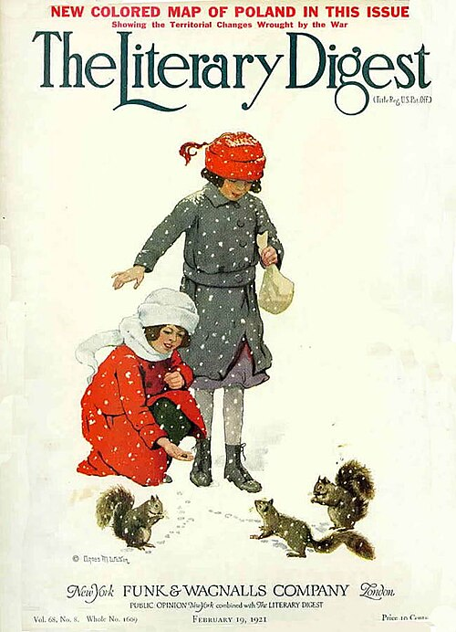
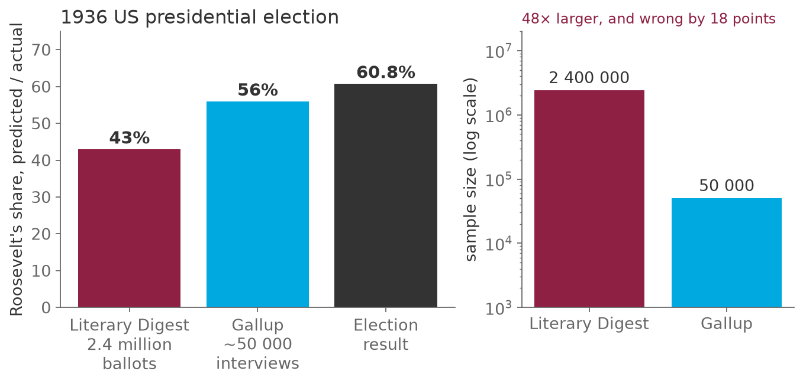

# Two point four million ballots, and the wrong president

*Session 13 · Social Science Applications · example X13-A ·
[notebook](../notebooks/X13-A.ipynb) ·
[slides](../../Slides/Examples/13-Examples/ICSS-2026-13-Examples.qmd)*

> The largest poll ever taken was wrong by eighteen points. A poll fifty
> times smaller was right. Size fixes variance and does nothing about bias,
> and a billion tweets is the Literary Digest with a better logo.

## The puzzle

<!-- FIG -->
<figure class="side wide"><figcaption><b>The Literary Digest in its heyday.</b> Photo: Agnes M. Watson, Public domain, via <a href="https://commons.wikimedia.org/wiki/File:LiteraryDigest-19210219.jpg">Wikimedia Commons</a>.</figcaption></figure>
<!-- /FIG -->
In 1936 the *Literary Digest* mailed ten million ballots and got 2.4 million
back, the biggest poll in history. It predicted Landon 57%, Roosevelt 43%. A
young pollster, George Gallup, with about 50 000 interviews, predicted
Roosevelt. Roosevelt won with 61%, and the *Digest* folded within two years.
How can 2.4 million responses be wrong by eighteen points while 50 000 are
right? And what does that say about a study of five hundred million tweets?

## Try it first

The [notebook](../notebooks/X13-A.ipynb) simulates an electorate in which
affluent voters lean one way, draws a huge sample from the affluent only, and
draws small random samples from everyone. Then it makes the biased sample
bigger and bigger and watches nothing improve.

## What is going on

<!-- FIG -->
<figure class="full"><figcaption>The Digest's 2.4 million ballots, Gallup's 50 000 interviews, and the result.</figcaption></figure>
<!-- /FIG -->
The *Digest* mailed to its own subscribers and to names from telephone
directories and car registrations. In 1936 that meant the affluent, the
people least hit by the Depression and most opposed to Roosevelt. The
*sampling frame* was not the electorate but a slice of it with different
politics. This is *coverage error*, and no number of ballots mailed to the
same list corrects it: every estimate from that frame converges, with ever
greater precision, on the opinion of the affluent. The biased samples in the
notebook of 10 000, 100 000 and 500 000 all land within a few tenths of a
point of each other, and eighteen points from the truth. There was a second
mechanism, which Squire's re-analysis of 1988 showed mattered as much. Only
24% of the ballots came back, and the people who bothered to return one were
more anti-Roosevelt than those who did not. *Non-response bias* compounds
coverage error, and both are invisible from inside the sample.

Gallup's sample was tiny by comparison and designed, with quotas by region,
class, age and sex so that the sample looked like the electorate. His error
was a few points, and it wobbles from sample to sample; the random draws of
1 000, 5 000 and 50 000 in the notebook show the wobble shrinking as the
sample grows. That is what sample size buys: less variance. It buys nothing
against bias, because bias is a property of who is in the frame, not of how
many.

## The answer

<!-- FIG -->
<figure class="side"><figcaption><b>George Gallup (1901–1984), whose small designed sample was right.</b> Photo: Norman James, Public domain, via <a href="https://commons.wikimedia.org/wiki/File:George_Gallup_1961_(01).jpg">Wikimedia Commons</a>.</figcaption></figure>
<!-- /FIG -->
The 2.4 million ballots were drawn from the wrong population and returned by
an unrepresentative fraction of it, and a biased sample of any size estimates
the wrong quantity precisely. The 50 000 were drawn to represent the
electorate, and a random sample of that size has a sampling error of well
under a point.

## Why this matters if you work with data

Every platform is a frame. The Pew table in the main deck, with 65% of 18- to
29-year-olds on Snapchat and 2% of the over-65s, is the subscriber list of the
*Literary Digest* with different numbers. A study of five hundred million
tweets has exactly the two problems of the *Digest*. Coverage: the users of
the platform are not the population, and the gap is demographic, not random.
Self-selection: those who post are not those who use, and those who post
about the topic are a further slice. And it has one the *Digest* did not have,
*algorithmic confounding*, where what you can observe is shaped by the
ranking software of the platform. None of the three is reduced by collecting
more. The phrase of the lecture, and the line to remember, is that a biased
sample of a billion is a biased sample.

## What we used from the lecture

- [Digital behavioral data](../../Transcripts/13-SocialScienceApplications.md#6-digital-behavioral-data)
- [Issues with digital data: representation](../../Transcripts/13-SocialScienceApplications.md#8-issues-with-digital-data-representation):
  coverage, behavioral distortion, algorithmic confounding.
- [The end of theory?](../../Transcripts/13-SocialScienceApplications.md#12-the-end-of-theory):
  why volume does not substitute for design.

## Further reading

- Squire, P. (1988), "Why the 1936 Literary Digest Poll Failed", *Public
  Opinion Quarterly* 52(1), the re-analysis that found non-response.
- Lazer, D. et al. (2021), "Meaningful measures of human society in the
  twenty-first century", *Nature* 595, the same argument for digital traces.
