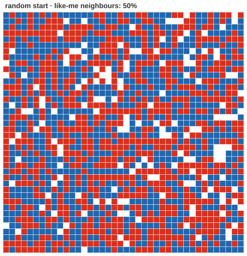
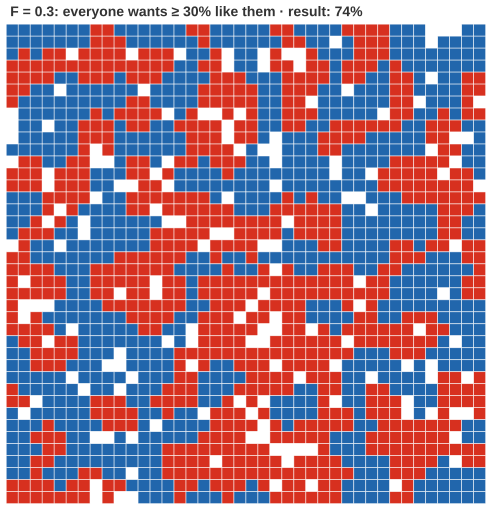
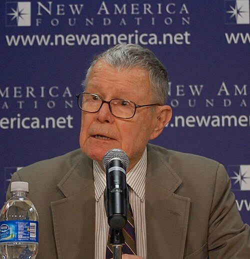

# Is every segregated city full of racists?

*Session 13 · Social Science Applications · example X13-B ·
[notebook](../notebooks/X13-B.ipynb) ·
[slides](../../Slides/Examples/13-Examples/ICSS-2026-13-Examples.qmd)*

> Agents content to be in a seventy-percent minority, and a grid that sorts
> itself into blocks anyway. The most important thing an agent-based model
> can teach is what you cannot infer.

## The puzzle

<!-- FIG -->
<figure class="side wide"><figcaption>Random start: about half of every agent's neighbors are like it.</figcaption></figure>
<!-- /FIG -->
1 440 agents of two kinds, placed at random on a 40×40 grid with 10% of cells
empty. Each agent wants at least 30% of its neighbors to be like itself, so
it is content in a 70% minority. Unsatisfied agents move to a free cell where
they would be satisfied. What does the grid look like when everyone is
satisfied? And if you saw only the end state, what would you conclude about
the agents' preferences?

## Try it first

The [notebook](../notebooks/X13-B.ipynb) runs Schelling's model in about
forty lines of NumPy on a 30×30 grid, plots the start and the end, and prints
the average share of like-me neighbors before and after. Change `F` at the
top and run it again.

## What is going on

<!-- FIG -->
<figure class="side wide"><figcaption>Everyone satisfied at F = 0.3: three quarters of neighbors are now like them.</figcaption></figure>
<!-- /FIG -->
Thomas Schelling built this model in 1969 with coins on a chessboard and
published it in 1971, and it is the example of the lecture for the
*generative* meaning of "computational". The rule is mild by any standard: an
agent is unhappy only when fewer than three in ten of its neighbors are like
it. Run it. In the version on the slide, after eight rounds and 384 moves
everyone is satisfied, and the typical agent now lives in a neighborhood that
is 74% like itself, up from 50% at the random start and far above the 30%
anyone asked for. The grid has large single-color regions with sharp borders.
The mechanism is in the moves. When an unhappy agent leaves, its old
neighborhood loses one of its kind and may tip a neighbor below the
threshold; when it arrives, the new neighborhood gains one and may tip
someone of the other kind. Each move is small and local, and the moves
compound. The word of the lecture for what the model establishes is
*generative sufficiency*: a mild local preference is enough to produce strong
global segregation. Nothing in any agent's rule mentions the pattern that
emerges.

That is the answer to the second question, which is the one that matters.
Given only the end state, the natural inference, that these agents must
strongly prefer their own kind, is wrong. Their preference was 30%. You
cannot read individual motives off an aggregate pattern, and the model is a
counterexample that proves it: the same macro outcome is compatible with
micro preferences ranging from mild to strong. Two qualifications, both in
the lecture, belong here. Sufficiency is not necessity: the model shows that
tolerant preferences can produce segregation, not that they did in any real
city, since other mechanisms, income, housing policy or outright
discrimination, can produce the same picture. And the value of the model is
independent of the result: writing the rule as code forced every assumption,
neighborhood size, threshold, empty cells and how agents move, to be stated
where it can be argued with.

## The answer

Strongly segregated, despite preferences that no one would call intolerant.
From the end state alone you would infer far stronger preferences than the
agents have, and the model shows that inference to be invalid.

## Why this matters if you work with data

<!-- FIG -->
<figure class="side"><figcaption><b>Thomas Schelling (1921–2016), who ran the first version with coins on a chessboard.</b> Photo: New America, CC BY 2.0, via <a href="https://commons.wikimedia.org/wiki/File:Thomas_C._Schelling_(cropped).jpg">Wikimedia Commons</a>.</figcaption></figure>
<!-- /FIG -->
This is the computational counterpart of the ecological fallacy, and it
applies wherever you observe aggregates and want to talk about individuals:
residential patterns, online communities, voting blocs, citation clusters.
Before interpreting a pattern as evidence of a motive, ask whether a simpler
mechanism generates it, and the honest way to ask is to build the mechanism
and run it. That is what agent-based modeling is for: not prediction, but
checking which explanations are even necessary.

## What we used from the lecture

- [The three meanings of "computational"](../../Transcripts/13-SocialScienceApplications.md#3-the-three-meanings-of-computational):
  generative.
- [Agent-based modeling](../../Transcripts/13-SocialScienceApplications.md#13-agent-based-modeling):
  generative sufficiency.
- [Schelling's segregation model](../../Transcripts/13-SocialScienceApplications.md#14-schellings-segregation-model)

## Further reading

- Schelling, T. C. (1971), "Dynamic Models of Segregation", *Journal of
  Mathematical Sociology* 1(2), with the chessboard.
- The slides of the course *Computational Modelling of Social Systems*
  (github.com/dgarcia-eu/CMSS-Konstanz) run the full sweep of thresholds and
  add the tolerance-curve extension.
