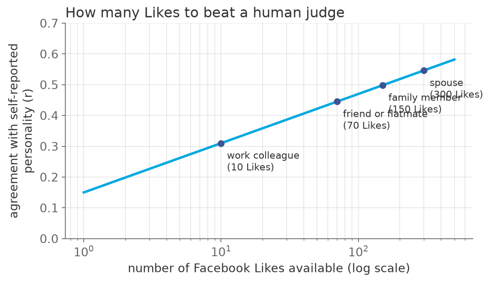
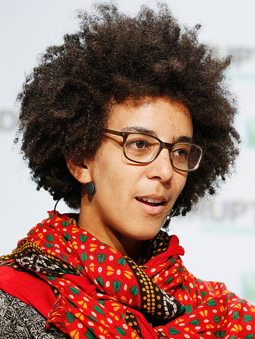

# How many Likes does it take to know you better than your spouse?

*Session 13 · Social Science Applications · example X13-C ·
[notebook](../notebooks/X13-C.ipynb) ·
[slides](../../Slides/Examples/13-Examples/ICSS-2026-13-Examples.qmd)*

> Ten to match a colleague, seventy a friend, three hundred a spouse. Plain
> supervised learning on innocuous data, and a privacy problem that no
> individual can opt out of.

## The puzzle

Personality, the Big Five, is normally measured with a hundred-item
questionnaire. In 2015 researchers built a model that predicts it from a
person's Facebook Likes alone, and compared its accuracy with judgments by
the person's friends, family and spouse, who each rated the same person. The
judges had known the person for years; the model had a list of Likes. How
many Likes did it need to match a colleague? A friend? A spouse? And what
follows for privacy, even for people who post nothing?

## Try it first

The [notebook](../notebooks/X13-C.ipynb) simulates the study: a binary Likes
matrix in which each page carries a little information about a hidden trait,
a linear regression fitted on two thousand people, and its accuracy on a
thousand others as a function of how many Likes it is allowed to see. The
curve rises with the logarithm of the count, as in the paper.

## What is going on

<!-- FIG -->
<figure class="full"><figcaption>Accuracy against the number of Likes available, with the human judges' thresholds from the paper.</figcaption></figure>
<!-- /FIG -->
Youyou, Kosinski and Stillwell (2015) had 86 220 people take the personality
questionnaire and share their Likes. The ratings of human judges agreed with
the self-reports at about $r = 0.49$ on average, and a linear model on Likes,
nothing more exotic, reached $r = 0.56$ with the average number of Likes. It
matched a work colleague at 10 Likes, a friend at 70, a family member at 150
and a spouse at 300, and the average user had 227. Nothing about this is
beyond session 10. The Likes matrix is $X$, the questionnaire score is $Y$,
the model is fitted on some people and evaluated on others, and the accuracy
is a correlation on held-out data. The notebook reproduces the shape with
synthetic pages: each one carries a weak signal, and a few hundred weak
signals combined are a strong one. That is the entire mechanism, and it is
why the threshold numbers matter less than the monotone curve: more traces,
better inference, with no natural ceiling.

The privacy consequence is the part the lecture dwells on. Every Like is
innocuous; the pattern is not. Kosinski's earlier study predicted sexual
orientation, religion, politics and substance use from the same data at high
accuracy. No individual disclosure happened, and no consent decision could
have anticipated it, because the inference lives across thousands of people.
Then the last step: the model was fitted on other people and works on you.
The final cell of the notebook makes that literal, since its test set never
appears in training. Push it one step further and you reach *shadow
profiles*: your friends' data predicts your attributes whether or not you
are on the platform at all. Privacy, in the phrase of the lecture, is
collective. Opting out removes your data and leaves the inference intact.

## The answer

About 10, 70 and 300 Likes for a colleague, a friend and a spouse. Privacy
follows: the pattern of harmless traces predicts sensitive attributes, the
model generalizes to people it never saw, and other people's traces predict
you. Individual consent cannot fix a collective leak.

## Why this matters if you work with data

<!-- FIG -->
<figure class="side"><figcaption><b>Timnit Gebru: the questions this raises about inference and consent are the ones session 10's ethics list asks.</b> Photo: TechCrunch, CC BY 2.0, via <a href="https://commons.wikimedia.org/wiki/File:Timnit_Gebru_crop.jpg">Wikimedia Commons</a>.</figcaption></figure>
<!-- /FIG -->
For research practice this sets an obligation the survey era did not have.
When you collect or model digital traces, the question is not only what your
dataset contains but what a model can infer from it, and the answer, for
almost any behavioral trace, includes things participants did not agree to
reveal. Two rules follow. Evaluate inferences, not just fields, before
releasing data or publishing individual-level predictions of sensitive
attributes. And treat consent as necessary but not sufficient, because
protections against inference and linkage have to be institutional when the
risk is shared.

## What we used from the lecture

- [Method examples: personality from Likes](../../Transcripts/13-SocialScienceApplications.md#10-method-examples)
- [Issues with methods: privacy](../../Transcripts/13-SocialScienceApplications.md#11-issues-with-methods-privacy):
  inference and shadow profiles.
- [Supervised learning: the setup](../../Transcripts/10-MachineLearning.md#3-supervised-learning-the-setup)
  (session 10).

## Further reading

- Youyou, W., Kosinski, M. and Stillwell, D. (2015), "Computer-based
  personality judgments are more accurate than those made by humans", *PNAS*
  112(4), the thresholds.
- Kosinski, M., Stillwell, D. and Graepel, T. (2013), "Private traits and
  attributes are predictable from digital records of human behavior", *PNAS*
  110(15), the sensitive-attribute predictions.
- Garcia, D. et al. (2018), "Collective aspects of privacy in the Twitter
  social network", *EPJ Data Science* 7:3, shadow profiles.
