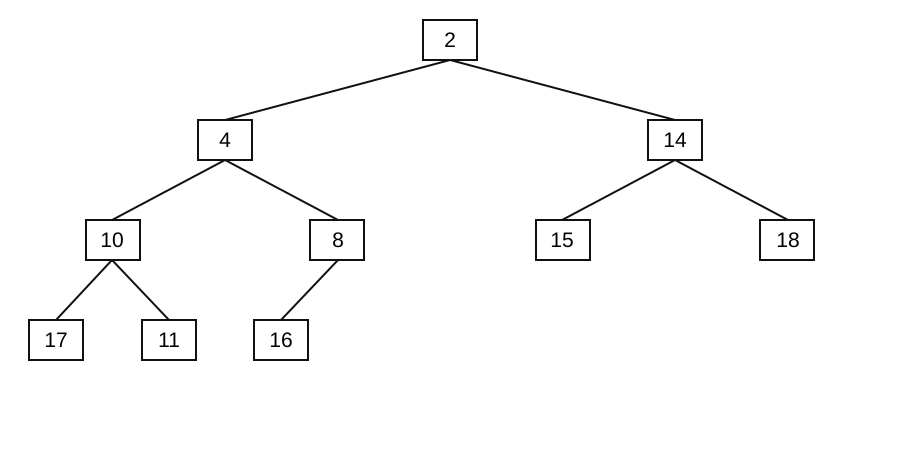
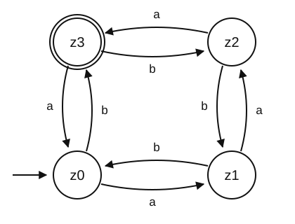

# Introduction to Computing for the Social Sciences: Exam Example

**Prof. Dr. David Garcia** · Winter Semester 2026-27

> **Assembled from the [question pool](README.md).** Item sources are listed in
> the marking key at the end: **delete that section before releasing this to
> students.**
>
> This example deliberately includes **machine learning** (question 6d–e), which
> no previous exam has covered. If ML is not examinable in 2026/27, swap 6d–e for
> `DB-08` and say so in the exam review session.

---

Exam Date: __________
Duration: **90 minutes**
Total points: **70 points**

Registration Number (Matrikelnummer): _______________________________

### Instructions

- Please make sure before you start that this exam contains, after this cover
  sheet, **10 single-sided printed pages with 6 questions** in total. If you miss
  any page, call an examiner before you start.
- Write your registration number before starting in a clearly readable way. Do
  not obscure or cross your registration number.
- Please write the answers in the space provided between questions. If you need
  more space, leave a note on the space for the question and continue behind that
  page or behind the previous one. Please clearly indicate the question number
  and letter for the solution in this case.
- Please only write solutions to the questions and refrain from writing any other
  comments or text not related to the questions.
- Do not use an erasable pencil or a red pen.
- The exam is **closed book and no calculators are allowed**.
- Note that each question has subquestions that go in depth in each topic. Make
  sure you do not get stuck in any question and that you read and think about
  every question in the exam before the time is over.
- The passing grade corresponds to **50% of the total: 35 points**.

| For examiner only | Points | Achieved |
|---|---|---|
| Question 1 | 10 | |
| Question 2 | 13 | |
| Question 3 | 12 | |
| Question 4 | 11 | |
| Question 5 | 12 | |
| Question 6 | 12 | |
| **total** | **70** | |

---

## Question 1: Information coding (10 points)

**a)** Convert the following numbers to octal notation. **(3 points)**

- $10111101_2$
- $20_{16}$
- $687_{10}$

**b)** The following two numbers are encoded in IEEE 754 single-precision
floating-point standard, shown in hexadecimal notation:

```
0x40000000
0x42400000
```

Multiply the numbers and show the result in the same standard using hexadecimal
notation. *(Note: remember that this standard has 8 bits for the exponent and a
bias of 127.)* **(4 points)**

**c)** You are able to **bias** a 16-sided die, which means that you can change
the probabilities of its results. Can you do that in a way that makes it possible
to store its results with only **two bits per result**? Reason your answer.
**(3 points)**

---

## Question 2: Data structures and recursion (13 points)

**a)** You are receiving the following set of (key, value) pairs to introduce in
sequence in a Python dictionary:

$$(6, \text{"A"})\ \ (0, \text{"B"})\ \ (2, \text{"C"})\ \ (12, \text{"D"})\ \ (3, \text{"E"})\ \ (11, \text{"F"})\ \ (16, \text{"H"})$$

Assuming that the initial size of the dictionary is $m = 16$, the hash function
is $f(x) = 2x \bmod m$, and collisions are solved with **linear probing**, show
the final state of the dictionary after inserting the pairs in order.
**(4 points)**

**b)** What makes the above hash function problematic? How could we overcome some
of its caveats? **(2 points)**

**c)** A **min-heap** is a nearly-complete binary tree (all levels full except
the last, which is filled from the leftmost leaf) in which every node holds a
value smaller than or equal to the values of its children. It is stored in an
array so that for a node at position $x$:

$$\text{left-child}(x) = 2x \qquad \text{right-child}(x) = 2x + 1 \qquad \text{parent}(x) = \lfloor x/2 \rfloor$$

Write the pseudocode of the algorithm to **remove the minimum** of a min-heap.
Make sure that the resulting structure still satisfies the min-heap property.
**(3 points)**

**d)** Show how your algorithm above removes the minimum from the following
min-heap. **(2 points)**



**e)** Explain an advantage and a disadvantage of **linked lists versus arrays**.
**(2 points)**

---

## Question 3: Algorithms and complexity (12 points)

The **h-index** of a scientist is defined as the maximum value of $h$ such that
the researcher has published at least $h$ articles that have each been cited at
least $h$ times. For example, a researcher has an h-index of 52 if they have at
least 52 articles with at least 52 citations, but not 53 articles with at least
53 citations.

**a)** Write the pseudocode of an algorithm that calculates the h-index of a
scientist. The algorithm receives as input an array of length $N$ with the number
of citations of each article, **in any order**. **(3 points)**

**b)** Based on your pseudocode above, describe the time complexity of your
algorithm using O-notation. **(2 points)**

**c)** We have an algorithm with running time that grows with the size of the
problem $n$ following the function $f(n) = 345\,n^3$. Is this function in
$O(n^2 \log n)$? Explain your answer **formally**. **(3 points)**

**d)** Consider the following array: `[1, 2, 10, 4, 3, 7, 9, 11]`. Show how
**selection sort** reorders the array. Indicate each state of the array in
temporal sequence, marking what entries are compared and/or swapped in each
state. **(2 points)**

**e)** Explain the advantages and disadvantages of selection sort compared to
**repeated minimum search**. **(2 points)**

---

## Question 4: Graph algorithms and parallelization (11 points)

Given the following adjacency matrix for a **directed, weighted** graph:

| from \ to | A | B | C | D | E |
|---|---|---|---|---|---|
| **A** | 0 | 6 | 0 | 7 | 0 |
| **B** | 0 | 0 | 5 | 8 | −4 |
| **C** | 0 | −2 | 0 | 0 | 0 |
| **D** | 0 | 0 | −3 | 0 | 9 |
| **E** | 3 | 0 | 7 | 0 | 0 |

**a)** Draw its corresponding graph with the weight of each edge. **(1 point)**

Consider the Bellman-Ford algorithm below. It calculates the weighted shortest
paths from a source node $s$ in a graph $G$, where `G.V` are its vertices, `G.E`
its edges, and `w(u,v)` the weight of the edge from $u$ to $v$. Note that weights
in this graph can be negative. There is no weight value from $u$ to $v$ if there
is no edge connecting them.

```
1   Bellman-Ford(G, s, w)
2       for each vertex v in G.V:
3           v.distance = INFINITY
4           v.parent = NULL
5       s.distance = 0
6       for i = 1 to |G.V| - 1:
7           for each (u,v) in G.E:
8               if v.distance > u.distance + w(u,v):
9                   v.distance = u.distance + w(u,v)
10                  v.parent = u
```

**b)** Show the final result of running Bellman-Ford on the graph above starting
from node **A**. When iterating over edges in the loop starting on line 7, do it
alphabetically with priority on $u$ and then on $v$ (i.e. $(x,y)$ goes right
before $(x,z)$, and that right before $(y,a)$). **(4 points)**

**c)** Consider the case in which the weight of the edge connecting node C to
node B is **−4** instead of −2. Describe in your own words how the algorithm
would behave and how this influences the result. **(2 points)**

**d)** You are working on parallelizing a program in which **75%** of the
computation is parallelizable. What speedup factor will you get using **3
processors** instead of 1? How many processors do you need to get a speedup
factor of **10**? Explain how you calculate your solutions. **(4 points)**

---

## Question 5: Theoretical computer science (12 points)

Consider the deterministic finite-state automaton below, with starting state
$z_0$, accepting state $z_3$, and input alphabet $\{a, b\}$.



**a)** A finite state automaton is defined by the 5-tuple
$(Q, \Sigma, \delta, q_0, X)$. For the automaton depicted above, describe what
each element of the 5-tuple consists of. **(3 points)**

**b)** Determine whether it recognizes the following inputs. Show the sequence of
states that justifies your answer. **(2 points)**

- `aaabbbb`
- `abaabb`

**c)** Is the automaton above a **non-deterministic** finite state automaton?
Justify your answer. **(2 points)**

**d)** Design a **deterministic** finite state automaton that recognizes strings
containing the substring `ICSS` in an alphabet composed of $\{I, C, S, X\}$. Show
a diagram with its states and transitions. **(3 points)**

**e)** Determine the satisfiability of the following formulas and reason your
answers. **(2 points)**

- $(\bar{x}_1 \vee \bar{x}_2 \vee x_3 \vee \bar{x}_4) \wedge (\bar{x}_3 \vee x_5 \vee \bar{x}_6) \wedge (x_3 \vee x_6)$
- $\bar{x}_1 \wedge (x_1 \vee x_2) \wedge (x_1 \vee \bar{x}_2)$

---

## Question 6: Databases and applications (12 points)

You receive the following table from the sales department:

| UserNumber | UserName | PurchaseTime | ProductName | N | ProductID | Delivered |
|---|---|---|---|---|---|---|
| 011011 | Hans | 2020.03.06 11:15:55 | Milk | 1 | 011011 | True |
| 012311 | Hans | 2020.04.07 01:50:50 | Milk | 2 | 011011 | True |
| 011011 | Hans | 2020.05.06 10:05:00 | Coffee | 1 | 215511 | True |
| 405444 | Marie | 2020.12.06 21:15:05 | Coffee | 45 | 215511 | False |
| 556677 | Peter | 2021.03.06 03:50:50 | Coffee | 4 | 215511 | True |

**a)** Without adding any columns, what combination of columns can you use as a
**primary key**? Explain the assumptions of your solution. **(2 points)**

**b)** Show how to restructure the table above into the tables of a relational
database that increases the efficiency of **changing the name of products while
keeping the same ProductID**. Indicate the primary key of the new table and give
it a name. **(3 points)**

**c)** Based on your tables of the previous result, write a SQL query that gives
the **delivery status of all purchases of the product named "Milk"**.
**(2 points)**

A research group builds a classifier to detect hate speech in social media posts
and evaluates it on 1000 posts, of which 100 are actually hate speech:

| | Predicted: hate speech | Predicted: normal |
|---|---|---|
| **Actually hate speech** | 60 | 40 |
| **Actually normal** | 30 | 870 |

**d)** Compute the **accuracy**, **precision** and **recall** of the classifier.
A colleague proposes a classifier that always predicts "normal": compute the same
three metrics for it (if one of them is not defined, say so and explain why)
and explain which classifier looks better under which metric, and why.
**(3 points)**

**e)** For each research task, say which family of machine learning it belongs to
(supervised, unsupervised or reinforcement learning) and name the specific task
type. One sentence of justification each. **(2 points)**

- Predicting a country's GDP next year from this year's indicators.
- Grouping parliamentary speeches into themes without a predefined list.
- Deciding whether a tweet is about climate change, given 5000 labeled tweets.
- Reducing 40 survey items to a small number of underlying attitude dimensions.

---
---

# Marking key: **remove before releasing to students**

Every item's full solution, marking guidance and known student errors are in the
pool file named below.

| Q | Points | Pool item | File |
|---|---|---|---|
| 1a | 3 | `IC-01` | [Pool 1](Pool-1-InformationCoding.md) |
| 1b | 4 | `IC-04` | [Pool 1](Pool-1-InformationCoding.md) |
| 1c | 3 | `IC-10b` | [Pool 1](Pool-1-InformationCoding.md) |
| 2a | 4 | `DS-04` | [Pool 2](Pool-2-DataStructures.md) |
| 2b | 2 | `DS-05` | [Pool 2](Pool-2-DataStructures.md) |
| 2c | 3 | `DS-08` | [Pool 2](Pool-2-DataStructures.md) |
| 2d | 2 | `DS-09` | [Pool 2](Pool-2-DataStructures.md) |
| 2e | 2 | `DS-02` | [Pool 2](Pool-2-DataStructures.md) |
| 3a | 3 | `AC-01` | [Pool 3](Pool-3-AlgorithmsComplexity.md) |
| 3b | 2 | `AC-02` | [Pool 3](Pool-3-AlgorithmsComplexity.md) |
| 3c | 3 | `AC-04` | [Pool 3](Pool-3-AlgorithmsComplexity.md) |
| 3d | 2 | `AC-05` | [Pool 3](Pool-3-AlgorithmsComplexity.md) |
| 3e | 2 | `AC-06` | [Pool 3](Pool-3-AlgorithmsComplexity.md) |
| 4a | 1 | `GP-01` | [Pool 4](Pool-4-GraphsParallel.md) |
| 4b | 4 | `GP-08` | [Pool 4](Pool-4-GraphsParallel.md) |
| 4c | 2 | `GP-10` | [Pool 4](Pool-4-GraphsParallel.md) |
| 4d | 4 | `GP-13` | [Pool 4](Pool-4-GraphsParallel.md) |
| 5a | 3 | `TC-01` | [Pool 5](Pool-5-TheoreticalCS.md) |
| 5b | 2 | `TC-02` | [Pool 5](Pool-5-TheoreticalCS.md) |
| 5c | 2 | `TC-03` | [Pool 5](Pool-5-TheoreticalCS.md) |
| 5d | 3 | `TC-04` | [Pool 5](Pool-5-TheoreticalCS.md) |
| 5e | 2 | `TC-12` | [Pool 5](Pool-5-TheoreticalCS.md) |
| 6a | 2 | `DB-01` | [Pool 6](Pool-6-DatabasesApplications.md) |
| 6b | 3 | `DB-03` | [Pool 6](Pool-6-DatabasesApplications.md) |
| 6c | 2 | `DB-04` | [Pool 6](Pool-6-DatabasesApplications.md) |
| 6d | 3 | `DB-10a+b` | [Pool 6](Pool-6-DatabasesApplications.md) |
| 6e | 2 | `DB-13` | [Pool 6](Pool-6-DatabasesApplications.md) |

## Short answer key

**1a** $275_8$; $40_8$; $1257_8$ · **1b** `0x42C00000` (= $2.0 \times 48.0 = 96$)
· **1c** Yes, *on average*, with a variable-length code, since the entropy can be
pushed below 2 bits; a *fixed* 2-bit code can never encode 16 outcomes.

**2a** slot 0→B, 1→H, 4→C, 6→E, 7→F, 8→D, 12→A · **2b** $2x \bmod 16$ only
produces even slots; use a prime modulus · **2c** move the last element to the
root, then sift down with the smaller child · **2d**
`[4, 8, 14, 10, 16, 15, 18, 17, 11]` · **2e** $O(1)$ mid-list insertion vs
$O(1)$ random access.

**3a** sort descending, largest $i$ with $C[i] \ge i$ · **3b** $O(N \log N)$ ·
**3c** **No**: $345n/\log n \to \infty$, so no constant $c$ exists · **3d**
three swaps: $(3{\leftrightarrow}5)$, $(5{\leftrightarrow}6)$,
$(6{\leftrightarrow}7)$ · **3e** in place vs stable.

**4b** $A=0$; $B=2\ (\pi=C)$; $C=4\ (\pi=D)$; $D=7\ (\pi=A)$; $E=-2\ (\pi=B)$ ·
**4c** creates the negative cycle $B \to E \to C \to B$ of weight $-1$; no
shortest path exists and the returned distances are wrong · **4d** $S = 2.0$ with
3 processors; speedup 10 is **impossible**, the ceiling is $1/0.25 = 4$.

**5b** `aaabbbb` accepted ($z_3$), `abaabb` rejected ($z_0$) · **5c** No, exactly
one transition per (state, symbol) · **5d** 5 states; the trap is
$q_1 \xrightarrow{I} q_1$ · **5e** (i) satisfiable, e.g.
$x_1=F, x_3=F, x_6=T$; (ii) unsatisfiable: $\bar{x}_1$ forces $x_1 = F$, and the
last two clauses then demand $x_2$ be both T and F.

**6a** (UserNumber, PurchaseTime), assuming one purchase per user per second ·
**6b** `Products(ProductID` PK`, ProductName)` with `ProductID` a foreign key in
`Purchases` · **6c** a join on `ProductID` filtering `ProductName = 'Milk'` ·
**6d** 93% / 0.667 / 0.60 versus 90% / 0 / 0, accuracy hides the difference
because of class imbalance · **6e** regression / clustering / classification /
dimensionality reduction.

## Timing check

70 points in 90 minutes is ~1.3 minutes per point. The two items most likely to
overrun are **4b** (Bellman-Ford, four passes over ten edges) and **2a** (seven
insertions with probing). If the cohort has been slow in the exercise sessions,
drop **3e** and **5c** to bring the paper to 66 points and rescale.
